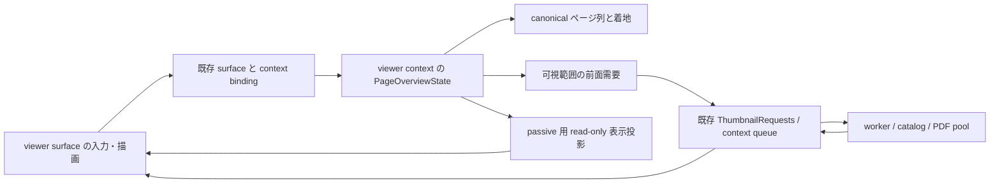

# 画像閲覧中の本のページ一覧（§1.340）設計

2026-10-27独立レビュー追補: **統合commit `1c134703b`に対する独立レビューはACCEPT WITH CHANGES（P2-1／P2-2）。受理済み移動の未提示中すべてに既存の共通入場拒否を適用し、前面操作のキー優先順と入場時のchrome終了を揃えた。新規5回帰を含む関連lib 1379件、通常／test-script check、audit、全UI snapshot 211件、glyph・整形検査は成功（§25.7）。新差分の独立再レビュー受入は未取得。統合時の成功記録は§25.6の履歴として保持する。Select照合後のClosed→既存landing一回は維持。独立再レビューと残工程はcoordinatorへ引き継ぐ。**

作成: 2026-10-12 / Codex、基準: `next-tile` / `ea060b66e`。
状態（2026-10-12〜13の履歴）: **R5 `a3bb1775b` は双方の構造合意済み。T1 `588fe1d76`、非PDF `f3d5cbe22` は実装・検証・独立ACCEPT。当時のmaster取込みの作業ファイルで競合を解消し、§1.377のowner-scoped API上にPDF／EPUBを接続、独立完了レビューACCEPT。最終検証・確認buildの記録は§20。今回の状態は冒頭追補と§25を参照。Gitのstage／merge commitはcoordinatorが行う。**
改訂 R5: R4 `7d0d0cf0a` の再レビュー REVISE（P1 1件）と2026-10-12の利用者／coordinator判断を反映。
既定キーは **O（Overview）で確定**。一覧からの選択は当該viewerの通常ページ移動と同じ扱いにする。
利用者の指示により§10のT1→T5で実装する。T1記録は§17、2026-10-12〜13の実装・検証履歴は§19〜24、今回の統合状況・残事項は§25へ記録する。
R3 の非アクティブ context への Select 破棄・一覧維持の契約は保持する。
公開時期は2026-10-27の利用者決定により**次の版（v4.9.0）**。v4.6.0の次の版の後とした2026-10-12の記録を置き換える。
項目・出典・時期の正本は [next-release-backlog.md §1.340](next-release-backlog.md#1340-複数ウィンドウの画像ウィンドウ内に本のページをタイル表示する--miv-スレ-509519-2026-10-07)。
利用者の確定事項と改訂履歴は §12／§15／§16 で区別する。R4のキー候補はOの確定で置き換えた。
スレ >>509 / >>519 の内容は backlog の要約を参照した。原文の追加調査・製品起動による観測は行っていない。

## 1. 要望と対象

画像閲覧中に、その viewer の表示領域へページをタイル状に並べ、任意のページを
選んで同じ viewer の閲覧へ戻る。一覧の入場・cursor移動・scroll・取消は、メイン画面の場所・一覧・
カーソル・選択・チェック・絞り込み・スクロール・履歴を変更しない。他のviewerの操作を妨げない。
**ページ選択の確定後は通常ページ移動と同じ副作用を許可する**。通常閲覧／連動窓は既存のGrid追従、
独立窓は既存のmain非干渉に従い、一覧選択専用のGrid保持例外を作らない。

「全ページ」は、**その viewer が現在読む可視実ページ列の全体**を意味する。構成内の白紙は
実ページの補助表示に限り、独立セル・独立選択・一覧総数の対象にしない。小窓へ全ページを
一度に詰め込むことや、未表示ページの画像をすべて生成することを意味しない。
可視行を仮想スクロールし、ページ数が多くても末尾まで一覧できる。
現在の階層・読み順・表示対象を尊重し、別階層への再帰走査や本の再オープンはしない。

**対象は利用者決定（2026-10-12）**: 独立複数窓、F12 の連動一窓、通常フルスクリーン、
メインウィンドウ内の画像閲覧（`ViewerPresentation::MainWindow`）で使える。
全surfaceで一覧を開いている間と取消時はGrid保持、選択時はそのviewerの通常ページ移動と同じ契約とする。
一覧の入場だけで表示先／viewer context を変更せず、連動モードの既存同期仕様も変えない。
通常のサムネイル Grid 自体ではこの一覧を開かず、既存の「一覧を開く」と共存する（§3.2）。
動画・音楽の画面には画像用一覧を出さず、動画の S タイルと音楽ビューは従来のまま。

## 2. 現行実装から確認した前提

以下は `ea060b66e` の静的なコード確認。実機での動作確認ではない。

| 経路 | 現行の責任と今回の接続先 |
| --- | --- |
| メインの「ページを開く／一覧を開く」 | `App::explicit_grid_container_open_disabled_reason`（`src/app.rs`）は複数窓で拒否する。メインのページ一覧へ切り替える操作のため、この gate を外して要望に対応しない |
| 静止画シーク／ストリップ | `FsSeekInfo::has_page_strip_content`、`get_still_image_indices`、`fullscreen_seek_info_cached`（`src/ui_fullscreen.rs`）。現在の読み順の画像列と、混在一覧かどうかを解決する。ストリップは表示幅で要求数を制限した近傍確認である |
| サムネイル前面需要 | `ensure_still_seek_thumbnail_requests` / `enqueue_priority_thumbnail`（`src/app.rs`）は exact set を要求し、worker の keep 判定もその共有投影を見る。離れたページのために grid の bounding range を広げない |
| 要求の寿命 | `ThumbnailRequests` と `ThumbMsgPayload`。source は画像の採用／破棄と `Finalized` の両方まで同じ要求を所有する。表示の Pending / Evicted を完了証明にしない（[§1.360](thumbnail-request-lifecycle-plan.md)） |
| ページ着地 | `land_still_page_navigation_target` と `FsPageLoadContract::LatestSeek`。`handle_fs_navigation_with_contract` の `jump_to` 経路へ合流し、見開き・読書位置・画像ロードを既存 owner に任せられる |
| 動画の S タイル | `ui_video_tile.rs` は状態と抽出、`video/native_presenter/overlay_draw.rs` が描画。動画 PTS の一括抽出・640px保存・native HWND overlay は静止画ページの生成部品ではない（[動画設計](video-architecture.md)） |
| キー競合 | `src/keymap.rs` で `FsSlideshow` は FsImage の S、`VideoTileMode` は FsVideo の S。動画のキーだけを画像へ移植するとスライドショーを奪う |
| context 所有 | `ViewerContextBundle`（`src/app/viewer_context_registry.rs`）が items / generation / thumbnail / queue / channel / cancel / exact set / navigation caches を所有し、mounted projection と交換する |
| 非アクティブ画像窓 | `DetachedImageWindowSnapshot`、`DeferredDetachedImageWindowView` / Shared（`src/app.rs`）、`render_detached_image_windows`（`src/ui_fullscreen.rs`）が frozen 静止画を描き、root へイベントを配送する。active の描画だけ追加しても一覧表示を維持できない |
| 表示先の識別 | `DetachedWindowManager` の window_id と context registry の binding。HWND の incarnation は host 所有を表す。rect 一致や入力処理時の App.current を操作対象の代用にしない |
| rework の現在地 | [detached-rework-plan.md §9.1](detached-rework-plan.md#91-現況-唯一の進捗表r2b-close-を-2026-08-28-に反映): R2b 完了、R4 の single render entry は未完。R4 完了を前提としない |

関連正本として [architecture-overview.md](architecture-overview.md)、
[display-pipeline.md](display-pipeline.md)、[async-architecture.md](async-architecture.md)、
[ui-responsiveness.md](ui-responsiveness.md)、[virtual-folders.md](virtual-folders.md)、
[keymap-spec.md](keymap-spec.md)、[key-customization-impl-plan.md](key-customization-impl-plan.md)、
[web-remote-plan.md](web-remote-plan.md)、[filename-stack-plan.md](filename-stack-plan.md)、
[compile-book-plan.md](compile-book-plan.md) を参照する。過去の detached / display / video の
監査文書は診断履歴として読み、現況は上記正本とこの基準コードで判断する。

## 3. 画面と操作

単クリックで閲覧へ戻る、RTL の行内順、取消で元ページ維持、一覧中だけ当該 viewer の
スライドショー休止・退出後再開、現在の読書列全体を対象として階層をまたがない操作は、
2026-10-12 に利用者が案どおり確定した。同日の確認用ビルドでの利用者確認により、
黒ベースの暗色固定、初期8列、最大20列も確定した（§21）。

### 3.1 一覧

- 現在 viewer のクライアント領域を一覧へ切り替える。通常 fullscreen は同じ fullscreen viewport、
  メイン内閲覧は同じ root viewport の閲覧領域、detached は同じ画像窓を使う。
  別 HWND、メイン一覧への切替、独立ダイアログは作らない。
- 通常fullscreen／メイン内閲覧／detachedの共通renderer内のchild Uiに
  `os_theme::apply_dark_ui`を適用し、本文の背景は黒とする。固定ヘッダ・操作・文字は
  helperの暗色visualsと現在の文字コントラスト設定に従う。passive投影も同じrendererを使う。
  親UiやContextのテーマ／styleを書き換えず、Lightのメイン画面への影響を出さない。
- 上部に本／階層の名前、現在位置／総数、列数の増減、「ページ表示に戻る」を固定する。
  OS の窓を閉じる操作と一覧を閉じる操作を区別する。
- 本文はスクロール可能なタイル。1 可視実ページにつき 1 セル、ページ番号と短い名前を付ける。
  初回は閲覧中の実ページを含む行を表示し、現在の見開きに含まれる実ページも別の印で示す。
- 並びは上から下、行内は読み方向に従う。RTL でも番号は読み順のまま。
  カーソル移動は描画されたセルの幾何に従い、左右矢印で見た方向の隣へ、上下で隣行へ移る。
- サムネイル未生成でも番号・placeholder は直ちに操作可能。選択時に全体の生成完了を待たない。
  失敗セルも選択でき、元画像の読み取りエラーは既存のページオープン経路が通知する。
- セルの単クリック／タップ、またはカーソルを合わせて確定すると一覧を閉じ、同じ窓へ着地する。
  カーソル移動・スクロール・hover だけでは読書位置を書き換えない。
- 列数は窓ごとのセッション値（初期8列、1〜20列かつ最小セル幅96 logical pxで実効列数を制限）。
  最小／最大値はメインGridの`settings::MIN_GRID_COLS`／`MAX_GRID_COLS`を共有する。
  ボタンと Ctrl+wheel で変更でき、リサイズ時はカーソル位置を基点に可視範囲を再計算する。
  UI 倍率と client rect は**その描画先**から取得する。セル高さにも下限を設け、窓サイズによる
  実効可視行数を bounded にする。小窓でも戻るボタンとスクロール導線を残す。
- サムネイルは既存 catalog / 編集 preview / 回転表示を使用し、一覧のために全ページの final AI・
  分析・高解像度合成を起動しない。アニメ画像は一覧の既存静止 preview を使用する。

### 3.2 ストリップ・メイン一覧・閲覧モードとの関係

| 機能 | 役割／一覧を開いている間 |
| --- | --- |
| サムネイルストリップ | 近傍確認として存続。一覧中は描画・hit・需要の consumer を休止し、閉じた後は同じ設定で復帰。表示／固定設定を保存し直さない |
| メイン一覧 | ファイル操作・検索・評価・製本などのフル機能一覧。今回のタイルにチェック、一括選択、削除、D&D、製本編集は持ち込まない。一覧中のcursor／scrollと取消はGridを変更せず、Select受理後は通常ページ移動と同じGrid同期を行う（§5.1） |
| 既存の「一覧を開く」 | コンテナをメイン画面のページ一覧に切り替える既存コマンド。通常Gridではそのまま使え、複数窓での既存拒否も維持。今回の「ページ一覧」は閲覧surface内の一時的なページ選択で、メインのitems置換／コンテナopen／Grid表示への退出を行わない。双方の名称・入口・意味を区別し、既存コマンドの実行先を新機能へ読み替えない |
| 動画 S | 時間位置へ seek する既存機能。画面の発見性・戻る操作を参考にするが、動画 state の bool / pending 群や decoder をコピーしない |
| 単ページ／見開き／横長分割／連結 | 設定と現在位置を保持。タイル選択を既存の absolute seek 着地へ渡す。見開きは選んだ実ページを含む canonical unit、分割は既存 seek の slice 方針、連結は既存 seek の位置へ戻す |
| スライドショー | 既存の S と機能を保存。一覧中だけこの viewer の自動送り tick を休止し、取消／選択後に元の再生状態で次の通常間隔から再開する。兄弟窓の再生は止めない。利用者確認済み |
| 編集・分析・比較・パノラマ | 未確定編集を暗黙保存／破棄しない。既存 exclusive-mode availability に一覧を登録し、競合中の新規入口は理由を表示する。通常閲覧を全窓モーダルにしない |

取消（一覧の戻る／Esc／同じ toggle）は現在の読書ページ、見開き調整、読み方を維持する。
背景クリックでは閉じない。ウィンドウ close は従来の terminal close であり、一覧の取消ではない。

## 4. キーと入力所有

新規 `KeyAction::FsPageOverviewToggle`（仮称）を **FsCommon / Press / no-repeat** として追加する。
バー／「…」の「ページ一覧」に加えて、**既定キーを設けることは利用者決定済み**。
既定は **O（Overview、利用者決定2026-10-12）**。S は `FsSlideshow`、動画 S は `VideoTileMode` を維持し、
今回のために再割当しない。コマンド設定・適格なリング／ジェスチャ候補・ヘルプにも同じ入口を出す。

新規入場は既存`fs_navigation_sequence_blocks_new_target()`または`page_turn_barrier_active()`が
示す受理済み移動の未提示中には受け付けない。animationのON／OFFは条件にしない。
Oを押しても一覧は開かず、通常出力の採用と受理済みcontinuationの完了後にもう一度押す。
HUD／リング／パッドも`open_page_overview_for_viewer`→`open_page_overview`の同じavailability／open受付を使う。
入場とSelectは既存`page_overview_available()`を共有する。新しいpredicate・pending・replay・取消は追加しない。
一般のnavigation lockにcurl限定の案内を流用せず、HUDのenabled判定はavailabilityを使い、
理由は既存のoptional reasonだけとする（§25.7）。

一覧用のローカル `KeyContext::FsPageOverview`（仮称）を設け、一覧の scope 集合を
`[Global, FsCommon, FsPageOverview]` とする。FsImage / Rating は同時 active にしない。
scope 内の全 Action を無条件許可せず、以下の**同じ実行可能 Action 集合**を全入口で使う。
名称／説明／context／trigger／chord／`ALL_ACTIONS`／`docs/keymap.ini.default` を揃える。
deferred callback は現在の effective keymap を read-only 投影として受け取り、raw S 判定を作らない。

| 操作 | 提案する Action / 既定 |
| --- | --- |
| 入場／取消 | `FsPageOverviewToggle`、既定O。Open 時も同じ toggle を許可 |
| 選択確定 | `FsPageOverviewConfirm` / Enter。既存 IME-safe helper と input permit を使用 |
| 行単位で画面送り | `FsPageOverviewPagePrev` / PageUp、`FsPageOverviewPageNext` / PageDown |
| 先頭／末尾カーソル | `FsPageOverviewFirst` / Home、`FsPageOverviewLast` / End |
| 列数変更 | `FsPageOverviewColumnsLess` / `FsPageOverviewColumnsMore`、既定なし。ボタンと Ctrl+wheel も同じ command へ |
| 最低限の移動／脱出 | 修飾なし矢印と Esc は keymap-spec の固定ナビ／脱出規則に合わせる。固定理由を同文書へ追記 |

### 4.1 一覧で許可する集合と競合の正本（P2-2）

実行可能集合を `OverviewExecutableActions(presentation, navigation_availability)`（概念名）で
一度解決し、keyboard dispatch、表示ボタン、ヘルプ、リング／ジェスチャ候補と保存済み割当の実行、
ゲームパッド command に共用する。通常画像での toggle 入場も同じ availability を使用し、
動画／音声では FsCommon 所属を理由に入場を許可しない。

| 一覧の許可 Action | 実行する意味／条件 |
| --- | --- |
| §4 の新規一覧 Action 全件 | toggle、confirm、画面送り、先頭末尾、列数変更 |
| `HelpShowContextShortcuts` | 一覧の実行可能集合からヘルプを作る |
| `FsToggleWindowMode` | F11 の既存表示先切替。context と一覧を保持 |
| `ToggleDetachedViewerMode` | 連動一窓等、現行 F12 gate が許可する presentation のみ。独立静止画窓では集合から除外 |
| `ToggleAlwaysOnTop` | 利用者による明示的な既存最前面設定操作。再描画による自動前面化とは区別 |
| `FsCtrlNavPrev` / `FsCtrlNavNext` / `FsSiblingPrev` / `FsSiblingNext` | 現行 navigation gate が許可するものだけ。受理されたら一覧を閉じて元の navigation を実行 |

これ以外の Action（`FsClose`、`FsBackToList`、画像のページ送り／編集／評価／slideshow を含む）は
一覧の集合に含めず、背面へ fallthrough させない。Enter は一覧 Confirm、Esc は一覧取消となる。
OS の窓 close／タイトルバー close は Action とは別の既存 terminal close として維持する。
リングの既存画像スロットを別の操作へ読み替えず、許可集合外の保存済み割当は無効表示／非実行とする。
通常画像へ戻れば元の割当を使用できる。

`ACTIVE_SCOPE_SETS` へ一覧 scope 集合を追加するだけで終えず、一覧に関係する Action の
`actions_can_overlap` は、通常画像／通常fullscreen一覧／メイン内一覧／連動一覧／独立一覧の**実行可能集合に二つの Action が
同時に含まれるか**を根拠にする。ヘルプ行の scope 抽出後も同じ許可集合で絞る。
通常画像の既存 scope／availability 契約は維持し、一覧だけ dispatch の例外 lookup を作らない。
この有限集合は keymap の静的 coexistence 検査と runtime availability の共有定義にする。
一時的な modal／nav lock は実行を抑止するだけで、潜在的な競合を消したことにはしない。

同じ chord の優先順位は、既存 modal・text input・popup → 固定 Esc 取消 →
`HelpShowContextShortcuts` → overview toggle → window mode／detached mode／always-on-top →
Ctrl／sibling navigation → overview confirm → その他の一覧 Action／固定 cursor とする。
同群内は上の表／Action 表の列挙順を固定し、一つの edge を最初の一致で消費する。
競合を黙って解消せず、たとえば toggle を Enter に割り当てたときは **Confirm との競合を表示し、
実行時は toggle が一回だけ一覧を取消**する。confirm は実行しない。
同じ判定を helper の外で raw key／scope 無視により再発火させない。

入力優先順位は上記 resolver に従い、一覧 → 通常 viewer の連続 dispatch は行わない。
一覧が処理した key edge / wheel / pointer / touch は背後のページ送り、ズーム、パネル、
メイン一覧へ再利用しない。未対応の通常画像 shortcut は一覧で実行せず、取消後に使用できる。
窓の F11、現行 gate が許可する F12、OS close、上記 navigation command は維持する。
表示先切替で同じ context の一覧は保持し、別本への navigation は一覧を閉じて既存経路を実行する。
リング／右ドラッグ／ゲームパッドの既存入力を奪わず、一覧 cursor と確定へ写像する範囲を明記する。
メインへのフォーカス移動を全窓 input lock で止めない。

メイン内閲覧は Grid と root viewport を共有するため、viewport focus だけで Grid を許可しない。
描画・入力双方が同じ現在の viewer surface を参照して一覧 mode の許可集合を選ぶ。
一覧の key／wheel／pointer は root の `process_scroll`、Grid selection／check、メインの
コンテナopenへ漏らさず、通常fullscreen／detachedと同じ resolver／command を使う。

### 4.2 既定キー O（Overview、利用者決定2026-10-12）

**既定は修飾なしOで確定**。R4のCtrl+D／Ctrl+W／Ctrl+Q候補は採用しない。
`7d0d0cf0a` の `src/keymap.rs` の `default_chords()`／`context()`／`FS_IMAGE_ACTIVE_SCOPES`／
`RESERVED_BINDINGS`、`docs/keymap-spec.md` の固定入力とゲームパッド仕様、`src/`のO入力参照を
静的に照合した。画像閲覧のactive scopeは **Global + FsCommon + Rating + FsImage**。
一覧のscopeと許可Actionは§4.1に従い、通常fullscreen／メイン内／連動・独立detachedで同じ意味にする。

| 照合対象 | 現行のOとの関係／設計上の扱い |
| --- | --- |
| KeyAction既定 | 上記画像閲覧scopeにはplain O無し。Ctrl+OはGlobalOpenFolderで、exact modifiersにより別chord。plain Oを割り当て済みのEraseToolEllipse／ConcealToolEllipse／LaToolEllipseは編集専用scopeで、一覧のavailabilityと排他。編集の楕円操作は変更しない |
| 固定キー／OS予約 | keymap-specの固定扱いとRESERVED_BINDINGSはEsc／矢印／GridのShift+矢印等。plain Oは予約されていない。srcのKey::O／VK 0x4F参照はキー変換・転送で、閲覧用の別の固定O操作は見つからない。Endのscan code 0x4FをOのVKと混同しない |
| マウス／タッチ | wheel、click、drag、タッチ、右ドラッグ取消などはpointerの固定入力／設定済みcommand。keyboard Oを生成・消費する固定入口は見つからない。既存入力をOの代わりに読み替えない |
| ゲームパッド | A/B/X/Y等のボタン・方向・トリガーとリングはgamepad入力／command経路。keyboard Oとの重複無し。Oを押したために既存pad操作を無効化しない |
| TextInput／IME／modal | Oは通常の文字でもあるため、既存input permitとmodal優先規則を使用。文字入力中のOを一覧へ奪わず、IME変換／確定や編集に漏らさない |

以上は現行既定／固定入力の静的確認で、個人のoverride・OS外部hotkeyまで非衝突を保証するものではない。
利用者が既にOを別Actionへ割り当てていれば通常の競合表示を行い、設定を勝手に変更しない。
S／Shift+S／Ctrl+Sはslideshow／strip／captureのまま保持する。

実装時は `KeyAction::FsPageOverviewToggle` の **ini_name=`FsPageOverviewToggle`、context=`FsCommon`、
trigger=Press/no-repeat、default_chords=`ChordList::one(Chord::key(O))`**、`ALL_ACTIONS`、
`description()`、consumerのkeymap helperを揃える。`docs/keymap.ini.default`は生成参照と一致する
`# FsPageOverviewToggle = O` にし、`docs/keymap-spec.md`／コマンド設定／ヘルプにも反映する。
`bundled_keymap_default_matches_generated_reference`等のinventory・default検査、§4.1の競合・scope・
実行可能集合、text inputと固定入力のhandler回帰を同時に検証する。
今回の変更は設計だけで、`src/keymap.rs`や同梱defaultを先行変更しない。

## 5. 状態と所有境界

概念型を `PageOverviewState = Closed | Open(PageOverviewSession)` とする。
Open は context identity、items / reader-order の revision、一覧 incarnation、canonical page projection の
共有参照、cursor、scroll anchor、列数を一つに所有する。準備が必要な projection は既存の
navigation cache の準備境界で解決し、別々の `active` bool / `pending` Option を増やさない。
表示先は既存 `ViewerPresentation`／`ActionSurface` から解決する。detachedのwindow_idは
registry bindingから導き、同じ情報の第二の正本として保存しない。

この状態は **viewer context 所有**。通常fullscreen／メイン内閲覧はmounted Appの同じowner、
detachedへの退避／復帰は`ViewerContextBundle`と一括交換する。通常表示のために別ownerや
新contextを生成せず、App-global detached flagも作らない。empty / mount / swap / split / fork / retire / Drop と
production context audit を同時に配線する。サムネイルの request / pixel / channel は既存 owner のまま。

### 5.1 一覧閲覧中のGrid保持と、選択後の通常ページ移動（R5再レビュー対象）

一覧のcursor／scroll／列数は`PageOverviewSession`に置く。**一覧を開いている間のcursor移動／scrollと
取消**では、メインGridの`selected`、`grid_click_selection_anchor`、`checked`、
`scroll_offset_y`／pending scrollを流用・更新しない。
同じitemsを使う通常閲覧でも、一覧入場のために`load_folder`／`start_loading_items`／items再採用／
場所履歴の追加・cursor移動を行わない。元のGrid状態を戻すための全件snapshot／rollbackも作らない。
**Selectを受理した後は、そのviewerの通常ページ移動と同じ扱い**で既存absolute seekへ渡す。
受理はstamp／binding／items・projection revision／incarnation／stable identity／active資格の
既存照合を全通過した時点とし、一覧をClosedにしてから既存landingをちょうど一度呼ぶ。
即時着地、構成の提示許可Checking後の許可、後着拒否、同期拒否の扱いは通常navigation ownerに任せ、
結果を理由に一覧を再openしない（2026-10-27 coordinator判断、§25.1追補）。
単ページの`sync_main_selection_from_viewer_idx`、連結の`seek_to_continuous_page_with_contract`の
cursor／scroll更新、読書位置・読書履歴記録、連動F12の後続同期を省略・変更しない。

| viewer | 一覧閲覧中／取消 | Select受理後の期待値 |
| --- | --- | --- |
| 通常fullscreen／メイン内閲覧 | メインGridを変更しない | 同viewerでの通常ページ移動と同じGrid追従。10ページ目から40ページ目を選べば既存規則でGrid cursorとscroll要求も40へ進む |
| 連動F12窓 | メインGridを変更しない | 通常ページ移動と同じGrid／viewer同期。Gridを旧10へ保持してviewerを戻す例外を作らず、後続同期でも40を保持する |
| 独立画像窓 | メインGridを変更しない | 通常ページ移動と同じ窓内着地。独立contextのcursor更新はそのcontextへ閉じ、main Gridを動かさない既存所有境界を維持する |

通常のページ移動に伴う履歴・選択anchor等の更新は、そのviewerの既存規則に従う。
一覧選択専用のnavigation origin、着地とGrid同期を分離する契約、同期抑止flag、snapshot／rollbackは
作らない。Grid追従の有無を一覧側で独自に判断せず、既存の単ページ／連結／連動／独立境界に任せる。
R3の非active Select破棄が先に成立した場合は着地もGrid同期も行わず、元一覧を維持する。
取消／選択後も同じpresentationで閲覧を続ける。新機能は`FsBackToList`／close-to-page-listを呼ばず、
メインGridへ退出しない。後の明示的なviewer退出自体は既存コマンドの契約に従う。

通常fullscreenの子viewport、メイン内閲覧のroot viewport、detachedのviewportは、
同じ描画helper／需要dispatcherとcontext ownerを使う。入力stampは既存surface／viewportと
context identity／一覧incarnationを照合し、通常viewerに存在しないdetached window_idを発行しない。
R3のSelect資格は全surfaceに適用し、通常viewerでは現用mounted viewerがそのsurfaceを所有し、
detachedでは既存active sessionとregistry bindingが元ownerに一致することを確認する。
別viewerへ切替後のSelectは破棄して元一覧を残し、background landingは作らない。
メインGrid表示への既存の明示退出が一覧を終了した場合は旧incarnationを破棄し、後着Selectで再openしない。



不変条件:

1. 一覧の開閉は読み取り操作であり、items / context / 読書位置／履歴の世代や Remote の
   mutation generation を進めない。メインや兄弟 context の queue / cancel / cache を変更しない。
2. 一覧 cursor と閲覧位置は別。確定した一回だけ既存の着地を呼び、既存の表示確定時点で記録する。
   Select は処理時に元 viewer が実際のアクティブ context である場合だけ受理する。
   非アクティブなら着地せず破棄し、その viewer の Open を維持する（§6.3）。
   `fullscreen_idx` だけを直接書き換える経路や、main へ戻して open し直す経路を作らない。
3. 通知は元 context の channel / request ID / items generation で照合する。
   UI 選択 command は binding / items・projection revision / 一覧 incarnation と描画したセルの
   stable identity で照合する。画面座標を後から新しい配置で解釈し直さない。
4. fork は要求 owner・queue・token・receiver を複製しない。独立複製は Closed で開始する。
   元窓を passive 化する park は同一 owner の移動であり、一覧の表示状態を保持する。
5. placement、HWND 捕捉、host_lost、再生成、transition owner の正本は増やさない。
   リサイズは一覧 layout の変更であって host 再生成理由ではない。

## 6. active／passive／backstop とライフサイクル

### 6.1 非アクティブ窓にも同じ一覧を残す

active の一覧 draw helper と **bounded read-only overview view** を新規に分離する。
`DetachedImageWindowSnapshot` / `DeferredDetachedImageWindowView` の表示内容は概念的に
`StillImage | PageOverview` の typed projection とし、Open と表示 payload の Option を別々の
mode 判定に使わない。overview view は canonical な可視実ページ metadata 全体の **immutable
共有参照**と、cursor／scroll anchor／列数／projection revision を持つ。各 entry は読み順位置、
stable page identity、着地用の実ページ参照、番号／短い名前、構成の補助表示情報を持つ。
metadata は既存 canonical projection の準備境界で一度作り共有し、park／passive callback で
全件コピー・走査・path 解決をしない。構成の白紙を独立 entry にしない。
**有界にするのは画像／texture の保持・要求・描画セル数**であり、identity 解決用の軽量 metadata
全体への共有参照は保つ。全ページの画像／items 複製や frozen の大きな一枚画像は作らない。

park 時は同じ owner の cursor / scroll / mode を残し、進行中の pointer gesture を終了する。
新規 overview thumbnail 需要は休止し、最後に描いた可視セルは bounded snapshot が保持する。
passive callback は DB・decode・生成・App state mutation を行わず、共有 metadata とその窓の
現在の client rect／DPI、scroll anchor／列数から可視行と hit layout を計算する。
park 後の resize／DPI変更で新たに露出したセルも、metadata の読み順位置から番号・名前・
stable identity を解決する。画像が無ければ placeholder を描き、同じ frame の hit から
**その実ページ identity**を command に捕捉する。旧可視セル cache や旧座標から推測せず、
生成待ち／再アクティブ化だけのクリックを挟まない。root が mount した後も座標で選び直さない。
画像 cache に無いセルでも、一クリックによる明示 activation が成立してその context が active に
復帰した場合は選択可能とする。Select 処理前に別 context へ切り替わった場合は §6.3 に従い破棄する。
active 復帰時に現在表示範囲の需要を再評価する。
非アクティブ一覧を理由に兄弟窓の worker を動かし直さない。

passive での最初のセルクリック／スクロール／一覧キーは **activate と command の一組**として
既存 Shared → root event → manager activation intent → registry mount の経路で実行する。
既存の RightDrag intent と同じ所有原則を用い、overview 用 typed intent を追加する。
ActivateOnly に落として最初のクリックを失わせない。command は描画時の owner stamp と
stable cell identity を持ち、root は明示 activation の成立と元 owner の active 資格を確認して適用する。
Select の受付は一度だけ。遅延 Select を成立させるために元窓を再 activation／scoped mount しない。
同じ event を active 側入力として再実行しない。viewport に stamped された配送済み key edge を
捕捉し、frame 最終 focus／現在の物理 key level／時間窓で stale 判定しない。
送信元の証明を持たない generic egui event を unfocused callback で代用しない。
既存の右ドラッグ配送は維持する。focus が変わった後の処理は §6.3 に従う。

detachedリワークのステージR4が未完なので、通常 active 描画、passive deferred 描画、legacy passive immediate 経路、
navigation gap / keepalive backstop の表示分岐を棚卸しし、どれも PageOverview projection を
尊重する。backstop は表示だけで command／enqueue を二重実行しない。新しい show_viewport 呼出しや
keepalive tick を足さず、既存の window_id と表示先を使う。これは R4 全体をこの機能へ混ぜる提案ではない。

### 6.2 遷移表

| 入口／終了 | 一覧 owner と副作用 |
| --- | --- |
| Open | 既存navigation-sequence／page-turn barrierが受理済み移動の未提示を示す間は入場せず、利用者が完了後に新しく押し直す。入場とSelectは同じpage_overview_availableを使用。入場要求の待機・保留・replay・owner取消はしない。その他の適格性も通れば現在viewerのcanonical projectionを参照し、現在ページへcursor、可視需要をpublish。items再列挙／履歴writeはしない |
| Cancel / toggle | Closed へ。overview の需要だけを解除し、元のページと strip 設定へ戻す |
| Select | stamp／binding／items・projection revision／incarnation／stable identity／処理時の実際のactive資格を既存経路で照合。全通過を受理とし、Closedにしてから既存landingをちょうど一度呼ぶ。照合不成立ならlandingも再activationもせず破棄し、Openを維持。landingの即時／Checking後許可／後着拒否／同期拒否は通常navigation ownerが扱い、一覧を再openしない |
| Scroll / resize / columns | 同じ Open の表示範囲と bounded demand を更新。実ページの位置とグローバル grid サイズを変更しない |
| F11 / 連動窓の同一 context の F12 migration | 一覧状態は同じ bundle とともに移動。新 client rect で layout 再計算。placement の別保存先を作らない。独立静止画窓の F12 は無効のまま |
| 別本 open / フォルダ移動 | 既存 command が受理された時点で Closed。incoming の loading/holdover と混在させず、既存 open continuation を使用する |
| items / 構成／読み順の置換 | 既存 invalidation 境界で Closed。専用の live rebuild や旧idxの再対応表を作らず、次回 Open で現在列を使う |
| window focus / park | 6.1 の bounded projection を保持。overview 固有需要を休止、gesture は終了。元の context の in-flight 終端を偽装しない |
| resume | 同じ bundle の Open を復帰し、layout／need を現在 rect で再評価。main の需要を一括 clear しない |
| terminal close / mode 全体終了 / Remote acquire / tray | 既存の context teardown／非表示処理へ接続。Closed と需要解除、CPU画像破棄は所有 context の request owner 経由。Remote barrier は新たな UI 待機を追加しない |
| stale command / late thumbnail | 元 owner の照合で破棄。新一覧／別窓へ再解釈しない。採用しない画像の寸法・origin・catalog invalidation を公開しない |

### 6.3 focus／z-order と Select の active 資格（R3 P1-1）

入力なしの repaint、passive resize／DPI変更、thumbnail Pixels／Finalized／Failed の終端は
閲覧窓の activate／foreground／raise を要求しない。main／兄弟窓の foreground と z-order を維持し、
既存 always-on-top 設定を自動的に変更しない。focus を取り直すための repaint／retry を追加しない。

通常の park→resume は既存 window_id、registry の window→context binding、ViewportId、
生存中の HWND／host incarnation を維持する。一覧の入場・退出、metadata 投影、resize／DPI変更を
host 再生成理由にしない。明示的な F12 migration に伴う host の生成・廃棄は既存 transition owner の
契約に従う別ケースであり、同 HWND の維持を要求しない。

**非アクティブ context への着地（background landing）は行わない。**
配送済み stamped key edge は元 viewport の入力であることを証明するが、Select を処理する時点の
active 資格まで保証しない。A に Enter が配送された後、B へ復帰し、A の Select が処理される時点で
A がアクティブ context でなければ、その Select は**着地させずに破棄し、A の一覧は Open のまま残す**。
利用者は A に戻ってから選び直す。破棄した Select を保存／再配送／再生して後から着地させない。

資格判定は既存 active session と registry の window→context binding が示す実際の active owner を
用い、元 command の context identity と照合する（detached）。通常fullscreen／メイン内は§5.1の
現用viewer surfaceとmounted ownerの一致で判定する。`with_viewer_context(A)` による一時的な mounted
projection や OS foreground のみを active 資格の代用にしない。判定は Select を理由に新たな
scoped mount／activation／navigation の副作用を発行する前に行い、非activeなら `land_still_page_navigation_target`、
fullscreen open、`prepare_viewer_presentation_open`、`begin_active_detached_session` を呼ばない。
stamp／identity の照合とこの実行資格は別の境界であり、現在の物理 key level／時間窓を使って
配送済み edge を stale と判定する仕組みではない。
passive窓の最初のクリックでは、§6.1の利用者による明示activationが既存intentで先に成立し、
その後も元contextがactiveならSelectを受理できる。このactivationと、B復帰後の旧Selectを
成立させるための再activationを区別する。後者は行わない。

A の破棄 Select は A の閲覧位置／cursor／一覧表示／需要を変更せず、B の active session、
runtime、描画先（ViewportId／host）、foreground／z-order を変更しない。A を active／Resuming に
戻す intent や raise 抑止付きの background open を作らない。他の Action は §4.1 と既存の入力／
activation gate に従い、scoped mount だけで presentation 副作用が隔離できるとはみなさない。
modal／TextInput／IME／別 viewport owner の block は command 実行より優先する。
hold／repeat の current-level 参照は `FocusedKeyStatePermit` があるときだけとし、focus喪失後に
hold state を復活させない。window mode／F12等の明示 command は元 target の既存契約へ渡す。
stamp 不一致・元 context 退役・一覧終了なら元 command を破棄し、別窓へ再配送しない。

この判断は coordinator が CLAUDE.md「設計の簡素化: 状態の組み合わせを減らす」に従って採用した。
共通 navigation の内容更新と active session／presentation を分離して background landing を維持する案は
採らない。非アクティブ窓の Closed 投影、background ロード完了の回収・復帰契約も追加しない。
既存の着地経路は active context だけで使用し、途中で別窓へ復帰した未受理 Select の組み合わせをなくす。

## 7. ZIP / PDF / EPUB / 本の構成

| source | 一覧の範囲と制約 |
| --- | --- |
| ZIP / CBZ / nested ZIP | viewer が採用済みの階層のページ列。ZipDir を一覧操作で掘らず、区切り・別本への移動は既存閲覧へ戻して行う。entry の完全 identity を使用 |
| RAR / CBR / 7z / LZH / 変換 ZIP | direct read／変換済み materializer が採用した列を消費。logical 元書庫と実体 cache の区別を維持し、タイルから変換を新規開始しない |
| PDF | 採用済みページ列・現在の password／document stamp を既存要求へ渡す。UI 上で PDF open、ページ寸法全件取得、同期 render をしない |
| EPUB | 変換済みの `PdfPage` の論理 EPUB path と固定 generation を使う。既存 `ReadTarget` の読取 lease を生成終了まで保持。一覧を開くために EPUB 再変換／PDF 物理パスへの key 書換えをしない |
| 画像だけの通常フォルダ／製本 | 現在の viewer の列と読み順に従う。製本の番号順・保存場所を変えず、再編成・遅延rename・ページ追加はこの画面の責務にしない |
| ファイル名スタック | フラット読書へ materialize 済みならその閲覧列を使用。メインの集約表示へ戻さず、tile から Stack 再展開を開始しない |
| 混在フォルダ／検索等の集約列 | 初期案は既存 `has_page_strip_content` と同じ「現在の navigation 列が画像だけ」を条件にする。「本以外を隠して全ページと称する」独自 filter を足さない。単画像も 1 セルとして扱える。適格性をボタンと Action で共有 |

### §1.242 との統合条件

2026-10-12の基準worktreeでは本の構成G1〜G4は未統合だった。2026-10-27のmaster取り込みでは、
overviewは構成採用後の可視実items順をそのまま消費し、並べ替えとhiddenを反映する。
白紙補助annotationは既存adapterの`None`のまま未接続で、fixtureの補助表示を製品接続済みとは扱わない。
構成の非同期提示許可とSelect受理は§25.1追補のcoordinator判断に従う。今回の統合後の検証は未完了。
backlog §1.242 の 2026-10-12 決定では構成は ZIP/PDF/EPUB が対象、画像フォルダ G4F は切り離し、製本は対象外。

構成がある本は構成側の canonical 読み取り列／navigation projection を唯一の正本にする。
並べ替えた順を tile へ出し、非表示ページは出さない。非表示ページを元ファイル順から復活させず、
タイル独自の sort／visibility／spread pairing を作らない。
**承認済み仕様との照合（P2-1）**: `next-book` の `5fb135810`、
`C:/home/mimageviewer-nextbook/docs/book-composition-plan.md` §1／§4 の `Single.companion` を参照した。
`Blank` は実ページの相方で、独立 ID／source address／PageIdentity／選択行を持たず、
一覧・単ページ表示・実ページ数へ含めない。この契約を本一覧でもそのまま採用する。
一覧の元列は構成を反映した**可視実ページ列**だけで、挿入白紙の独立セル・カーソル位置・
選択 target・一覧総数は作らない。白紙を示す場合は対応実ページのセル内の補助描画に限り、
補助描画部分をクリックしても当該実ページの選択になる。白紙の page path／items idx／
サムネイル要求／専用 landing adapter を追加しない。
確定は実ページの既存 absolute seek へ渡し、白紙の相方を含む表示は構成側の canonical unit が担う。

実画像の横長分割は閲覧方式なので、tile は元実ページ 1 セル。見開き端の白い相方や末尾表紙の
再掲は表示 composition の役割であって新しいページではなく、一覧の総数へ二重計上しない。
構成の白紙と表示上の余白は補助表示の由来として区別するが、どちらも独立の一覧 entry にしない。
構成保存による既存 reload では一覧を閉じ、保存完了前後の表示追従 machinery を追加しない。
本機能から構成の編集／一時ずらしを迂回適用する入口を作らない。

## 8. サムネイル要求・取消・性能

### 8.1 全件生成せず既存 owner を利用する

全ページの**列**は `Arc` 等の既存 navigation cache を共有し、各 frame は可視行 + 上下 1 行の
overscan だけを列から直接参照する。遠い末尾へ移動しても 0..末尾 の keep range を作らない。
初回の列構築が必要なら既存準備を再利用し、新たな O(N) path clone・DB照会・寸法取得を
UI 入場処理へ追加しない。構成 projection の準備も同じ原則とする。

`still_seek_thumbnail_pages(_shared)` を **viewer の foreground exact demand** へ一般化する。
概念上の需要は `None | SeekStripOrPreview | PageOverview`。strip と overview の同時表示はせず、
一つの dispatcher がその frame の有効 consumer の exact set を publish する。
strip の hidden 分岐の `ensure(..., &[])` が後から overview 需要を消す構造を残さない。
別の全ページ queue・request owner・thread pool・consumer channel は作らない。
generation と request ID は既存 `ThumbnailRequests`、GPU textures は同じ context の cache が所有する。

keep は既存 grid／閲覧／hover consumer と exact demand の和である。overview の可視範囲変更は
前後の差分だけを更新し、同一 frame に二度 enqueue／clear しない。確定・取消時に**新規需要**を
撤回するが、request owner の `clear` を保存完了の代用にしない。

### 8.2 取消の契約

- overview だけが必要とした keep 外の queued 要求は、context の既存 queue lock 下で
  未取得と証明できるものだけ prune し、相関付き局所取消で owner を終了する。
  grid／閲覧／strip の残る需要と共用している要求は取消しない。
- worker 取得後は既存 exact-keep 判定と request-specific 取消経路を利用する。
  既存 producer が直ちに止められない decode／保存は完了を許し、範囲外 Pixels は owner 経由で破棄、
  `Finalized` まで同要求の再投入を禁止する。タイル close で context 全体の cancel token を立てない。
- 高速スクロールで queued／CPU backlog が訪問した全ページ数に比例して増えないよう、
  keep 外取消と採用前破棄を同じ需要更新に接続する。実行中の上限は既存 worker 数、保持画像は
  bounded keep + 採用待ち予算とする。終端順序を変えて同 idx の閉じる→開くも検査する。
- PDF pool の priority／context epoch は既存契約を維持する。全窓共通 epoch を一覧開閉で
  進めることや、path だけで兄弟／Remote の in-flight job を取り消すことは禁止。
  scoped queued prune／promotion に必要な相関が現行 API に足りなければ、その所有境界の
  限定修正を独立レビューへ返し、広域失効や retry を代替にしない。
- EPUB の lease、RAW follow-up、編集 preview は元要求と同じ identity／ID を持ち、
  取消時の保存終端契約を維持する。兄弟が同じ実ファイルを読んでいても別 context の要求は保つ。

### 8.3 budget と計測

新規 enqueue は可視範囲を優先し、frame 内の新規要求を最大 32 件／経過 2ms の準備予算で分割する案。
これは生成 worker を UI 上で待たせる timeout ではない。request の file／archive／DB 解決は worker。
GPU upload は同一viewer contextの全thumbnail consumerで既存の **8枚/poll frame**を共有し、
tile用の追加poll／別枠を作らない。mainとactive detachedなど複数contextの既存poll予算は維持する。
App-globalの新しいbudget ownerや、兄弟の従来描画を遅らせる変更はこの項目へ追加しない。
texture 作成の時間は budget 化された既存 upload 境界に限る。描画中の非制限 upload は禁止する。
cache／生成サイズは既存 thumbnail 設定を使い、動画タイルの 640px 常時抽出は導入しない。
一覧の列数で main の `display_px_shared` や grid 設定を変えない。拡大時は既存 origin の
評価済み解像度と idle upgrade の収束規則を使い、同じ要求を再生成し続けない。

非表示、全可視セルが終端、入力無しのときは一覧のための連続 repaint をしない。
進捗は全ページではなく現在の可視需要について表示する。placeholder を pending 仕事と同一視しない。
perf は context／window／overview incarnation／items generation／request ID／input_seq を相関可能にし、
open、layout、demand差分、enqueue／prune、adopt／discard、select、close、park／resume を記録する。
ページ画像 decode の worker 時間と UI の layout／upload 時間を分ける。
50,000 ページの headless fixture で表示／request／texture 数の有界性を検査し、
実本の cold／warm／大規模性能と兄弟動画・音声への影響は、別途了承済みの実機枠で測る。
上記数値は実装時の初期予算案であり、製品性能の実測値ではない。

## 9. Remote・永続化・簡素化

Remote の既存ページ一覧／サムネイル／navigation はその session のまま。今回のローカル
PageOverviewState を Remote が借りたり、ブラウザから操作する API を追加したりしない。
既存 request 型を一般化する場合も standalone Remote consumer の相関契約を明示して保つ。
一覧開閉はコンテンツ変更ではないため Remote cache の mutation 通知を発行しない。
Remote acquire は既存の全 local context teardown で一覧を閉じ、その context の要求だけを取消し、
既存の barrier 完了判定に乗せる。返却時に一覧の自動再オープンを予約しない。
IPC payload を変更する必要は現提案にはなく、変更するなら版上げ・両 consumer 更新を同時にレビューする。

新 DB、設定 schema、一覧の位置／列数の永続化は作らない。既存キー override 以外はセッション状態。
タイルで見る／取消するだけでは本の構成・読書位置・タグ等を書かず、選択着地後の保存は既存 writer。

状態の組み合わせを減らす案を先に検討した結果:

- **採用**: strip と overview の表示を相互排他にして前面需要を一つにする。
- **採用**: items／構成／読み順が変われば一覧を閉じ、次回入場で参照し直す。
  設定変更ごとの専用 live rebuild、rollback、一覧位置の復旧 pending を足さない。
- **採用**: 既存 conversion／password／保存 modal の中では新規一覧操作を開始しない。
- **採用（R5 利用者／coordinator判断）**: 一覧選択を通常ページ移動の既存経路・既存同期時点へ揃える。
  一覧閲覧中／取消だけGridを保持し、Select受理後のGrid追従は通常／連動／独立の既存規則に任せる。
  一覧起点だけGrid同期を抑止するnavigation origin／効果分離の組合せは作らない。
- **採用（R3 coordinator判断）**: Select処理時に元contextが非アクティブならSelectを破棄し、一覧を残す。
  Aへ戻って選び直す仕様とし、background landing、共通navigationのpresentation分離、
  非active窓のClosed投影／ロード回収の状態組合せを作らない。
- **不採用**: 一覧を全窓モーダルにして窓切替を止める。複数窓とメイン一覧の通常操作を削るため。
- **不採用**: park で一覧を自動取消する。別の窓を見た後にページ探索をやり直す手間が増えるため、
  bounded read-only snapshot と既存 activation intent で保持する。
- **不採用**: 全件サムネイル生成を先に終えてから開く。通常の開く速度とメモリを悪化させるため。

**まれな失敗は割り切り（ログ + 通知 [+ 作り直し]）。** 新しい retry／部分保存／回復待機機構は
設計しない。元の本・設定・タグ・構成は消さない。通常のスクロール、窓切替、即再オープン、
遅着通知はまれな失敗ではなく、上記 owner／相関で扱う。

## 10. 実装 chunk と予定ファイル所有

R5 `a3bb1775b` は独立レビューACCEPT、通常fullscreen／メイン内閲覧への対象拡張を含め
「detached §2 に沿う構造追加であり症状パッチではない」ことへ独立Codex reviewer／ClaudeCode双方が合意。
既定Oと通常ページ移動との同一契約も確定し、利用者が実装開始を指示した。
§1.242 統合後の projection／landing API の差分もレビュー対象に含める。
一つの chunk で shared file の writer は実装担当一人とし、別 worktree の master 更新と突き合わせる。

| chunk | 予定する内容／主なファイル |
| --- | --- |
| T1 | 純粋な overview state／layout／canonical target adapter、`src/page_overview.rs`（仮称）、`src/lib.rs`。構成の型は既存正本を利用 |
| T2 | bundle mount/swap/fork/retire と bounded demand 一般化、`src/app.rs`、`src/app/viewer_context_registry.rs`、`src/thumb_loader.rs`。PDF部分は§1.377をmaster経由で取り込んでから既存owner-scoped APIへ接続（§18）。非PDF部分は先行可能 |
| T3 | 通常fullscreen／root embedded／detached active／passive／backstopの共通表示・surface入力所有・identified activation command、`src/ui_page_overview.rs`（仮称）、`src/ui_fullscreen.rs`、`src/app/detached_window_manager.rs`。placement・host 捕捉は変更しない |
| T4 | KeyAction/context／入口／ring/gamepad／headless snapshot、`src/keymap.rs` と既存 command availability・`src/app/gamepad_input.rs` 等。新しい独立 raw-key handler は作らない |
| T5 | 文書・回帰・最終 gate。`docs/keymap-spec.md`、`docs/keymap.ini.default`、display/async 正本、`spec.md`、`htdocs/mimageviewer/`、detached ship checklist を実装の仕様に更新 |

T1〜T4 は内部の確認可能な chunk で、部分機能を公開する計画ではない。
2026-10-12 coordinator指示により、§1.377待ちの間はT2の非PDF owner／metadataとT3／T4の
非PDF UI・O・入力・snapshot、T5のマニュアルを先行する。PDFの昇格・ticket／再評価接続と
PDF／EPUB回帰は統合後に実施する。部分実装の段階でPDF対応や全機能完成を主張しない。
所有境界が想定より大きくなる、既存入力を失う、構成の契約と矛盾する場合は実装を止め、
範囲と費用を lead／利用者へ返す。detachedリワークのステージR4の代わりに症状 guard や App-global flag を足さない。

## 11. 受入条件と検証計画

実装担当が targeted tests と通常／portable core check、fmt の証拠を記録する。
coordinator は有効な結果を再利用し、項目の最後に `test-full.ps1` を一回実行・集約する。
アプリの起動・実機入力はこの設計／通常開発の scope に含めない。

予定する **20 ケース群**（実装時にテスト本数と実行数を別記し、下記を実行済み本数と称さない）:

1. Open／cancel／select の状態遷移と、cancel／cursor 操作で読書位置が変わらないこと。
   Selectの既存照合を全通過したらClosed→landing一回となり、即時着地／Checking後許可／
   後着拒否／同期拒否でも再openしないこと。照合不成立はOpenを保ちlandingを呼ばないこと（§25.1追補）。
2. 1／数百／50,000 ページの仮想行、末尾アクセス、空列、縮小 client rect の戻る操作到達性。
3. RTL／LTR の描画順・カーソル幾何・ページ番号、列数／DPI／resize 時の cursor anchor。
4. Placeholder／Failed セルも着地可能、生成完了待ちや全件要求が無いこと。
5. 単ページ／見開き／横長分割／縦横連結の既存 absolute seek と同じ target／表示 unit。
6. ZIP 階層／nested ZIP／変換元書庫／PDF／EPUB／製本／stack の canonical identity と順序。
7. 構成順の可視実ページのみを一覧にする。非表示と白紙は独立セル／選択／総数へ含めず、
   白紙補助部分の hit は対応実ページに着地。末尾表紙を二重計上せず、白紙にサムネ要求を出さないこと。
8. strip→overview→strip の単一需要 publish と、strip hidden branch による需要の上書きが無いこと。
9. source Pixels→Finalized／逆順、cache単一通知、取消・keep外破棄と即再入場で重複要求しないこと。
10. 高速の末尾／先頭往復で queue／CPU画像／GPU texture がページ総数や訪問数に比例しないこと。
11. A と B の同数 generation／同idx／同path でも要求・drop・取消が片側だけへ作用すること。
12. main／active／at-rest の mount/swap/park/resume/fork/terminal close と production context audit。
13. passive の最初の click／wheel／key は既存 activation／input gate に従って一度処理し、stale stamp と閉じた窓は拒否されること。
    park→passive resize／DPI変更→新たに露出した未生成セルを一クリックで選択でき、
    明示activation後に元contextがactiveである場合だけ描画時metadata identityへ着地する。
    処理前に別contextへ切り替わったSelectは破棄して一覧を維持。旧座標や画像cacheの有無でtargetを変えないこと。
14. active／deferred passive／legacy passive／backstop の同じ表示 projection、gesture 終了と snapshot 有界性。
15. keymap の inventory／default／競合／任意再割当／none、S slideshow／動画 S を保持し、入力が背後へ漏れないこと。
    toggle=Enter と Confirm の競合を表示して toggle だけ一度実行。dispatch／ヘルプ／リング／
    保存済み割当の availability が §4.1 の同じ集合となり、一覧 scope 外の例外 dispatch が無いこと。
16. F11／本移動／modal／編集 availability とスライドショー tick の所有。独立静止画窓の F12 は
    無効で binding／HWND／一覧を変えず、連動窓の F12 は既存 migration と context 保持を検査する。
    park→resume で window binding／ViewportId／生存 HWND／incarnation を維持し、兄弟の操作・再生を保持すること。
17. Remote acquire／release／既存 standalone thumbnail consumer。read-only open/close で Remote mutation 通知を出さないこと。
18. headless snapshot（小窓／RTL／placeholder／current spread／白紙補助表示／暗色・倍率）、終端 idle の repaint／仕事収束。
    入力なしの repaint／resize／DPI変更／サムネ終端で activate／foreground／raise effect が0件。
    **AへEnter配送→B復帰→AのSelect処理**では、Aへの着地／fullscreen open／active-session切替の
    effectが0件、Bのactive session・runtime・描画先（ViewportId／host）・foreground／z-orderが不変。
    Aの一覧Open・閲覧位置・cursor・需要が保持され、Selectの再配送／保留が無いこと。
    Aへ再復帰しても旧Selectは発火せず、利用者の新しいSelectだけが既存着地へ一度進むこと。
    stamp不一致／terminal close は破棄、証明のない unfocused generic event／held は非実行となること。
19. 通常fullscreen／メイン内閲覧／連動一窓／独立窓のOpen→scroll／cursor→Cancelでは、
    メインGridの場所・items／generation・selected・選択anchor・checked・filter・scroll／pending scroll・
    場所移動履歴／cursorが不変。Open→Selectは、そのviewerで一覧を使わず同じtargetへ通常移動した対照と
    Grid同期・scroll要求・読書位置／履歴の効果が一致すること。10→40の選択で通常／連動はGridも40へ追従し、
    独立窓はmain Gridを10に保つ。Select直後だけでなく後続描画・連結再アンカー・連動同期まで通し、
    選択ページを維持して旧Grid選択へ戻らないこと。続いてGridを利用者が明示操作した場合は、
    連動窓は従来どおり追従、独立窓は従来どおり非連動であること。
    一覧の開閉・選択でpresentationを変えず、通常Gridの「一覧を開く」は従来どおりメインページ一覧へ切り替わる。
20. 既定Oを通常fullscreen／root embedded／連動・独立detachedの同じscopeでdispatchし、
    Open時もOで戻れること。root embeddedでGridやGlobalの未許可Actionへ漏らさず、
    Ctrl+Oのフォルダopen、編集scopeのO楕円、固定pointer／gamepad／キーを変更しないこと。
    TextInput／IME／modal中はOを一覧へ流さず、held repeatでOpen→Closeが繰り返されないこと。
    S／Shift+S／Ctrl+Sを変更せず、ユーザーoverrideの競合表示とヘルプ／リングの実行可能集合が一致すること。

自動検証コマンド（filter 名は実装後に実在名と件数を記録）:

```powershell
cargo test -p mimageviewer --lib page_overview
cargo test -p mimageviewer --lib viewer_context
cargo test -p mimageviewer --lib still_seek
cargo test -p mimageviewer --lib thumbnail_request
cargo test -p mimageviewer --lib keymap
cargo check -p mimageviewer --bin mimageviewer-core
cargo check -p mimageviewer --bin mimageviewer-core --features portable
cargo fmt --check
python scripts/check_ui_glyphs.py
# 項目の最後に coordinator と重複実行を調整:
.\scripts\test-full.ps1
```

独立完了レビュー後に正常 profile の `build-dev.ps1` で確認 binary を作る。
本人が実機で確認する具体シナリオは、通常fullscreenとメイン内閲覧のそれぞれでメインGridの
位置・選択・チェック・履歴を控え、Oとバー／「…」で一覧を開き、cursor移動／scroll／取消で
元のGrid状態が保持されること、RTLとslideshow休止／退出後再開を確認する。
一覧から10→40を選択すると通常／連動ではGridも通常ページ移動と同じく40へ追従し、後続描画／
連結再アンカー／連動同期でも選んだページが維持されることを確認する。独立窓ではmain Gridを動かさない。
次にメイン一覧を残して ZIP と PDF/EPUB の独立画像窓を二つ開き、
一方で一覧を開く→スクロール→他窓へ移る→passive の窓を拡大／DPI変更→新たに露出した
未生成セルを最初のクリックで選択、取消、F11 を確認する。独立静止画窓の F12 は無効が期待値。
連動窓の F12 migration は別シナリオで確認し、入力なしの再描画／resize／サムネ終端では前面化しない。
AへEnter配送後にBへ復帰する競合は、AのSelectが着地せず一覧が残り、Bのactive session／runtime／
描画先／foregroundが不変という期待値で検査する（配送順序の確定はheadless handler／effect検査を併用）。
加えて、大きい本の末尾選択、本の構成と兄弟動画／音声の併用、Remote の取得を確認する。
実機観測なしに性能／最初の入力到達／native focus 成功を断定しない。
normal profile binary はエージェントが起動しない。実機枠とデータ保護は
[interactive-release-verification.md](interactive-release-verification.md) と AGENTS.md に従う。

## 12. レビュー・利用者確認への申し送りと今回の検証

独立レビューの重点は、detachedリワークR4未完の複数描画経路、passive の first-input と identity、
foreground exact demand の撤回と保存終端、PDF の sibling scope、§1.242 の可視実ページと白紙補助表示。
R3では、非アクティブSelect破棄がactive session／presentation副作用より前に成立し、Aの一覧と
Bのactive ownerを保持することも重点とする。background landingの契約は追加しない。
性能を理由に全窓 modal、park 自動取消、既存 S の無断変更を採用しないことも確認する。

利用者確認済み（2026-10-12）:

1. バー／「…」の「ページ一覧」に加え既定キーを付ける。S slideshowは変更しない。
2. 通常fullscreen（メイン内閲覧を含む）とdetachedを対象にする。一覧閲覧中／取消はGrid保持、
   選択受理後は通常ページ移動と同じ扱い（R5決定）。通常／連動はGrid追従、独立窓はmain非干渉。
3. 単クリックで戻る、RTLの行内順、取消で元ページ維持、一覧中だけ当該viewerのslideshow休止・退出後再開。
4. 現在読む列全体を対象にし、階層をまたがない。画像だけの列の適格性は既存stripと同じ規則を使う。

5. **既定chordはO（Overview）で確定**。固定入力との照合とKeyAction実装前提は§4.2。

キー選択待ちは解消済み。対象拡張のP1へ通常ページ移動との同一契約で対応したR5はACCEPT済み。
現在の実装状況とT2限定設計の確認事項は§17／§18を参照する。

初回設計提出（`6432e8e04`）の文書作成時の記録: 成果は設計文書と索引／§11 記録のみ。
実装担当による製品コード変更 0、製品起動 0、コミット 0（文書のコミットは coordinator）。
Rust テスト／通常・portable core check／test-full／確認 build は設計提出時には実行しない。
この文書変更では実行物を変更しないためであり、当時の18ケース群の実装検証は未実施。
初回の検証: 新規文書と追加行のローカルリンク 18 箇所の参照先ファイルあり、欠落 0。
追加文書／行の末尾空白 0、`git diff --check` 成功、`cargo fmt --check` 成功（exit 0）。
Rust テスト実行 0 件、通常／portable core check 各 0 回、test-full 0 回、確認 build 0 回。

## 13. 初回 REVISE への R2 対応（2026-10-12、履歴）

対象 `6432e8e04`、利用者が提示した独立レビュー: P1 0件、P2 3件、P3 1件。
単一 context owner／既存 navigation／exact demand 一般化は症状パッチではなく構造追加と
評価されたが、全面的な構造合意は保留。本改訂を再レビューへ渡し、実装は開始しない。

| 指摘 | 修正した契約／受入ケース |
| --- | --- |
| P2-1 白紙 | §1／§3／§7 を可視実ページだけの列へ修正。`next-book` `5fb135810` の承認済み `Blank` 契約に合わせ、実ページセルの補助表示に限定。独立セル・identity・選択・総数・白紙 landing 案を撤去。ケース7／18を修正 |
| P2-2 scope | §4で toggle を FsCommon へ変更。§4.1の許可 Action 集合と優先順位を明示し、scope／Action 単位の同時実行可能性、dispatch／競合／ヘルプ／リングの共有契約を追加。ケース15で toggle=Enter と Confirm の競合と一回 dispatch を検査 |
| P2-3 passive metadata | §6.1で可視実ページ全列の immutable metadata を共有し、画像だけ有界保持。passive resize／DPI変更でも新セルの identity を描画時に解決。ケース13に未生成セルの first-click landing を追加 |
| P3-1 focus／z-order | §6.3に入力なしの非前面化、通常 park／resume の binding・生存 HWND維持、配送済み edge と current focus の分離を記載。ケース16／18と実機手順で独立窓 F12 無効と連動窓 migration を分ける |

静的照合: `next-book` の HEAD が `5fb135810` であることと構成正本 §1／§4 の Blank、
現行 `src/keymap.rs` の active scope／overlap／ヘルプ、`docs/keymap-spec.md` の配送済み edge／
F12 gate、context registry の scoped mount／return 境界を読んだ。製品挙動の実機観測ではない。
変更対象は本書と detached 計画 §11 のレビュー対応記録だけ。
Rust テスト0件、通常／portable core check各0回、test-full・build各0回、製品起動0回、コミット0回。
文書のみのため初回 fmt 成功証拠はコードに対して有効のままとし、Cargo は再実行しない。
改訂の検証: 本書のローカルリンク15箇所の参照先ファイルあり、欠落0。
指摘別の対応記録4件、受入計画18ケース群を検査し、`git diff --check` 成功（exit 0）。
受入計画の実装検証は未実施。

## 14. R2 再レビュー P1 への R3 対応（2026-10-12、履歴）

対象 R2 `daa32a068`、利用者が提示した独立レビュー: **REVISE、P1 1件、P2 0件、P3 0件**。
前回4件の文書対応は確認されたが、scoped mount による Select 着地では App-global active session／
presentation の副作用が B に漏れるため、R2 全体への構造合意は保留。

coordinator は CLAUDE.md の状態組合せ削減に従い、background landing をしない仕様を採用した。
§6.3 の R2 の scoped mount 着地案を撤回し、Select 処理時に元 context が実際の active owner でなければ
Select を破棄して一覧 Open を維持する。§5 の不変条件、§6.1／§6.2 の受付、§9 の簡素化判断、
受入ケース13／18、実機手順も同じ契約へ揃えた。
着地前の active 資格を、入力 edge の provenance や一時 mounted projection と混同しない。
共通 navigation 境界の分離、非active窓のClosed投影、backgroundロード回収の契約は作らない。

回帰は **AへEnter配送→B復帰→AのSelectは着地せず破棄、Bのactive session・runtime・描画先・
foregroundが不変、Aの一覧が残る**。Aへの再復帰だけで旧Selectが発火しないことも検査する。
変更は本書と detached 計画 §11 の対応記録のみ。再レビュー待ちで停止し、実装着手の合意を主張しない。
Rustテスト0件、通常／portable core check各0回、test-full・build各0回、製品起動0回、コミット0回。
文書のみのためCargoは再実行しない。ローカルリンク15箇所・欠落0、受入計画18ケース群を検査し、
`git diff --check` 成功（exit 0）。受入ケースの実装検証は未実施。

## 15. R3 ACCEPT と利用者確認による R4 拡張（2026-10-12、履歴）

利用者が提示した結果: **R3 `015b44c03` は独立レビュー ACCEPT、構造的修正であることへ合意済み**。
基本owner／exact demand／immutable projection、非active Select破棄の合意を保持する。
本日の利用者確認で、既定キーを付けること、通常fullscreen／メイン内閲覧への開放、§12の操作を確定した。
既定キー自体は未決定。候補3件は現行keymapの既定／contextと固定入力を静的に照合し、§4.2へ記録した。

R4再レビューの対象は§1／§3.2の共存、§4の全surface共通の実行可能集合とroot Gridへの入力非干渉、
§5.1の通常viewer owner・Grid cursor／scroll／historyとの分離、§6.3の全surface active資格、
ケース19／20のメインGrid不変と既定chordのscope matrix。
別context／windowを新設して通常fullscreenだけdetachedへ迂回する方式は採らない。
R3の合意を拡張部分まで自動的に承認済みと扱わず、再レビューとキー選択待ちで停止する。

この改訂は設計と索引・backlog・detached計画記録のみ。製品コード変更0、Rustテスト0件、
通常／portable core check各0回、test-full・build各0回、製品起動0回、コミット0回。
改訂の検証: 本書と他3文書の追加行のローカルリンク16箇所・欠落0、候補3件の既定chordの
静的照合、受入計画20ケース群を検査し、`git diff --check`成功（exit 0）。実装検証は未実施。

## 16. R4 再レビュー P1 と O 確定への R5 対応（2026-10-12）

対象 R4 `7d0d0cf0a`、利用者が提示した独立再レビュー: **REVISE、P1 1件、P2 0件、P3 0件**。
R3の構造合意は維持、R4拡張全体への合意は保留。通常単ページのGrid同期、連結のcursor／scroll更新、
連動のGrid→viewer同期があるため、R4の「Select後もGrid保持」は既存absolute seekだけでは成立しなかった。

利用者はOを既定キーに確定。coordinatorはCLAUDE.mdの「既存機能と同じ経路・同じタイミングに揃える」
簡素化を採用し、一覧Selectを通常ページ移動と同じ扱いにする仕様を決定した。
§1／§3.2／§5.1のGrid保持を一覧閲覧中・取消に限定し、Select受理後は通常／連動でGrid追従、
独立窓ではmain非干渉という既存規則へ揃えた。レビュー提案のnavigation起点別の着地／Grid効果分離は
採用せず、同期抑止flag・snapshot／rollbackも追加しない。R3の非active Select破棄は維持する。
ケース19／実機手順に通常移動との対照と後続描画・連結再アンカー・連動同期・明示Grid操作を追加した。

§4.2／ケース20はOの確定仕様へ更新。KeyActionのini_name／context／default_chords／ALL_ACTIONS／
同梱defaultを揃える実装前提と、固定キー・マウス・ゲームパッド・編集scope／TextInputとの境界を記載。
候補比較・Select後のGrid保持という§15のR4記録は履歴で、現行契約はこのR5を優先する。
今回の変更は設計と索引・backlog・detached記録のみ。再レビュー待ちで停止し、実装着手の合意を主張しない。
Rustテスト0件、通常／portable core check各0回、test-full・build各0回、製品起動0回、コミット0回。
改訂の検証: ローカルリンク16箇所・欠落0、現行O関連既定chord式4件（Ctrl+O 1件、編集O 3件）と
固定入力境界を静的照合。受入計画20ケース群を検査し、`git diff --check`成功（exit 0）。実装検証は未実施。

## 17. R5 ACCEPT と T1 実装記録（2026-10-12）

利用者が提示したR5 `a3bb1775b` の独立レビューは **ACCEPT、P1/P2/P3なし**。
通常fullscreen／メイン内閲覧への対象拡張を含めて構造的修正へ独立reviewerとClaudeCodeが双方合意し、
利用者が§10順での実装を指示した。detached計画§11へ双方合意を記録した。

T1の変更は `src/page_overview.rs` と `src/lib.rs` のmodule宣言。純粋なClosed／Open owner、
metadata／reader-orderのArc共有、整数index remap、仮想行／有界overscan、RTL／幾何cursor移動、
scroll／reflow、stamped Selectの検証を実装した。実ページの白紙補助annotationは独立targetを持たない。
inactive／stale／navigation拒否のSelectはlandingもcloseもせず、受理時だけClosedへ遷移する。
これはT1当時の履歴。現行のSelect受理と一覧終了は§25.1追補の2026-10-27判断を優先し、
既存照合を全通過した後のlanding拒否でも一覧はClosedを維持する。
実際のactive session／surface bindingの検証はT2／T3の接続先が供給する契約であり、
純粋モデルのcontext serialだけでnative window所有を検証済みと扱わない。

canonical metadataと読み順を準備する実装、ViewerContextBundleへの接続、需要／worker／PDF、
全surfaceの描画・入力、OのKeyAction、snapshot、マニュアルは未実装（T2〜T5）。
T1の白紙情報は既存構成ownerの情報を受け取るadapterであり、新たな構成保存形式ではない。
§1.242 consumerの統合時には§7のprojection／landing照合を実施する。

独立 `gpt-6.1-sol` / `xhigh` reviewerによるT1完了レビューは **ACCEPT、P1/P2/P3なし**。
対象は純粋モデル2ファイルで、ページ一覧機能全体の完了判定ではない。
reviewerは以下の証拠を再利用し、追加のtest／build／製品起動は行っていない。

| T1の実行済み検証 | 実数／結果 |
| --- | --- |
| `cargo test -p mimageviewer --lib page_overview` | **16 passed、0 failed、0 ignored、12,188 filtered out**。初回compile込み7分40秒、test 0.08秒、exit 0 |
| `cargo fmt --check` | 1回、exit 0 |
| `cargo check -p mimageviewer --bin mimageviewer-core` | 1回、2分10秒、exit 0 |
| `cargo check -p mimageviewer --bin mimageviewer-core --features portable` | 1回、1分24秒、exit 0 |

testsは状態遷移、各stamp要素／identity／active ownerの拒否、landing受理、共有／remap、
RTL／空slot／gap、幾何移動、PageUp／Down／Home／End、縮小面／列数、50,000ページの有界範囲、
passive metadataによる新規露出placeholderのidentity、reflow、白紙補助を対象とした16本。
passiveテストは純粋metadataの高さ拡大であり、実際のwidth／DPI変更・first-clickの
activation／handler回帰は未実施でT3に残る。既存警告あり、compile errorなし。

§18の前提不足でT2接続前に停止した。最終 `test-full.ps1` 0回、release／dev確認build各0回、
UI glyph／snapshot実行0回、製品起動0回、コミット0回、CHANGELOG変更なし。
まだAppが呼び出さない純粋モデルだけなので、確認用binaryを作ってページ一覧を試せる段階ではない。
最終gate／必要時のrelease build／build-devとマニュアル・snapshot更新はT5で実施する。
停止時の文書差分は `git diff --check` 成功、新規ローカルリンク4箇所・参照先欠落0。
§17／§18と索引・backlog・detached§11の記録を独立reviewerが確認し、追加指摘0件。

## 18. T2 PDF昇格は§1.377の既存owner-scoped APIへ接続する（2026-10-12決定）

### 18.1 coordinator判断と確認した既存修正

T1は利用者が `588fe1d76` としてコミットした。以前の§18で提案したcancel Arc identityの
別APIは**撤回し、実装しない**。coordinatorは同じ所有問題が§1.377の
`mimageviewer-nexteffetune` / `next-effetune`、`4510346f5` で修正済み・独立ACCEPTと確認した。
`git show 4510346f5` と同commitの `docs/pdf-render-epoch-ownership-plan.md`（R2）、
`src/pdf_loader/render_epoch.rs`／`src/pdf_loader.rs`／`src/app.rs` を読むだけで照合した。
next-effetune側の編集・build・test・mergeは行っていない。この決定時点ではnext-tileのHEADには未統合だった。

§1.377がmasterへ入った後、masterをnext-tileへ取り込んでその正本・APIを利用する。
同commitのcherry-pickや別実装、仮のUnscopedでの迂回はしない。

### 18.2 利用する所有・昇格契約

- 非Clone `PdfRenderEpochOwner` はApp投影／ViewerContextBundleとともに移譲される。
  `snapshot()` のimmutable `PdfRenderEpochTicket`はowner identityと要求世代を保持する。
  `PdfRenderValidity::Viewer(ticket)` と既存perf_keyの双方をqueueの照合入力にする。
- `pdf_loader::promote_to_high_normal(keys, target)` とAppの既存
  `promote_viewer_pdf_keys` を利用する。Normal／HighNormalの対象判定、found／already_highは
  **同じowner・同じcurrent要求世代・同key**へ限定される。兄弟／旧世代／Unscopedは一致しない。
  対象外jobのpriorityと相互順、Critical／in-flight、lane cap／予約方針は既存契約を維持する。
- 旧global `last_promoted_visible_keys`／`promote_retry_pending`は§1.377で
  `PdfVisiblePromotionState::Idle | Tracking { ticket, keys, retry_needed }`へ置換され、
  bundleへ分類済み。overviewもこのcontext-local追跡と既存の遅着再評価を使い、
  poolのjob ticketをfresh化せず、新しいretry map／timer／ACK／別ownerを作らない。
- fullscreen本体用の `promote_fullscreen_to_high_normal` はUnscoped専用。
  fullscreenで表示するoverview／stripのthumbnailもViewer側へ渡し、本体用APIへ流さない。
  closeはforeground新規需要の撤回であり、render owner全体のadvance／retireではない。
- 単一foreground exact demand dispatcher、局所queued pruneのrequest ID、Pixels／Finalized、
  EPUB lease／RAW派生の契約は§8を維持する。§1.377のticket継承を破るproducerを作らない。

これにより§18旧案の追加API・cancel identityによる第二の所有判定は不要となる。
PDF所有のstructural reviewは§1.377の承認済み境界を再利用し、統合後のoverview接続を完了レビューする。
**まれな失敗は割り切り（ログ + 通知 [+ 作り直し]）**を維持する。

### 18.3 先行作業と統合後の回帰

利用者はPDF昇格に依存しない非PDF UI・O・入力・snapshot・マニュアルの先行を許可した。
T2全体を停止する旧記録を現行状態とせず、§10の先行順で作業を継続する。
PDF／EPUBの要求経路を旧unscoped APIへ接続して完成扱いにすることはない。

master取り込み後は実際のAPI差分・bundle分類を照合し、以下をoverview接続の回帰として実施する:

1. 同PDF/pageでA／B／Remote／Unscoped／旧A世代を混在させ、overview Aの昇格／foundがAだけへ作用。
2. B同key先着→A overview昇格未着→A遅着の再評価と、同keyの世代変更でdedupが旧statsを持ち越さない。
3. A open→park→B mount→A resume、fork／retireでticketと昇格追跡の既存移譲が保たれる。
4. overview close／再入場・局所prune／Finalized、PDF／EPUBの論理source／lease、兄弟非干渉。

§1.377の有効なtest証拠は再利用し、overview接続のtargeted tests・fmt・通常／portable checkを追加する。
実機のPDFium／focus／性能の成功はheadless検証だけから主張しない。

## 19. 非PDF先行実装と検証記録（2026-10-12、統合前の履歴）

T2の非PDF需要／context接続、T3のactive／passive描画、T4のO・入力を実装し、T5の
snapshot／マニュアルを更新した。PDF／EPUB要求・owner-scoped昇格接続は§18の取込み後に残る。
機能全体の最終gate・native実機受入は未完了であり、非PDF先行chunkの完了と区別する。

- `src/app/page_overview.rs`／`detached_page_overview.rs`、registry／manager／App:
  contextのClosed／Open owner、worker準備のcanonical metadata、stamped command、実active資格、
  有界holdover／VRAM投影、park／resume／fork／retireを既存境界へ接続した。
- `src/ui_page_overview.rs`／`ui_fullscreen/page_overview.rs`／fullscreen／main:
  共通仮想layout／描画、RTL、単クリック、列数、現在ページ・cursor・placeholder、strip相互排他。
  passiveは全列metadataを共有し、現在rect／DPIのidentityで最初の入力を捕捉する。
  geometry cacheはowner stamp単位で、F11／連動F12の同context移動後もcursor anchorをreflowする。
  Select／取消で一覧shellを退出したら既存Closed／Rebased transitionで後続描画を再準備し、
  同passの通常入力を二度処理しない。pointerとUI「×」は実際のviewer surfaceの資格を使う。
- thumbnailのforeground exact需要をstripと共用し、可視セルをoverscanより先に扱う。
  局所queued pruneは同contextのrequest ID／RAW ticketだけへ作用する。
  rootでは既存Gridの保持帯・touch残量・VRAM制限を同じgeometry計算で保持する。
  worker取得済みのPixels／Finalizedは従来の所有を維持する。
- `src/keymap.rs`／ring／pad／設定UI、default ini／keymap spec:
  Oと一覧Action群のini_name／context／trigger／default_chords／ALL_ACTIONSを揃え、
  有限実行可能集合をdispatch・競合・help・ringへ共有した。S／Shift+S／Ctrl+Sは維持する。
- snapshotはlight／dark／狭窓light／狭窓dark／RTL／白紙補助の6枚。
  白紙annotationのfixtureは§1.242未統合のadapter契約を検査し、現行sourceからの構成採用を主張しない。
  マニュアルはfullscreen／shortcuts／gamepadを更新し、バージョン表記・CHANGELOGは追加しない。

独立 `gpt-6.1-sol`／`xhigh` 完了レビューは非PDF coherent chunkに **ACCEPT、P1/P2/P3なし**。
最後のtyped transition、actual-surface入力、owner単位geometry cache、readonly API監査指紋も確認済み。
§8.3の既存contextごとのupload予算の明確化にも合意した。
reviewerは静的確認のみで、Cargo／build／製品起動を重ねていない。
detached計画§11へ双方の構造合意と接続範囲を記録した。

再開時の82件中1件の失敗は、新しいEsc回帰がnative edgeだけを注入し、既存の固定egui Esc入力を
注入していなかったtest fixtureを修正したもの。製品側にnative Escの別経路を追加していない。
keymap全体の検証で見つけたリング台帳の登録漏れも、KeyAction-backed分類へ1項目追加した。
先行chunkの現行差分に対する検証（filter間の重複を合算しない）:

| 最終検証 | 実数／結果 |
| --- | --- |
| lib `overview` | 82 passed、0 failed、0 ignored、12,184 filtered out |
| lib `keymap::tests` | 156 passed、0 failed、0 ignored、12,110 filtered out |
| lib `still_seek_thumbnail_ownership` | 18 passed、0 failed、0 ignored、12,248 filtered out |
| lib `viewer_context_registry` | 81 passed、0 failed、0 ignored、12,185 filtered out |
| `ui_snapshot page_overview` 比較 | 6 passed、0 failed、0 ignored、157 filtered out |
| `viewer_context_audit` tests | 36 passed、0 failed、0 ignored（bin／doc tests各0件） |
| `cargo run --locked -p viewer_context_audit` | exit 0、残指摘／known findings 0 |
| `cargo fmt --check` | exit 0 |
| 通常core check | exit 0、46.09秒、警告あり |
| portable core check | exit 0、1分43秒、警告あり |
| test-script core check | exit 0、2分02秒、警告あり |
| UI glyph検査 | exit 0、dangerous glyphs 0 |
| 文書／manual参照検査 | 差分関連28参照、欠落file／anchor 0、version追加0 |
| `build-dev.ps1 -PreserveRuntime -WaitForOtherBuildsMinutes 0` | process-local `CARGO_BUILD_JOBS=1`でexit 0。本体29分39秒、remote 7分03秒、EPUB worker 4分47秒 |
| 付属runtime／PE検査 | runtime 4件／PE 3件、成功。FFmpeg DLL6／VC runtime DLL4／EffeTune bundleを配置 |
| 最終test-full／release build／製品起動／コミット | 各0回。test-fullはPDF／EPUB接続後の最終gateに残す |

snapshotは生成時も6 passedで、6枚すべて目視確認した後、上記の通常比較を通した。
新規PNGは6枚・合計223,772bytes。`target/page-overview-*-final.log` と
`target/page-overview-targeted-r9.log`へログを保存する。
変更46ファイル（36変更・新規Rust4・PNG6）の一覧は `target/page-overview-handoff-files.txt`。

§1.377 `4510346f5` はmasterへ統合済み。next-tileのHEADは `588fe1d76` のままで、
Gitのindex.lockがworktree外の `C:/home/mimageviewer/.git/worktrees/mimageviewer-nexttile/` にあり、
この環境の書込み権限ではmaster取込みが拒否された。追跡sourceの復元・mergeは実行されていない。
外部Git管理領域を迂回した別API・cherry-pick・Git設定差替えは行わない。
coordinatorが未コミット差分を保持してmasterを取り込んだ後、§18.3回帰、PDF／EPUB接続、
各chunkのtargeted tests／fmt／通常・portable checkを行い、最後にtest-fullを1回だけ実施する。
release固有処理の変更はなく、release buildは現段階で必要としない。
確認用buildは通常profileのbuild-devを使い、製品を起動しない。

確認buildの環境検証: 初回のログ用`*>`リダイレクトはPowerShellのStopによる通常stderrの
エラー化で停止したため、scriptをplainに呼び直した。cold dev-runtimeのTurboJPEG native buildは
Cargo／CMakeの24ジョブ実行でexit 101を再現し、同じ出力ディレクトリ・同じ設定の
`cmake --build ... --target install --config RelWithDebInfo --parallel 1` は4分55秒、
警告0／エラー0で成功した。確認buildだけprocess-localの `CARGO_BUILD_JOBS=1` を指定し、
その環境変数は実行後に戻す。source／Cargo設定／build script／feature／profileを変更しない。
診断ログは `target/page-overview-dev-core-diagnostic.log` と `target/page-overview-turbojpeg-msbuild.log`。
成功した確認buildの収集出力は `target/page-overview-build-dev-tool-output.log`（途中のtool出力省略あり）、
PE検査の正本は `target/vcrt-pe-reports/dev-runtime.json`。
通常featureで生成した3実行ファイルは `target/dev-runtime/` に置いた。
core 325,357,568bytes、remote 12,786,688bytes、EPUB worker 3,125,248bytes。
いずれも生成後に起動していない。通常の `%APPDATA%/mimageviewer` profileを既定で使用するため、
利用者にはinstalled／tray常駐版を先に閉じ、実設定／dataを更新し得ることを伝えて手動起動してもらう。

確認用binaryで利用者が検査する非PDFケースは、画像／ZIP画像のOと「…」入口、一覧中の
Grid不変と取消、選択後の通常Grid追従／独立窓のmain非干渉、S休止／再開、単ページRTL、
park→resize／DPI変更→新たに露出したplaceholderの一クリック選択、F11／連動F12のreflow、
独立静止画窓のF12無効、AへEnter配送→B復帰→AのSelect破棄・Bのactive/runtime/foreground不変。
headlessでnative HWND／z-order／実PDFium／実機性能を確認済みとはしない。

## 20. master統合とT2 PDF／EPUB接続（2026-10-12）

coordinatorが非PDF `f3d5cbe22` をコミットし、Everythingと§1.377 `4510346f5`を含むmasterを
next-tileへmergeした。作業ファイルの3競合（detached記録／App／context registry）を、
双方のowner分類・移譲・破棄と履歴を保持して解消した。Gitのindexはcoordinatorのstage待ちであり、
本担当はgit add／commitも他worktreeの編集も行わない。

T2接続は`ensure_page_overview_requests`から既存foreground dispatcherに`PdfPage`を許可し、
既存`promote_viewer_pdf_keys`へ渡す変更である。新規admissionは32件／2msの予算と可視優先を維持し、
未完了需要は既存repaintで再評価する。PDF本体のUnscoped経路、Remote、Grid昇格は変更しない。
EPUBは論理sourceと既存lease／派生要求ticket継承を維持し、別の昇格identityやretry mapは作らない。
overview closeは局所foreground需要の撤回で、PDF render owner全体をadvance／retireしない。

registryのempty/build/swap/keep-in-main/fork/retireは一覧ownerとPDF owner／trackingを両方保持する。
両親の回帰関数を保持し、A4の既存`ContextRef::page_overview_view`完全一致指紋を確認した。
PDF owner／trackingはprivate分類のため新規公開API登録は不要。監査規則・allowlistは変更しない。
独立 `gpt-6.1-sol`／`xhigh` 完了レビューは **ACCEPT、P1/P2/P3なし**。
対象はこの競合解消とPDF／EPUB接続で、既存R5／§1.377の承認済み所有境界を再利用する構造追加に合意した。

新規回帰3件は、PDF close／再入場時の局所queued pruneと取得済みPixels／Finalizedの保持、
同PDFのmain／detachedでのticket・channel・promotion追跡の分離、EPUB logical identity／read lease／
派生要求ticketの継承を実際のadmission経路で検査する。PDFium／pool workerを起動せず、
poolの別owner／旧世代／遅着／Remote・Unscoped除外は既存§1.377の回帰と併せて検査する。

最終検証の実数は以下へ追記する。filter間の重複を合算しない。
製品起動・git add／commit・CHANGELOG更新は0回。§1.242の構成consumerは未統合で、
白紙fixtureは補助annotationのadapter契約だけを保証する。

統合後監査でEverythingの子testファイルにA6が46件発生した。親の既存`#[cfg(test)] mod tests`と
同じ`#![cfg(test)]`を`src/global_search_ui/everything/tests.rs`に明示する2行だけで修正した。
既存A6のper-file判定に合わせる変更で、製品経路・test本体・監査規則／allowlistは不変。
追加の独立静的レビューもACCEPT、P1/P2/P3なし。再監査はexit 0、known／残指摘0。

| 統合後のtargeted検証 | 実数／結果 |
| --- | --- |
| lib `overview` | 85 passed、0 failed、0 ignored、12,267 filtered out |
| lib `viewer_context_registry` | 86 passed、0 failed、0 ignored、12,266 filtered out |
| lib `pdf_render_epoch` | 5 passed、0 failed、0 ignored、12,347 filtered out |
| lib `still_seek_thumbnail_ownership` | 21 passed、0 failed、0 ignored、12,331 filtered out |
| lib `pdf_loader` | 105 passed、0 failed、0 ignored、12,247 filtered out |
| lib `global_search_ui::everything::tests` | 18 passed、0 failed、0 ignored、12,334 filtered out |
| `viewer_context_audit` tests | 36 passed、0 failed、0 ignored（bin／doc tests各0件） |
| `cargo run --locked -p viewer_context_audit` | exit 0、known／残指摘0 |
| `cargo fmt --check` | exit 0 |
| 通常core check | exit 0、38.91秒、既存警告あり |
| portable core check | exit 0、1分17秒、既存警告あり |
| UI glyph検査 | exit 0、dangerous glyphs 0 |

ログは`target/tile-final-*.log`と`target/tile-pdf-overview-tests.log`。
競合解消直後・PDF接続前の通常checkもexit 0（1分53秒）で、最終値は上記の接続後検証を使う。
releaseのcore／launcherが存在しなかったため、利用者指示に従いrelease入力を作成してから
`test-full.ps1`を1回実行する。build scriptは`-PreserveRuntime`を指定してplainに呼び、
実行中アプリの停止・通常APPDATAの変更をしない。確認buildは最後に通常featureのbuild-devを行う。

release入力の作成は`build-release.ps1 -PreserveRuntime` 1回、exit 0。
core 16分06秒、remote 52.33秒、EPUB worker 23.72秒、launcher 29.40秒。
前回の並列native失敗を避ける準備はTurboJPEGのみ`cargo build --release -p turbojpeg-sys -j 1`
（3分12秒、exit 0）で、Rust本体のジョブ数・source／profile／featureは変更しない。
VST3 SDK不在はscript既存経路で現行sourceのvendor host hashを検証して再利用した。
VCRT／PE検査はrelease runtime 4／PE 4、embedded runtime 4／PE 12が成功。
releaseのcore 330,927,104bytes、remote 11,702,784bytes、EPUB worker 3,055,104bytes、
launcher 488,899,072bytesを生成し、いずれも起動していない。
script段階ログは`target/tile-build-release.log`、PE正本は`target/vcrt-pe-reports/release-*.json`。

### 20.1 最終full実行で見つかった範囲と補完

`test-full.ps1 -SuppressCrashDialogs`は1回だけ実行してexit 101。
本体libは12,286 passed／9 failed／57 ignored（1,515.94秒）、LibRaw bindingは0 passed／4 failed。
別targetのUI snapshotは168 passed／0 failedで、先行6枚も含む。
失敗した2 target以外のworkspace targetは成功し、vendor 3 crateはscriptの失敗時規則で未実行となった。
stdout／stderrの正本は`target/tile-test-full.stdout.log`／`target/tile-test-full.stderr.log`。
以下の原因を確認し、全体を重ねて走らせずaffected targeted／未実行vendorを補完する。

- RAW 9件は`vendor/raw-samples`がない前提不足。masterのCC0素材27ファイル・360,971,087bytesを
  実体コピーし、全ファイルのSHA-256とサイズを`tests/raw-samples.json`へ照合した。
  master側には書かず、source／テスト期待値／skip条件は変更しない。
- tray／F12 1件は最終resume比較でSome(0)／期待Some(1)。単独では成功したが、fixtureは
  非同期writerのACK前にDBを読み返していた。既存`read_position_after(admitted)`のACKを
  testだけで待ち、保存位置と従来のresume比較を両方検査する。製品のtray保存を同期化しない。
- overflow 2件は追加した「ページ一覧」でrootが6→7行になったことの期待値／fixture更新漏れ。
  48pxの行高、44pxのheader、位置・狭面clampの検査を保持し、root高さ396px／submenuとの差96pxへ更新。
  同じ実rendererを使うsnapshot fixtureへOの行を追加し、root PNG 1枚を更新・目視確認する。
- rotation SQL 1件は単独でも再現。exact需要の共用reconcileが、非表示Bookmark consumerのgetterで
  eligibilityより先にspreadを解決し、cold rotation SQLを同期実行していた。
  共通getterの既存条件（panel open／Bookmarks tab）をresolver前に移す根本修正とする。
  details／foreground／通常keep更新の3 callerに効き、既に空だった需要集合は不変。
  有資格時の実spread判定・既存draw reachability・需要／保持契約は変更しない。
  独立Sol/xhigh reviewはR5 §8.1の同じ所有境界の実装是正としてACCEPT、追加設計／API／ownerは不要。
  旧SQLzero回帰の期待を維持し、閉panel＋Bookmarks／開panel＋別tabのLTR／RTL・2度のF5を検査する。
  active bookmark保持は既存回帰で確認し、active経路の別の表示pair契約をこの修正で作らない。

この後の製品差分は非表示consumerの副作用除去だけ。入力／着地／Grid同期／window所有は不変。
release入力は上記full前のsourceで生成済みであり、最終修正は最後のdev確認buildへ反映する。

修正後の独立実装レビューもACCEPT、P1/P2/P3なし。更新root PNGは29,487bytesで、
実装担当とreviewerが旧／新を目視確認した。新O行・文字・disabled表示・scrollが意図どおりで、
navigator submenuのPNGは変更しない。LibRaw補完の最初のparallel 24 buildはcold TurboJPEGで
exit 101（テスト未実行）となり、同じ検証を`-j 1`で準備して成功した。
LibRaw compileは5分55秒、4 testsは133.34秒。source／feature／profile／skip条件は変更しない。

| 最終差分・環境補完後の検証 | 実数／結果 |
| --- | --- |
| lib `overview` | 85 passed、0 failed、0 ignored |
| lib `still_seek_thumbnail_ownership` | 21 passed、0 failed、0 ignored（active bookmarkのdetails／foreground／grid保持・context分離を含む） |
| lib `bookmark_panel` | 4 passed、0 failed、0 ignored |
| lib `still_seek_rotation` | 16 passed、0 failed、1 ignored（既存isolated child） |
| lib `fullscreen_overflow` | 5 passed、0 failed、0 ignored。root更新後の通常比較／submenu比較を含む |
| lib tray／F12 setting changed | 2 passed、0 failed、0 ignored |
| LibRaw binding lib | 4 passed、0 failed、0 ignored |
| lib RAW quality／color／metadata | 1／3／1 passed、failed／ignored各0 |
| vendor egui／egui-wgpu（winit）／eframe（wgpu）lib | 25／11／18 passed、failed／ignored各0（未実行になった3 gateをunfilteredで補完） |
| `cargo fmt --check` | exit 0 |
| 最終通常／portable core check | 各exit 0、31.20秒／25.20秒 |
| 最終`viewer_context_audit` run | exit 0、known／残指摘0。A4指紋の登録・規則は不変 |
| 最終UI glyph検査 | exit 0、dangerous glyphs 0 |

元のtest-fullのexit 101をPASSへ書き換えず、失敗13件の原因別補完と未実行gate成功を上表へ残す。
全体再実行は0回、test-full総実行は1回。検証ログは`target/tile-*-after.log`と
`target/tile-{rotation,tray}-fixed.log`。最終code差分に対する追加指摘・未解決のfailed targetedは0件。
最終通常profile確認binaryは`build-dev.ps1 -PreserveRuntime`で生成し、製品を起動しない。

### 20.2 最終確認buildとhandoff

`build-dev.ps1 -PreserveRuntime`は1回、exit 0。通常feature（portableなし）の
coreは7分42秒、変更のないremote／EPUB workerは既存成果物を再利用して0.75秒／0.85秒で成功。
FFmpeg DLL6・VCRT DLL4・EffeTune bundleを確認し、runtime 4／PE 3の検査は成功した。
正本ログは`target/tile-build-dev.stdout.log`／`target/tile-build-dev.stderr.log`、
PE記録は`target/vcrt-pe-reports/dev-runtime.json`。
最終core 323,067,904bytes、remote 12,786,688bytes、EPUB worker 3,125,248bytes。
release buildはfull入力用に1回、dev buildは最終修正を含め1回、製品起動／git add／commitは各0回。
CHANGELOG／バージョン表記は追加しない。

coordinatorのmaster merge差分以外に、本担当の作業ファイル差分は20ファイル
（Rust9、docs9、manual1、既存PNG1）。競合3ファイルを含む全一覧は`target/tile-final-files.txt`。
A4 getter指紋・PDF private owner分類を保持し、監査側の登録追加／例外追加は不要だった。
Gitのindex上の3 unmerged entryはcoordinatorのgit add待ちで、作業ファイルの競合マーカーは0件。
最終`git diff --check`も成功。fullを再実行していないことと補完実数を隠さずにhandoffする。

利用者がinstalled／tray常駐版を先に閉じ（共有single-instance mutex）、以下で手動起動する:

```powershell
Start-Process -FilePath .\target\dev-runtime\mimageviewer-core.exe
```

既定は通常の`%APPDATA%/mimageviewer` profileで、起動だけでも実設定／dataを更新し得る。
PDF／変換済みEPUBでO／「…」入口→スクロール→単クリック／Enter選択、取消・再入場を確認する。
同じPDFを複数窓で開いてAの需要撤回／park／復帰がBの表示・runtimeへ作用しないこと、
通常／連動SelectはGrid追従・独立Selectはmain非干渉、Sの休止／再開も確認対象とする。
nativeのDPI／placeholder first-click、AへEnter配送→B復帰でAのSelect破棄、
HWND／foreground／実PDFium／実機性能の受入は利用者の実機確認に残す。

## 21. 利用者確認後の暗色・列数修正（2026-10-12）

利用者がPDF対応前の確認用ビルドを操作し、Lightテーマで一覧も明るくなる点と、
初期4列／最大10列の密度を変更するよう指定した。§20のmerge／PDF接続／full補完／
確認用buildを完了後、黒ベースの暗色固定・初期8列／最大20列へ変更する。

`ui_page_overview`の共通rendererにchild Uiを設け、既存`os_theme::apply_dark_ui`を
そのchildだけに適用する。文字色を別途固定せず現在の文字コントラスト設定を使い、
親Ui・Contextのtheme preference／LightとDarkのstyleは不変とする。
通常fullscreen・メイン内閲覧・detached・passive投影は同じ描画関数を使うため、
入口ごとのテーマ例外やviewer所有／viewport／入力状態は追加しない。

初期値は`PageOverviewLayout::DEFAULT_COLUMNS = 8`、最小／最大は
`settings::MIN_GRID_COLS`／`MAX_GRID_COLS`を共有し、open／layout／列数command／
wheel／ボタンを同じ範囲へ揃える。最小セル幅96 logical px、cursor基点のreflow、
窓ごとのセッション値は維持し、新規の保存設定やmain Grid列数変更は作らない。

snapshotは既存6枚を更新し、実際の8列（960×480）／20列（2200×440）を2枚追加する。
Light／Dark親で一覧が暗色のままであること、狭幅・RTL・白紙補助表示を確認し、
マニュアルには暗色固定・初期8列／1〜20列・狭い窓での実効列制限を追記する。
§20のtest-fullは再実行しない。この修正の検証結果:

| 検証 | 実数／結果 |
| --- | --- |
| lib `overview` targeted（`pack-build-tools`） | 86 passed、0 failed／ignored。親テーマ非干渉・Strong文字色、実App初期8列、20列上限／最小幅制限を含む |
| integration `ui_snapshot ... page_overview`（`pack-build-tools`） | 基準生成8 passed、UPDATEなしの通常比較8 passed。8枚すべて目視確認 |
| `cargo fmt --check` | 成功 |
| 通常／portable core `cargo check` | 各成功（29.58秒／25.26秒） |
| `check_ui_glyphs.py` | 危険glyph 0 |
| 限定独立レビュー（Sol/xhigh） | ACCEPT、P1／P2／P3なし。共通child暗色境界・全caller・列数境界・8枚を確認 |
| `build-dev.ps1 -PreserveRuntime` | 成功。通常feature／非portable。core 4分26秒、Remote 0.55秒、EPUB worker 0.49秒、ランタイム4／PE3の検査成功 |

本修正の差分は15ファイル（Rust4、docs2、manual1、PNG8）。
`git add`／commit／製品起動は行わず、CHANGELOG／バージョン表記も追加しない。

確認用binaryは`target/dev-runtime/mimageviewer-core.exe`。§20.2の起動コマンドと
通常profile／共有mutexの注意を継承する。Lightテーマで通常fullscreen／メイン内閲覧と
detachedのO一覧を開き、黒ベース・広い窓での初期8列・＋／Ctrl+wheelで最大20列・
小窓での実効列制限を確認する。取消後もメインがLightのままであることを確認対象に加える。

## 22. 一覧の「未生成」が残る不具合（2026-10-13）

### 22.1 観測・修正前の確定

利用者／ClaudeCodeが`503e33d7b`の確認用coreを隔離`G:/miv-iso/tile/data`で操作した。
JPEG40枚の画像フォルダとSTORED ZIPで、mainの4列×3行に見えていた1〜12ページだけが
O一覧でも表示され、13〜40ページは20秒待機・mouse再描画・scroll後も「未生成」のまま。
提供ログを読み取り確認したところ、114.745秒からmain先読みが13〜40ページをdecodeし、
114.775秒までに40ページのtextureをpoll済みである。117.467秒にfullscreenへ移り、
120.895秒のO以降は新しいload／poll_thumbnailsがない。従って「未生成」は新規decodeの
停止だけを意味せず、既存Loadedの投影条件も調べる必要がある。

修正を入れる前にpriority producerの全early returnを`PriorityThumbnailAdmission`で分類し、
通常の非blocking loggerへ`[page-overview-demand]`を出す計装を追加した。
Surfaceは`ActiveDemand`／`ReadonlyProjection`／`PassiveProjection`を識別する。
Admissionはcontext・viewport・items generation・overview stampと
`(idx, reason, requested, kept, visibility)`を記録する。同じ観測はeguiの診断cacheで抑制し、
cacheを受付・取消・完了採用の判定に使わない。局所queue取消は`PrunedOutsideKeep`で記録する。
`LoadedReady`／`LoadedAwaitingRotation`を分け、requested済み・state終端・metadata不足・
queue不足・予約拒否・consumer不一致・frame予算・unsupported種別も型付き理由で区別する。

headlessで実際の`render_page_overview_surface`を呼び、mainで12セルだけ回転が既知、
残りは画像先読み済みの40ページ状態からfullscreen→通常の`open_page_overview`へ進めた。
修正前ログはidx12〜39（13〜40ページ）が`Loaded, requested=false, kept=true,
LoadedAwaitingRotation`。既存workerの完了をtest側で待った後も、**manual pollやstrip描画を
挟まない**次のoverview frameでidx12／39が投影されず、画像／ZIP／PDFの3種類ともfalseだった。
別の回帰はmainで1〜12だけLoaded、13〜40がPending／Evictedの各状態から実surfaceを描画し、
3種類×2状態すべてで後半28ページのpriority要求がkeep内に残ることを確認した。

修正前gateは2 tests中1 passed／1 failed（想定したred）。証拠は
`target/tile-overview-admission-repro.log`。**実機で新計装を動かしたログは未取得**であり、
今回の状態ログは同じproduction producer／rendererを通したheadless実験である。
提供実機ログの全ページ先読み・可視12セルという境目と、この確定した欠陥が整合する。

### 22.2 根因・契約の復元

既存`poll_still_seek_rotations`の唯一のproduction callerは通常seek overlayの描画だった。
overviewは自分のrenderer後にreturnしてoverlayを通らないが、`start_still_seek_rotations`と
回転値を必須にするLoaded投影を使っている。このproducer／consumerの接続漏れにより、
workerが正常完了しても結果が同contextのRotationCacheへ採用されない。
pendingの同一要求dedupが正しく働くため、新しいreadにもならずplaceholderが残る。

修正は共通foreground dispatcherで、overview consumerの適格性を確認した後、
既存の同context `poll_still_seek_rotations`をrequest／rotation start／投影より前に呼ぶだけである。
pollはtry_recvと世代照合、現在cache優先のメモリ採用であり、新規FS／DB I/OをUIに追加しない。
第二worker owner・新規pending・force decode・0°の仮定・追加repaint loopを作らず、
readonly／passiveは引き続き投影のみとする。close／park／fork／swap／世代取消を変更しない。
既存契約の復元として独立Sol/xhighの根因／修正設計レビューはACCEPT。

従来のownership fixtureはDetails／全Pendingとfake queueで`ensure_page_overview_requests`を
直接呼び、新規要求の寿命だけを検査していた。rotation回帰は手動pollまたはstripの描画経路を
使っており、「main先読みLoaded・回転は可視12セルのみ既知→overviewだけ描画」の
producer／consumer組合せが欠けていた。今回の2回帰はこの差を埋め、Pending／Evictedの
後半要求には通常のframe bookkeeping／keep-pruneも通す。

### 22.3 検証・引き渡し

| 検証 | 実数／結果 |
| --- | --- |
| lib `overview`（`pack-build-tools`） | 88 passed、0 failed／ignored。新規2回帰を含む |
| lib `still_seek_thumbnail_ownership`（同feature） | 23 passed、0 failed／ignored |
| lib `still_seek_rotation`（同feature） | 16 passed、0 failed、既存ignored 1 |
| lib `viewer_context`（同feature） | 106 passed、0 failed／ignored |
| `viewer_context_audit` | exit 0、違反0。登録／例外変更なし |
| `cargo fmt --check`／`git diff --check` | 成功 |
| 通常／portable core `cargo check` | 各成功（53.23秒／46.29秒） |
| `check_ui_glyphs.py` | 危険glyph 0 |
| 独立根因・修正設計／完了レビュー（Sol/xhigh） | 各ACCEPT、P1／P2／P3なし |
| `build-dev.ps1 -PreserveRuntime` | 成功。通常feature／非portable。core 4分13秒、Remote 0.37秒、EPUB worker 0.33秒。ランタイム4／PE3の検査成功 |

各test filterは一部重なるため上記件数を合算してunique test数としない。
新回帰のframe helperだけ`max_passes=1`として、eguiのimplicit discard passが高速workerを
明示の完了待ちcheckpointより前に採用し得るtest側の競合を除いた。productionのpass設定は変更しない。
このtest-only補完も独立レビューACCEPTで、overview filterを再確認する。
最終の再確認も88 passed、0 failed／ignored（6.89秒）。
gateログは`target/tile-overview-admission-*.log`、修正前redは`*-repro.log`へ保持する。
buildのstdout／stderrは`target/tile-overview-admission-build-dev.{stdout,stderr}.log`。
変更7ファイル（Rust4、docs3）。test-full／release buildの再実行は0回。

製品の起動とgit add／commitは行わない。今回の修正は見た目／キー／保存設定を変更せず、
PNG／マニュアル／CHANGELOG／バージョン表記の更新は不要。実機での採用確認は利用者が行う。

利用者は古い確認用coreを終了し、同じ隔離環境で次を手動実行する（agentは起動しない）:

```powershell
Start-Process -FilePath .\target\dev-runtime\mimageviewer-core.exe -ArgumentList '--data-dir', 'G:\miv-iso\tile\data'
```

`--data-dir`を省略すると通常の`%APPDATA%/mimageviewer` profileを使用し、実設定／dataを更新し得る。
通常profileを使う場合はinstalled／tray常駐版を先に閉じ、共有single-instance mutexに注意する。
同じ画像フォルダ／ZIPのmainページ一覧→1ページ目fullscreen→O、PDFのOでも、
13〜40ページの画像が表示されることと、scroll先がplaceholderのまま残らないことを確認する。
先読みLoadedは`LoadedAwaitingRotation`から`LoadedReady`へ、新規Pending／Evictedは
`Enqueued`／`AlreadyRequested`からLoadedへ進む。loggerのidxは0基点（12が13ページ目）。

## 23. 一覧で省略された共通入力・案内の接続（TILE11、2026-10-13）

`13f70e9aa`の全体独立レビューはREVISE（P2 2件）。overviewを描画するCentralPanelの
early returnが、右ドラッグ／gestureの認識とgamepad X ringの案内描画を飛ばしていた。
禁止slotの実行gate／「無効」label自体はあるため、label単体・pure overview snapshotでは
この到達性欠陥を検出できない。§4.1の集合・保存割当は変更せず、実rendererのframe経路を修正する。

### 23.1 共通境界へ戻す範囲

通常pointer handler全体を一覧へ流す案は採らない。通常のwheel pan／zoom・ページ送り・
画像menu／編集canvasまで復活するためである。既存の処理を共有helperへ抽出し、通常の
callerのタイミング・guardを維持したまま、active overview rendererも同じhelperを使う。
early-return箇所へ操作ごとの新しい分岐や状態fieldを追加しない。

- 共通pointer frameは既存primary suppressionの終端／右ドラッグ取消を処理する。
  右ドラッグ開始・更新・release／短押し分類は既存recognizer／所有を使用し、
  ring／gesture／中ボタン短押しの保存済み割当は既存§4.1の実行gateへ配送する。
  一覧での短右click／画像long-press menuはpassiveと同じ非実行を維持する。
  一覧のヘッダ・close等のchromeは一覧geometryから入力の除外領域を得る。
- 既存detached borderless transitionのstepを共通presentation境界へ抽出する。
  通常canvasと一覧が同じstepを呼び、F11のPrimeBlackFrame→ApplyWindowMode→Settleを進める。
  primeによるblack frameではbody／guideを描かない。HWND／placement／transition ownerを変更しない。
- 共通overlay helperはmouse ring／gesture／gamepad ring、既存picker、Viewer feedback、
  既存job進捗・modal dialogを各既存guardで描く。通常のtouch初回guideと画像設定保存は
  still-only側へ残し、通常callerのoverlay順を維持する。
- guide labelは描画元surfaceの実行可能集合を使用する。activeは現在ownerの集合、
  passiveは既存immutable `overview.executable_actions`から解く。新しいowner／scopeは作らず、
  同じ集合で許可／禁止のlabelとdispatchを揃える。画像用short-click hintを一覧へ出さない。

### 23.2 同じreturnで省略されていた処理の棚卸し

| 分類 | 処理／一覧の扱い |
| --- | --- |
| 共通入力 | 右ドラッグ／gesture lifecycle、primaryによる取消とsuppression終端、中ボタン短押しの保存割当を接続。中ドラッグzoomは抑止 |
| 共通表示 | mouse／gesture／X ring guide、Viewer feedback、既存job進捗・modal／picker／保存・export dialogを既存guardで接続 |
| presentation | F11 borderless stepの唯一のconsumerが省略されていたため共通境界へ接続 |
| 計測／test-script | 通常canvas用input／tail細分計測はstill-only側へ残し、一覧処理全体は既存central計測へ計上。action-pass終端をclosure後の共通境界へ戻す |
| still-only入力 | 通常ページ送り、背景click終了、wheel pan／zoom、navigator、touch page-side／pinch、画像の短右click／long-press menuを抑止したまま維持 |
| still-only描画・保存 | full image／spread／比較／panorama、編集canvas、loupe、navigator／strip、分析・補正・metadata panel、AI画像ステータス、通常hover bar／overflow、touch初回guide、回転choice適用・spread表示設定の保存は一覧へ開放しない |
| return後も動く外側処理 | CentralPanel closure後のvisibility解放・window-command観測、cursor制御、VST管理、ヘルプ／Remote／変換／sidecar／external toolのmodalと起動ACKは元から到達しており変更しない |

新たな独立owner・複数窓state・再構築・input lockは不要。R5の既存共通入力／presentation契約への
接続復元として独立限定レビューを受けてから実装する。実renderer回帰で通常fullscreen／
メイン内閲覧／active detachedの右ドラッグ・gesture・中ボタン、X保持案内と許可／禁止releaseを
検査し、passive A／active Bのmodeが違う場合のlabelも確認する。test-fullは最後に1回、
通常／portable check・fmt・監査・build-devを実施し、製品起動／git add／commitは行わない。

### 23.3 同frameのsurface切替境界

限定設計レビューはACCEPT。実装の独立レビューで、共通入力の到達を戻すだけでは、
一覧toggle／migration後に同frameの別ボタンが通常画像の許可集合で配送されること、
通常pointerから一覧を開く逆方向でも旧wheel／key navigationが残ることを確認した。

physical middle edgeは右actionの前に認識・終端を消費し、その実行前には元overviewの
stamp／context／viewport／pageを再照合する。切替があれば別入力を新surfaceへ再配送しない。
F11のprimeが始まるpassも後続pointer配送を抑止する。正常な次frameの入力は通常どおり受け取る。
通常pointerが一覧を開いたpassは、旧phaseの局所navigation結果を破棄し、
`OverviewPointerPhase::Consumed`として新一覧を描画する。Appへpending／抑止fieldは追加しない。
既に一覧が開いていた入口、キーで開いた入口、pointerで開いた入口のいずれも、
描画後に既存`FsKeyPageTransition`へ着地を再照合し、Closed／Rebasedを後続consumerへ伝える。

right／middleの各配送後は同じ`continue_page_overview_pointer_phase`境界で所有とpresentationを
照合する。最初の評価で遷移がなければmiddleを配送し、その操作が新設したPrimeも同frameで
消費する。blocked時は一度stepしてreturnするため同遷移を二度進めない。
interludeの全面fillは通常callerでは従来のcanvas色、一覧ではBLACK固定とし、白い画像余白の
設定でも一覧のPrime／Apply／Settleが白くならない。OSのclose要求はCentralPanel前の局所値を
保持し、旧normal inputのnavigation／click close結果だけをsurface切替時に破棄する。

### 23.4 完了レビューと回帰の証拠

独立Sol/xhighの限定設計・完了追補レビューはいずれもACCEPT（P1／P2／P3なし）。
追加のowner／HWND設計は不要で、R5の既存境界へ接続を戻す構造修正であることに合意。
normal→overviewの旧navigation結果、OS close保持、中ボタンF11の同framePrime採用、
白い画像余白での黒canvasも追補で確認した。

新規10実renderer回帰は通常fullscreen／メイン内閲覧／active detachedの38入力sequenceを
検査する。right ring／gesture／middleの許可・禁止、X保持paintとrelease、左button取消後の
非current tile非選択、取消後middle再配送防止、O入場時Select後の既存frame memoのidx更新、
通常phaseのkey／wheelを一覧入場へ持ち越さないこと、F11 prime／Apply／settleと
middle F11＋同frameSelectの抑止を含む。passive A／active BのOpen／Closedを逆にした
ring／gestureの4組は追加mapper回帰1件で検査する。

新規pure案内snapshot2件は`page_overview_gamepad_ring_dark`と
`page_overview_gesture_guide_dark`。暗色・無効label・短押し操作なし・選択色を目視確認し、
再生成後にUPDATEなしの比較を実施。既存snapshotは変更しない。

実renderer fixtureは通常Appのbegin-pass navigator入力hookと配送済みViewer surfaceを設定し、
ページごとのtexture identityを分ける。省略したhook／複数ページで同じtextureを共有した
fixtureは通常閲覧の契約assertへ達するため、実装のguardを緩めずfixtureを修正した。
製品の起動／native input injectionによる実機確認は行わず、利用者による確認へ渡す。

### 23.5 変更ファイルと最終検証

| 変更ファイル | 内容 |
| --- | --- |
| `src/ui_fullscreen/viewer_chrome.rs`（新規） | 既存physical input／overlay／dialog／presentationの共通境界。test-onlyの既存frame memo観測 |
| `src/ui_fullscreen.rs` | 通常callerを共通helperへ接続し、全overview入口で既存着地を再照合。旧phase結果破棄とOS close保持、action-pass終端 |
| `src/ui_fullscreen/page_overview.rs` | active overviewの共通入力・案内・presentation接続、配送後の共通continue境界とFresh／Consumedの局所phase |
| `src/app/gamepad_input.rs` | runtime labelの集合共有、gesture hint、10実renderer＋1passive mapper回帰 |
| `src/app.rs` | passive案内をそのwindowのimmutable実行可能集合で構築 |
| `src/app/gamepad_input/overview_guide_snapshots.rs`（新規） | Appを構築しないpure案内snapshot2件 |
| `docs/detached-book-page-overview-plan.md` | §23の原因・設計・棚卸し・証拠 |
| `docs/detached-rework-plan.md` | §11の合意／構造修正記録 |
| `docs/display-pipeline.md` | 共通入力・案内・presentationの表示境界 |
| `docs/keymap-spec.md` | 一覧の認識経路と共通実行可能集合 |
| `docs/ui-snapshot-policy.md` | 実renderer到達性回帰とpure snapshotの役割 |
| `htdocs/mimageviewer/manual/fullscreen.html` | 一覧中のright ring／gesture／middle、左button取消、短右click |
| `htdocs/mimageviewer/manual/gamepad.html` | X保持中の案内と許可slotのrelease実行 |
| `tests/snapshots/page_overview_gamepad_ring_dark.png`（新規） | 暗色X ring guide |
| `tests/snapshots/page_overview_gesture_guide_dark.png`（新規） | 暗色gesture guide／短押しhint |

15変更ファイル（Rust6、docs5、manual2、PNG2）。既存キー／ini／既定割当とCHANGELOG／versionは
変更しない。新規App状態field、監査の登録・例外、PDF owner API、native focus／HWND policyも追加しない。

| 検証 | 実数／結果 |
| --- | --- |
| lib `overview`（`pack-build-tools`） | 101 passed、0 failed／ignored。追加13件を含み、UPDATEなしのsnapshot比較も成功 |
| lib `right_drag`／`mouse_`／`gamepad`（同feature） | 26／51／91 passed、各0 failed／ignored |
| lib `fullscreen_primary_suppression`（同feature） | 1 passed、0 failed／ignored |
| lib `viewer_context`（同feature） | 106 passed、0 failed／ignored |
| `viewer_context_audit` | exit 0、違反0。登録／例外変更なし |
| `cargo fmt --check`／`git diff --check` | 成功 |
| 通常／portable core `cargo check` | 各成功（48.11秒／42.85秒） |
| `check_ui_glyphs.py` | 危険glyph 0 |
| 独立限定設計／完了追補レビュー（Sol/xhigh） | 各ACCEPT、P1／P2／P3なし |
| `build-dev.ps1 -PreserveRuntime` | 成功。通常feature／非portable。core 3分47秒、Remote 0.35秒、EPUB worker 0.28秒。runtime4／PE3の検査成功 |
| `test-full.ps1 -SuppressCrashDialogs` | 最終1回がPASS。workspace＋vendor3本の非filter suite合計13,593 passed、0 failed、64 ignored。app libは12,311 passed／57 ignored、UI snapshot integrationは170 passed、vendor egui／egui-wgpu／eframeは25／11／18 passed |

targeted filterは一部重なるため合算をunique test数としない。全体合計はfiltered outが0の
親suiteだけを数え、内部の隔離child test（filtered out 12,367）の2件を二重計上しない。
app libの所要時間は1,477.09秒。`fs_primary`は一致0件だったため、
正しい`fullscreen_primary_suppression` filterで既存所有終端回帰1件を実行した。
release入力は既に揃っており、本変更はrelease-only／launcher／asset抽出に依存しないため
release buildの追加実行は0回。製品起動／git add／commitは行わない。
ログは`target/tile11-*.log`、build／full gateはstdout／stderrを別ファイルへ保持する。

利用者は古い確認用coreを閉じ、同じ隔離環境で次を実行する（agentは起動しない）:

```powershell
Start-Process -FilePath .\target\dev-runtime\mimageviewer-core.exe -ArgumentList '--data-dir', 'G:\miv-iso\tile\data'
```

画像／ZIP／PDFのOで、right ring／gestureに「本のページ一覧」を割り当てて取消できること、
画像操作を割り当てたslotの「無効」表示と非実行、X保持中の案内とreleaseの一致を確認する。
通常fullscreen／メイン内閲覧／active detachedで確認し、right drag途中の左button取消では
非current tileを選択しないこと、detachedのF11／中button F11でも一覧と元ページが保持され
遷移中の背景が黒であることを確認する。native実機確認は未実施。
`--data-dir`を省略すると通常`%APPDATA%/mimageviewer` profileを使い、実設定／dataを更新し得る。
通常起動ではinstalled／tray常駐版を先に閉じる。

## 24. キー取消とprimary releaseの同時配送 (TILE12、2026-10-13)

### 24.1 根因と不変条件

`945c21cf3`の独立再レビューTILErev7はREVISE（P1なし、P2 1件）。TILE11の右ドラッグ／
gestureとX ring guideの接続は解消確認済みで、共通境界への構造合意は維持されている。
右ドラッグを左button pressで取消すると、既存`FullscreenPrimarySuppression::PointerStream`が
そのprimary streamを所有する。一覧のEsc／Oとprimary releaseが同frameに届くと、先行する
key handlerが一覧を閉じ、Openがない一覧rendererと通常pointer phaseの両方を通らない。
終端の`PointerFrame { released: true }`を採用できず、次の通常クリックまで抑止が残る。

同じviewerの物理primary PointerStreamの終端は、表示内容のOpen／Closedに依存せず、そのviewerの入力passで
一度処理する。終端frame自体の抑止結果は局所値として保持し、persistent ownerがIdleになった
ことを理由にそのframeの背面clickへ再配送しない。次の新しいクリックは通常操作へ戻す。

### 24.2 共通境界と簡素化

実`render_fullscreen_viewport`のCentralPanel入口で、key handlerより前に既存
`advance_viewer_primary_pointer_frame`を一度呼ぶ。戻り値の
`FullscreenPrimarySuppressionDecision`を通常pointer handler／一覧rendererへ渡し、
各描画内容の内部では物理primary終端を再採用しない。右drag取消と既存focus復帰graceも
同helperのままで、touchの相関／TouchStreamの遷移と既存の局所overrideは維持する。
一覧を開閉する各branchへのrelease処理、Appのpending field、別owner、遅延解除は追加しない。
入力寿命を表示状態から分離する共通境界の修正で、開閉の状態組合せ自体を増やさない。

単独handler／surfaceテストの入口は、既存の直接呼出しでも一度advanceして局所値を渡す。
一覧の単独入口は既存active context／viewer viewportの照合を通った場合だけadvanceする。
通常pointer配送後に描くConsumed一覧は物理edgeを再認識しない。root key forwardingはキーだけの
既存配送であり、別viewportの物理入力をviewerのstream終端に使わない。passive windowの投影／
入力、native video presenter、context registry／mount／park／HWND／foregroundは変更しない。

### 24.3 回帰と検証

headlessの実renderer回帰で通常fullscreen／メイン内閲覧／active detachedの3surfaceについて、
Esc／Oの2key、計6組を通す。非currentセルで右dragを開始し、左pressで取消してPointerStreamを
開始する。その左releaseとkey downを同frameへ配送し、一覧Closed、元ページ維持、抑止ownerの
終端を直後に検査する。続く通常閲覧の新しい左clickが1ページ送りとして成立することも検査する。
既存の「一覧Openのままrelease」回帰と通常touch／primary抑止回帰を併せて確認する。
見た目／ラベルは変更せず、PNG／manual／KeyAction／iniの更新は不要。

修正前の実renderer回帰はFullscreen／Escで「取消frameでownerが終端しない」と失敗した。
修正後の初回runでは終端assertを通過したが、次clickのassertがfixtureの初回focus観測による
別の300ms復帰クリック抑止に阻まれた。報告された既にfocus済みのreaderを再現するため、
追加fixtureの`fs_prev_focused`をtrueで開始する。製品graceやsuppression gateは緩めない。
TouchStreamの終端は既存touch recognizerのcompleted／cancelledの契約で、本修正の保証は
PointerStreamに限定する。限定独立設計レビューはACCEPT（今回の移動によるtouch意味変更なし）。

### 24.4 変更ファイルと検証結果

7変更ファイル（Rust4、docs3）。`src/ui_fullscreen.rs`の共通pre-key入口と通常pointer引数、
`src/ui_fullscreen/page_overview.rs`の受領／単独入口、`src/ui_fullscreen/viewer_chrome.rs`の
説明、`src/app/gamepad_input.rs`の実renderer回帰を変更する。文書は本§24、
`docs/detached-rework-plan.md`§11、`docs/display-pipeline.md`§1.6.1を更新する。

| 検証 | 実数／結果 |
| --- | --- |
| lib 新規実renderer回帰（`pack-build-tools`） | 1 passed、0 failed／ignored。3surface×2keyの6組 |
| lib `overview`（同feature） | 102 passed、0 failed／ignored。新規回帰と既存案内snapshot比較を含む |
| lib `fullscreen_primary_suppression`／`touch_`（同feature） | 1／126 passed、各0 failed／ignored |
| lib `right_drag`／`mouse_`／`viewer_context`（同feature） | 26／51／106 passed、各0 failed／ignored |
| 独立限定設計／完了レビュー（Sol/xhigh） | 各ACCEPT。完了レビューP1／P2／P3なし |
| `cargo fmt --check`／`git diff --check` | 各成功 |
| `viewer_context_audit`／`check_ui_glyphs.py` | exit 0／危険glyph 0。監査登録・例外の変更なし |
| 通常／portable core `cargo check` | 各成功（28.10秒／27.41秒） |
| `build-dev.ps1 -PreserveRuntime` | 成功。通常feature／非portable。core 2分45秒、Remote／EPUB worker各0.27秒、runtime4／PE3検査成功 |
| `test-full.ps1 -SuppressCrashDialogs` | 最終1回がPASS／exit 0。非filter親suiteの合計13,594 passed、0 failed、64 ignored。本体12,312 passed／57 ignored、UI snapshot integration170 passed、vendor egui／egui-wgpu／eframe各25／11／18 passed |

filterは一部重なるため合算をunique test数としない。全体合計はfiltered outが0の親suiteだけを
数え、内部の隔離child（filtered out 12,368）を二重計上しない。本体libの所要時間は1,301.98秒。
release入力4本は既に揃っており、本修正はrelease-only／launcher／asset抽出に依存しないため
追加release buildは0回。ログは`target/tile12-*.log`、build／fullはstdout／stderrを別ファイルへ保持する。
製品起動、git add／commitは行っていない。

利用者は古い確認用coreを閉じ、同じ隔離環境で次を実行する（agentは起動しない）:

```powershell
Start-Process -FilePath .\target\dev-runtime\mimageviewer-core.exe -ArgumentList '--data-dir', 'G:\miv-iso\tile\data'
```

通常fullscreen／メイン内閲覧／active detachedのO一覧で右dragを始め、左buttonで取消す。
その左buttonのreleaseとEsc／Oを同時に配送した場合、一覧だけが閉じ元ページを保ち、
次の通常左clickがページ送りとして成立することを確認する。製品／native実機確認は未実施。
`--data-dir`を省略すると通常`%APPDATA%/mimageviewer` profileを使い、実設定／dataを更新し得る。
通常起動ではinstalled／tray常駐版を先に閉じる。

## 25. 2026-10-27 master統合記録

対象は`next-tile` HEAD `319adf60c`と、coordinatorがmergeを開始したmaster
`3caa9c1a9`。v4.9.0への採用は利用者決定済み。gitのindex／merge状態は操作していない。
本節は今回の統合をACCEPT／検証済みとする記録ではない。

### 25.1 Select受理と構成の非同期提示許可（停止時の調査履歴）

以下は再開前の調査と判断待ちの履歴。三値返却案は直後のcoordinator判断で不採用とし、
現在の実装・受入条件は同追補を優先する。

`app/page_overview.rs::handle_page_overview_command`は、Selectで
`land_still_page_navigation_target(..., LatestSeek, ...)`を呼び、直後の
`fullscreen_idx == target.items_idx`を成立条件にして一覧を閉じる。
masterのpaged／continuous landingは、構成の提示許可を既存の
`OpenPermission::Checking`へ受理した場合、idxを変えずにreturnする。
後着結果は`poll_book_presentation_permission`→`resume_qualified_book_target`から
通常navigation／continuous seekを再開するが、一覧Selectの受理・終了には接続されていない。

従って、異なるページへのSelectが許可照会へ受理されると、その場では拒否扱いで一覧が
Openのまま残り、後から閲覧位置だけが変わる経路がソース上成立する。実行による再現は未実施。
「通常ページ移動の入口は即時着地する」という旧実装の前提をそのまま使えない。

設計担当へ返す論点は、既存navigation ownerからSelectの受付結果をどう返し、一覧をいつ
閉じるか。受理時にClosedとする既存§6.2の契約へ揃えるには、共通landing側が
即時着地／既存ownerへの受理／拒否を区別して返す案がある。
現在の`defer_book_composition_target_route`のboolは拒否でもtrueを返し、
包括的な`pending()`には表示occurrenceの受動照会も含まれるため、これらを受付証明へ流用しない。
追加pending field、背景Selectの再配送、表示許可待ちの同期化は実装していない。
この境界の変更は新たな設計照合へ返し、独断で着手しない。

### 25.1追補 coordinator判断（2026-10-27、作業再開・検証中）

1. Selectの受理は、既存のstamp／binding／items・projection revision／incarnation／
   stable identity／処理時のactive資格の照合をすべて通過した時点とする。
   照合不成立のSelectは従来どおり破棄し、元一覧をOpenのまま維持する。
2. 受理したら一覧をClosedにし、既存の`land_still_page_navigation_target`をちょうど一度呼ぶ。
   即時の`fullscreen_idx`一致をSelect受理の条件にしない。終了とlandingの実装順序はClose→landing。
   closeをlanding直前へ移す理由は、overview需要を先に撤回し、通常landingの
   `fs_page_turn_ordinary_context_blocker`のpage_overview判定へOpenを持ち込まないため。
   直後のidx比較は削除する。Selectの`LatestSeek`は既存seek／jumpと同じく新curlの対象外。
   隣ページでもjump原因で除外し、`offer_page_turn_with_operation`は`Sequential`だけを対象にする
   （[page-turn計画§6](page-turn-animation-plan.md#6-操作表示機能多窓)）。D3は選択先の通常flatが
   実表示受理された後、`prefetch_next_final_unit`の既存ON／paged／non-split／入力素材資格に
   従って次unit先読みに合流する。一覧専用policyは作らない。これは既存経路の静的な接続確認で、
   animation／D3の実行結果を表すものではない。結果は検証担当が集約する。
3. 以後の即時着地、`OpenPermission::Checking`後の許可・後着拒否、同期拒否は、
   通常ページ移動と同じ既存navigation／permission ownerの責務とする。
   一覧は結果を待たず、拒否でも再openせず、許可完了からSelectを再実行しない。
4. 一覧専用の待機状態、追加pending、受付証明、再配送、landing結果の監視は作らない。
   共通landingへ即時着地／既存owner受理／拒否の三値を追加する案は不採用。
   状態の組み合わせを減らし、通常ページ移動と同じ境界へ揃えるcoordinator判断である。
5. この判断で統合作業を再開する。既存の所有・入力照合・非active Select破棄を維持し、
   新しい構造判断は追加しない。統合後の自動検証・独立レビュー・確認build・実機確認は未完了で、
   以下の停止時記録や§19〜24の過去の成功を今回の成功証拠へ流用しない。

### 25.2 保存した作業と未完了範囲（停止時の履歴）

以下の未完了範囲・実行数は停止時点の記録。再開後の結果は検証担当が確定して追記する。

17競合中のtext16ファイルはマーカーを除去したが、`ui_fullscreen.rs`のAPI合流は途中。
masterで移動したframe準備、primary suppression引数、分割されたsecondary認識／実行と
一覧の共通helperの接続が未完了であり、コンパイル可能とは扱わない。
`overview_guide_snapshots.rs`など非衝突のegui 0.37追従も残る。
root overflow PNGは未更新・未目視。git indexには17件のunmerged entryがそのまま残る。

静的確認では、overviewとListOrderSnapshotのbundle分類・fork／promote／park／F12契約は
両立し、構成の可視実items順とoverviewのreader orderは同じ列を使う。
構成の白紙は独立セル／総数へ増えず、白紙の補助annotationは従来のNoneのまま未接続。
入力担当はmasterのordered pad batch／operation IDと一覧batchラッチを合流し、
回帰1件を追加したが未実行。これらは独立レビューや実行成功の代用ではない。

今回の実行確認は、対象text16ファイルの競合マーカー0と`git diff --check`の成功だけ。
fmt、通常／test-script core check、targeted nextest、全ui_snapshot、audit、glyphは未実行。
全libとbuild-devは依頼どおりcoordinator担当。製品起動・git add／commitは行っていない。
詳細handoffは作業領域の`target/next-tile-master-20261027-handoff.md`へ保存する。

### 25.3 再開後の接続範囲（2026-10-27、検証中）

**通常navigation ownerの同期停止経路（実装担当のソース調査）**:
`poll_and_remap_book_target`が新構成のhidden／missingを検出した場合の通知、構成の
Unreadable、paged openのremote／`grid_item_input_allowed`再判定（構造操作・画像folderの
ZIP化・場所履歴のrating遷移・stack復帰refresh）、EPUB削除中のlease拒否通知、idx不在がある。
独立窓のvideo拒否は一覧の可視実ページ列から到達しない。sidecar待ちとCheckingは継続であり拒否ではない。
安定した通常読書で頻繁に拒否する経路は見つからなかった。これはソース調査の範囲の結論で、
発生頻度の実測や実アプリ確認ではない。これらの停止でも§25.1追補のClosedを維持し、
既存navigation ownerの通知・終了へ任せる。

**master側APIとの機械的合流（親担当の実装記録）**:

- `PhysicalWindowPlacement`から既存`detached_snapshot_client_size`でDPIのみを反映した
  client sizeを導き、UI scaleで正規化する。overviewのplacement寸法参照3箇所をこの境界へ追従させる。
  placementの新しい保存先や別の変換ownerは作らない。
- masterのfront pointerをCentralPanelで一度captureし、その同frame入力値をprimary終端、
  一覧、通常canvasへ渡す。overviewのright recognizerもmasterのrecognize／apply分離APIを共用する。
  新owner、追加fallback、時間窓は設けない。
- old-owned releaseを取り逃さない実renderer回帰を通常fullscreen／メイン内閲覧／active detachedの
  3surfaceへ追加した。回帰は未実行であり、追加だけを成功証拠にはしない。

本節は接続範囲とソース調査の記録だけで、検証結果は追記しない。統合後の結果は親担当が集約する。

### 25.4 進行中のcurlと一覧入場のcoordinator判断

以下の失敗再現と確認待ちの記録は、同日coordinator判断を採択する前の履歴。
現行契約は本節末尾の採択記録を優先する。元の失敗を成功扱いにはせず、修正後の再検証を待つ。

親担当が実行した`overview-r3`は113件中110 passed／3 failed。新規の受理済みpermission
3ケース（a／b／c）、物理old-owned release、deferredのwheel／right command混在の回帰は成功した。
これは今回の部分的な検証結果であり、全体の検証完了・独立受入・実アプリ確認を意味しない。

失敗した新規回帰
`ui_fullscreen::overview_page_turn_tests::overview_enter_during_page_turn_keeps_confirm_in_the_overview_scope`
では、実際の受理経路で600msのcurlを開始し、overviewを開いてから
`begin_page_turn_viewer_frame`へEnterを渡すと、一覧の確定に留まらずviewerを退出することを確認した。
これはheadless回帰による再現で、製品起動による観測ではない。

ソース調査では、操作観測によりpage-turn ownerが`Completing`／`NeedFlat`へ移る一方、
overviewは通常flat描画を省略するため、通常flatの受入を待つbarrierが取り残され得る。
一覧Selectを既存landingへ渡す§25.1の契約とは別に、**進行中のcurlから一覧へ入場する時点**の
所有境界を確定する必要がある。

実装担当は、次のどちらにするかをcoordinatorへ非同期で確認中。回答待ちであり、ここでは選択しない。

- 進行中の完了処理を済ませてからoverviewへ入る。
- 直ちにdeactivateし、未提示flatとcontinuationを取消してoverviewへ入る。

この境界の製品コード変更は行っていない。§25.1の受理済みSelectはClosed→既存landing一回、
結果を一覧へ戻す追加状態を持たないという採択判断は維持する。残る失敗と最終結果は親担当が集約し、
当該runの3失敗は履歴として保持する。fixture修正後の結果は§25.5へ集約し、
curl入場の設計再現は未解決の失敗として残す。

**coordinator判断（2026-10-27、新指示の手順2採択）**:

coordinatorは「受理済みの移動を保持し、追加pendingを作らない」を条件に、既存の同期的な
保持完了処理があれば使い、無ければcurl中のO入場を受け付けない方針を確定した。
親担当と入力担当の調査では同期完了経路は無く、既存barrierによる入場拒否を採択した。
上の即deactivate案は、受理済み移動の保持完了を証明する経路としては採用しない。
本記録の「case 2」は**新coordinator手順2（同期完了なし→入場拒否）**を指す。
調査時の旧選択肢2（即退役・未提示flat／continuation取消）ではなく、その旧案は明示的に不採用とした。

**独立レビュー後のcoordinator拡張判断（2026-10-27、P2-1）**: 入場拒否はcurlに限定せず、受理済み移動が未提示の間すべてへ適用する。既存`fs_navigation_sequence_blocks_new_target()`と`page_turn_barrier_active()`を既存`page_overview_available()`へまとめ、OpenとSelectが同じavailabilityを使う。Select側の重複navigation checkは除き、新しいpredicate・pending・replay・取消は作らない。一般のnavigation lockへ適合する新案内は追加せず、旧curl限定の理由文を外し、HUDはavailabilityと既存optional reasonでenabled／理由を分ける。この追補後の検証は§25.7へ集約する。

- `page_turn_take_continuation`はaccepted receiptのframeが現在のctx frameより前であることを要求する。
  `SubmissionPlugin::output_hook`が描画後に出力を採用し、productionのcontinuation commitは
  次frameの`begin_page_turn_viewer_frame`で行われる。同frameで一覧に置き換えて同期完了する入口はない。
- rapid next／spread nudge／slideshowはcancel→`Completing`／`NeedFlat`と既存continuationを使う。
  Esc／closeのdeactivateはviewer終了時のretirementであり、有効なflatの採用完了ではない。
  F11／HUDもflatを採用済みにしない。Ctrl／一覧順移動は演出対象外・通常フォルダ移動の経路で、
  ring／padも共通handlerを使うため、受理済み移動を保持した同期完了の代用にできない。
- `page_overview_unavailable_reason`の既存availability／open受付に
  `page_turn_barrier_active()`を接続し、`Turning`／`Completing`で新規入場を拒否する。
  O／HUD／ring／padは`open_page_overview_for_viewer`→`open_page_overview`へ揃える。
  完了後に利用者がもう一度操作する。flag、replay、pending、新しい取消処理は追加しない。
- O自身の既存operation観測がcurlを通常flat完了へ進めることはあるが、入場受付はownerを取消・変更せず、
  受理済み移動と既存continuationを保持する。操作観測と入場受付を同じ副作用とみなさない。

製品変更は`app/page_overview.rs`の既存unavailable-reason gateに限定する。
実O入力→通常flat採用→受理済みcontinuation→後のO／Enterを通す回帰を親担当が追加した。
現行gateの指定自動検証は§25.6で成功。既存§25.1のSelect受理判断は変えず、独立受入とcoordinator担当の残工程は分けて引き継ぐ。

### 25.5 追加の部分検証と画像確認（2026-10-27、検証中）

以下は§25.4のcase 2 gate導入前に親担当から引き継いだ検証履歴。
本節の「未完了」「再検証待ち」は当時の状態で、現行gateの指定自動検証成功は§25.6を参照する。
この履歴自体を最新製品変更後の機能全体の検証完了・独立受入・実アプリ確認とは扱わない。

| 確認対象 | この時点の結果と限界 |
| --- | --- |
| `overflow-and-f11-r4`（更新指定） | 9件中8 passed／1 failed。overflow panelの8件はすべて成功。残り1件はF11 fixtureの失敗であり、成功扱いにしない |
| Root／RootTall／PageTurnOnの実PNG | 再生成した画像を親担当が目視確認。「本の構成を編集」が先頭、次に「ページ一覧 [O]」があり、masterのページめくりとスライドショーの行を保持 |
| Tall fixtureの高さ | 600→614へ変更。10行×48ptの内容にはviewport高608ptが必要であり、600ptでは8ptのスクロールが正しい。fixtureを調整し、製品layoutは変更していない |
| guideの実PNG 2枚 | 再生成後に親担当が目視確認。geometry／labelを保持し、egui 0.37由来のglyph変化を確認 |
| `ui_snapshot`初回全件 | 203 passed、overview 8件で画像差分。8枚の候補をすべて親担当が目視し、geometry・背景・列数・RTLの保持を確認 |
| `ui-overview-update`（更新指定） | 8 passed、8枚を再生成。コンパイルを含め143.17秒。再生成後のdark／eight columns／narrow lightの実PNGも親担当が開き、確認済み候補と同じ見え方を確認 |
| `ui-snapshot-final` | 更新指定なしの全件比較はexit 0、211 passed／0 failed／0 ignored。コンパイルを含め87.60秒 |
| `check-normal-final` | exit 0、107.79秒 |
| `check-test-script-final` | exit 0、60.54秒。`--features test-script`であり、Cargo／scriptsでもfeature名を照合済み |
| `audit-final` | tool tests 69 passed、source監査の違反0 |
| UI glyph／fmt／差分 | 危険glyph 0、引数なし`cargo fmt`と最終`cargo fmt --check`成功、`git diff --check`成功、競合マーカー0 |

通常／test-script check後のソース変更はtest-fixtureの診断だけであり、製品コードの変更はない。
関連libの広い検証`related-lib-r6`は1372件中1370 passed／2 failed。2件は以下のfixtureを修正した。

- F11回帰は固定sizeのcanvasを期待していた。診断では実際のchild 340×420／inner 326×372の
  全域に不透明BLACKがあることを確認した。fixtureは同じpass内で実Areaの矩形を取得し、
  設定でWHITEにした既存CentralPanel背景を独立のcanvas証拠とし、そのcanvas全域を
  不透明BLACKが覆うことを要求する（Windowのtitle barを含むArea全体とは区別する）。
  製品layout・描画は変更しない。
- D3の`d3_entry_connections_and_receiver_contract`は`include_str`の最初の
  `for event in events`を探しており、新規test fixtureのloopを拾った。製品の
  `service_final_prepare_before_lookup`はmaster同様、event matchより前にある。
  既存source gateの探索を`fn dispatch_gamepad_batch_with_admission`へ限定するtest-only修正とした。

`related-lib-r7`は1372件中1371 passed／1 failed。D3 source gateは成功し、残った1件はF11 fixture。
その後F11 fixtureだけを修正し、最終`overview-f11-final`はnextestの
`/overview_real_viewer.*f11/`対象2件が2 passed／0 failed、コンパイル込み95.47秒。
F11以外の製品コード・fixtureは変わらないためr7の他1371件の結果を再利用する。
focused 2件には重複があるため合算せず、1372件を一度にすべて成功したrunがあるとは記録しない。

最終F11 fixtureはfull rendererでPrime→ApplyのBLACKを検査する。`ctx.run_pass`内の有効なviewer入力で
既存のplacement境界へlive fake hostを渡し、実際の`step()`でSettleへ進めてtarget geometry／placed／
borderlessをassertする。SettleのBLACKと期限終了後のoverview復帰は再びfull rendererで検査する。
rendererが直接呼ぶ実`IsWindow`はfake hostを無効化するため、このheadless検査ではnative placement境界を
分けている。製品変更、新しいtest seam、Settle phaseの強制代入はない。既存deadlineの未来／過去への
設定だけをfixtureで行う。実HWND・OSの遷移まで検証済みとは扱わない。

ここまではF11 fixtureだけの変更だったため、当時の通常／test-script check、audit、全ui_snapshot 211件の
成功結果を再利用した。その後の§25.4 case 2 gateは製品変更であり、最新の検証結果は別に確定する。
関連libからの除外は既知の設計再現
`overview_enter_during_page_turn_keeps_confirm_in_the_overview_scope`の1件だけ。
この失敗は別runの`overview-r3`と§25.4の修正前履歴に保持し、除外を解消としない。
この時点ではcoordinator判断がcase 2へ確定した段階であり、その実装・回帰と最新全体検証の成功はまだ主張していなかった。

画像の目視確認を製品入力・表示の実アプリ確認へ読み替えない。上記の通常比較と限定再検証は
当時は成功したが、curl入場gate導入後の再検証はその時点では未完了だった。最新結果は次節を参照する。

### 25.6 現行gate導入後の検証記録

本節は統合commit `1c134703b`までの指定自動検証履歴。独立レビュー後のP2追補の結果は§25.7で別に扱う。

対象の製品変更は`app/page_overview.rs`の既存`page_overview_unavailable_reason`へ加えた
6行のbarrier gate。以下は新coordinator手順2の実装後に親担当が確定した結果で、§25.5以前の履歴と区別する。

| 確認対象 | 現行gateに対する結果 |
| --- | --- |
| 新規overview O回帰（r3） | 2 passed／0 failed、コンパイル込み88.79秒。`overview_o_during_curl_waits_for_normal_flat_before_fresh_o_and_confirm`と`overview_o_preserves_accepted_navigation_until_flat_and_continuation_land` |
| 通常core check | exit 0、87.15秒 |
| test-script core check | exit 0、84.49秒 |
| audit | tool tests 69 passed、source監査違反0、82.36秒 |
| UI snapshot全件 | 211 passed／0 failed／0 ignored、コンパイル込み135.37秒・テスト実行30.65秒。前回再生成したPNG 13枚は変更せず、通常比較で成功。追加再生成なし |
| UI glyph | 危険glyph 0 |
| 整形 | 引数なし`cargo fmt`実行済み。最終`cargo fmt --check`はexit 0 |
| `related-lib-curl-final` | exit 0、1374 run／1374 passed／0 failed。指定範囲外のfilter-skipped 13,210件、特定testの除外なし。wall 88.25秒・テスト実行86.257秒 |

新規O回帰のr1／r2の失敗はfixtureによるものだった。メイン内閲覧のfixtureで
`settings.video_in_window_mode`が表示先と揃っていなかったことと、continuation先のtarget 2を描く際に
通常経路の`emit_fs_page_turn_ready_for_display_unit`を呼ばずnavigation lockを残してEnterを送ったことを
修正した。製品のbarrier gateはこの修正の間も変更していない。

旧`overview-r3`の失敗を過去の成功へ書き換えず、現行仕様のO拒否→通常flat採用→受理済みcontinuation→
後の新しいO／Enterを検査する。これらを含む関連1374件は同じ最終runで成功し、
以前の特定再現の除外は最終runに残していない。今回指定された衝突解消・自動検証は完了、未merge。
独立レビュー・full-lib・build-dev・実機確認はcoordinatorへ引き継ぐ。full-libとbuild-devは
利用者の指示により今回の実行範囲から除外し、製品バイナリの起動も行っていない。
指定範囲の自動検証完了をこれらの受入まで完了したとは扱わない。

### 25.7 独立レビューP2追補の実装と検証

統合commit `1c134703b`の独立レビューはACCEPT WITH CHANGES、指摘はP2-1／P2-2。
以下はcoordinatorが採択した修正範囲。部分検証は成功し、最終関連libと整形検査の結果はまだ未確定。

**P2-1: animationに依存しない、未提示の受理済み移動と一覧入場の境界**。
curlだけの拒否ではanimation OFFの通常移動の表示待ちを保護できないため、§25.4追補の
既存navigation-sequence／page-turn admissionを既存`page_overview_available()`へ集約する。
OpenとSelectが同じ判定を使い、Selectの重複checkは除く。受理済み移動はそのまま保持し、
入場要求を保留・replayせず、新しい取消・predicate・pendingを追加しない。
実rendererでanimation OFF・uncachedのArrowRight→Display待ち→O拒否→raster到着→通常出力で
既存owner退役→新しいO→End／Enter選択を通す回帰を親担当が追加した。

**P2-2: 既存の前面キー優先順と、受理した一覧入場のchrome終了**。
Oの処理を既存のfocused Slideshow／overflowの「次のキーで閉じる」処理の後へ揃える。
棚卸しでは非focusedのspread／fitのApp bool panelも同じ旧hit領域を残すことを確認した。
`dismiss_fs_transient_menu_state()`がspread／fit／panoramaのboolと、
`dismiss_fs_overflow_panel()`経由のoverflowを終了する。通常`close_fullscreen`の既存4代入と、
成功した`open_page_overview_for_viewer`だけがこの共通helperを使う。
keyboardの次キーdismiss、HUD Close、HUD Overviewはoverflowだけを閉じる既存意味を
`dismiss_fs_overflow_panel()`で共有する。受理したO／HUD／ring／gesture／padの共通入場は
transient menu stateを終了するが、physical streamを維持する。ring全体を一括resetしない。
拒否されたring入場は旧chromeを残し、通常キーのdismiss規則も従来のまま。

| chromeの所有形態 | 入場時の扱いと保持する境界 |
| --- | --- |
| App boolのspread／fit／panoramaとoverflow | 上の既存終了helperを共用。受理入場だけで終了し、取消後に旧menuのhit領域を復活させない |
| rotation／seek等のegui Popup | viewport所有の`Memory::end_pass`が、表示・keepされなくなったpopupを自然に退役させる。明示的popup closeは追加しない |
| keyboardのseek popup | 既存ownerのキー優先順を維持し、Oを入場へ渡さない。非keyのring入場後は実viewerのowner pass終端で自然に閉じる |
| right-click context／modal／overlay編集／picker | 既存availabilityが入場を拒否する。fullscreen tag pickerは既存common modalからany_dialog_openへ接続し、erase／local adjust／conceal／crop／SNS／textはis_overlay_edit_mode_activeの既存拒否を使う |
| 通常のadjustment panel | 非focusedなら入場できる場合があるが、旧rectをfront-menu captureへ加えない。focused TextEdit／IMEでは既存keyboard ownerがOを止める |
| metadata／info panelのlock・明示表示・hover | front-menu captureへ入らない。永続的なlockを維持し、旧menu captureとは扱わない。通常canvasのside-panel回避処理はoverview経路では使わない |
| hover tooltip | vendorのPopupKind::Tooltip／Sense::hover、既定inactiveのArea／描画寿命を使う。永続的なopen-menu stateではなく、一括resetの対象にしない |

`capture_fs_front_pointer_input`が読むのは`fs_front_menu_presented`とoverflow rectだけであり、
adjustment mode／info／tag pickerはその集合に含まれない。durable side panelの一括resetはしない。

`Popup::close_all`は兄弟viewportまで消すため使わず、root ctxへの明示popup close、
新lookup・guard・stateは追加しない。Popupの自然退役を明示closeと表現しない。

新規回帰は計5件。P2-1は`overview_real_viewer_o_during_unpresented_navigation_is_rejected_then_selects`。
P2-2は`gamepad_input`の次の4件で、いずれも通常fullscreen／メイン内閲覧／active detachedを通す。

- `overview_real_viewer_o_dismisses_overflow_before_tile_input_or_cancel`: 8ページ専用fixtureで旧overflow矩形へのclick／取消を検査。
- `overview_real_viewer_o_finishes_nonfocused_top_menu_and_retains_info_lock`: spread／fit→O／取消とinfo lock保持を検査。
- `overview_real_viewer_popup_lifecycle_keeps_seek_keys_then_retires_in_own_pass`: rotation／seek Popupを通常2frame keep後、Oまたはseekへの非key ring入場→owner pass終端→click／取消を検査。
- `overview_real_viewer_gamepad_ring_entry_finishes_only_accepted_chrome_transition`: 実gamepad X ringの受理／拒否入場を検査。

**追補後の検証（実装担当の確定結果）**:

すべてのCargo runnerは`MSBUILDDISABLENODEREUSE=1`で実行し、最終結果JSON／ログにも同環境値を記録する。

| 確認対象 | P2追補後の結果 |
| --- | --- |
| 新規5回帰のfocused（r4） | 5 passed／0 failed。コンパイル込みwall 125.51秒、テスト実行2.796秒 |
| 通常core check | exit 0、133.89秒（lock待ちを含む） |
| test-script core check | exit 0、30.59秒 |
| audit | tool tests 69 passed、source監査違反0、run 82.49秒 |
| UI snapshot全件 | 211 passed／0 failed／0 ignored、wall 166.88秒・テスト実行33.55秒。PNG変更なし |
| UI glyph | 危険glyph 0 |
| 整形 | 引数なしcargo fmtと最終cargo fmt --check成功。git diff --checkも成功 |
| review-p2-related-final | exit 0、前回と同じ指定regexで1379 run／1379 passed／0 failed（1374＋新規5）。特定test除外なし、指定範囲外filter-skipped 13210件。wall 88.13秒、テスト実行86.267秒 |

focused初回の5件中2失敗は、menu stateがClosedになった後のtile clickに関するfixtureだった。
実装不備や旧layer残存を原因とせず、既存`advance_viewer_primary_pointer_frame`が最初のprimary downで
focus復帰300msの抑止をarmする一方、通常warm fixtureが約0.27秒しか経ていなかったことを特定した。
fixtureは既存focus timestampをnow−1秒へ設定し、`fs_prev_focused`をassertする。
最初のdownで既存guard自身がtimestampを消費し、suppressionがinactiveであることをassertして、
同じ最初のpress／releaseで選択する。sleep、製品guardの変更・迂回は行わない。
既に要求済みのrepaintも反映し、Popup検査中は実Windowを描き続け、seek bar lockedをfixtureで設定する。
focused r1以降の製品コード変更はなく、修正はこれらのfixture条件だけ。

§25.6は統合時の履歴として保持する。P2追補の実装と指定自動検証は完了し、追加判断待ちはない。
新しい差分の独立再レビュー受入はまだ得ていない。新たなfull-lib／build-dev／製品バイナリ起動は
行っておらず、coordinator担当の残工程と区別する。
