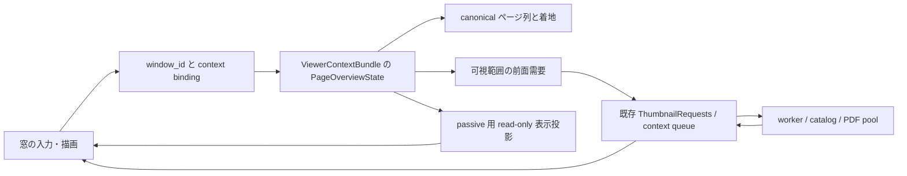

# 画像ウィンドウ内の本のページ一覧（§1.340）設計案

作成: 2026-10-12 / Codex、基準: `next-tile` / `ea060b66e`。
状態: **設計提出・独立レビュー／利用者確認待ち。実装未着手。**
改訂: `6432e8e04` の独立設計レビュー REVISE（P2 3件・P3 1件）への対応。
構造追加の方針は評価されたが、実装着手への全面的な構造合意は保留。今回の改訂は再レビュー待ち。
公開時期は v4.6.0 の次の版の**後**。次の版の必須成果にはしない。
項目・出典・時期の正本は [next-release-backlog.md §1.340](next-release-backlog.md#1340-複数ウィンドウの画像ウィンドウ内に本のページをタイル表示する--miv-スレ-509519-2026-10-07)。
本書は要望を実装可能な境界へ整理した提案で、利用者が下記の細部を承認した記録ではない。
スレ >>509 / >>519 の内容は backlog の要約を参照した。原文の追加調査・製品起動による観測は行っていない。

## 1. 要望と対象

複数ウィンドウモードで、本を読む画像窓の中にページをタイル状に並べ、任意のページを
選んで同じ窓の閲覧へ戻る。メイン画面の場所・一覧・カーソル・選択・チェック・絞り込み・
スクロール・履歴を変えず、他の画像／動画／音声窓の操作も妨げない。

「全ページ」は、**その viewer が現在読む可視実ページ列の全体**を意味する。構成内の白紙は
実ページの補助表示に限り、独立セル・独立選択・一覧総数の対象にしない。小窓へ全ページを
一度に詰め込むことや、未表示ページの画像をすべて生成することを意味しない。
可視行を仮想スクロールし、ページ数が多くても末尾まで一覧できる。
現在の階層・読み順・表示対象を尊重し、別階層への再帰走査や本の再オープンはしない。

初期対象案は独立複数窓の静止画閲覧。F12 の連動一窓でも同じ表示部品を利用できるが、
連動モード自体の既存同期仕様は変えない。通常メイン内／通常フルスクリーンへの入口の
開放は利用者確認事項とし、今回、既存の「一覧を開く」を置換しない。
動画・音楽の画面には画像用一覧を出さず、動画の S タイルと音楽ビューは従来のまま。

## 2. 現行実装から確認した前提

以下は `ea060b66e` の静的なコード確認。実機での動作確認ではない。

| 経路 | 現行の責任と今回の接続先 |
| --- | --- |
| メインの「ページを開く／一覧を開く」 | `App::explicit_grid_container_open_disabled_reason`（`src/app.rs`）は複数窓で拒否する。メインのページ一覧へ切り替える操作のため、この gate を外して要望に対応しない |
| 静止画シーク／ストリップ | `FsSeekInfo::has_page_strip_content`、`get_still_image_indices`、`fullscreen_seek_info_cached`（`src/ui_fullscreen.rs`）。現在の読み順の画像列と、混在一覧かどうかを解決する。ストリップは表示幅で要求数を制限した近傍確認である |
| サムネイル前面需要 | `ensure_still_seek_thumbnail_requests` / `enqueue_priority_thumbnail`（`src/app.rs`）は exact set を要求し、worker の keep 判定もその共有投影を見る。離れたページのために grid の bounding range を広げない |
| 要求の寿命 | `ThumbnailRequests` と `ThumbMsgPayload`。source は画像の採用／破棄と `Finalized` の両方まで同じ要求を所有する。表示の Pending / Evicted を完了証明にしない（[§1.360](thumbnail-request-lifecycle-plan.md)） |
| ページ着地 | `land_still_page_navigation_target` と `FsPageLoadContract::LatestSeek`。`handle_fs_navigation_with_contract` の `jump_to` 経路へ合流し、見開き・読書位置・画像ロードを既存 owner に任せられる |
| 動画の S タイル | `ui_video_tile.rs` は状態と抽出、`video/native_presenter/overlay_draw.rs` が描画。動画 PTS の一括抽出・640px保存・native HWND overlay は静止画ページの生成部品ではない（[動画設計](video-architecture.md)） |
| キー競合 | `src/keymap.rs` で `FsSlideshow` は FsImage の S、`VideoTileMode` は FsVideo の S。動画のキーだけを画像へ移植するとスライドショーを奪う |
| context 所有 | `ViewerContextBundle`（`src/app/viewer_context_registry.rs`）が items / generation / thumbnail / queue / channel / cancel / exact set / navigation caches を所有し、mounted projection と交換する |
| 非アクティブ画像窓 | `DetachedImageWindowSnapshot`、`DeferredDetachedImageWindowView` / Shared（`src/app.rs`）、`render_detached_image_windows`（`src/ui_fullscreen.rs`）が frozen 静止画を描き、root へイベントを配送する。active の描画だけ追加しても一覧表示を維持できない |
| 表示先の識別 | `DetachedWindowManager` の window_id と context registry の binding。HWND の incarnation は host 所有を表す。rect 一致や入力処理時の App.current を操作対象の代用にしない |
| rework の現在地 | [detached-rework-plan.md §9.1](detached-rework-plan.md#91-現況-唯一の進捗表r2b-close-を-2026-08-28-に反映): R2b 完了、R4 の single render entry は未完。R4 完了を前提としない |

関連正本として [architecture-overview.md](architecture-overview.md)、
[display-pipeline.md](display-pipeline.md)、[async-architecture.md](async-architecture.md)、
[ui-responsiveness.md](ui-responsiveness.md)、[virtual-folders.md](virtual-folders.md)、
[keymap-spec.md](keymap-spec.md)、[key-customization-impl-plan.md](key-customization-impl-plan.md)、
[web-remote-plan.md](web-remote-plan.md)、[filename-stack-plan.md](filename-stack-plan.md)、
[compile-book-plan.md](compile-book-plan.md) を参照する。過去の detached / display / video の
監査文書は診断履歴として読み、現況は上記正本とこの基準コードで判断する。

## 3. 画面と操作の提案

### 3.1 一覧

- 画像窓のクライアント領域を一覧へ切り替える。別 HWND、メイン一覧、独立ダイアログは作らない。
- 上部に本／階層の名前、現在位置／総数、列数の増減、「ページ表示に戻る」を固定する。
  OS の窓を閉じる操作と一覧を閉じる操作を区別する。
- 本文はスクロール可能なタイル。1 可視実ページにつき 1 セル、ページ番号と短い名前を付ける。
  初回は閲覧中の実ページを含む行を表示し、現在の見開きに含まれる実ページも別の印で示す。
- 既定の並び案は上から下、行内は読み方向に従う。RTL でも番号は読み順のまま。
  カーソル移動は描画されたセルの幾何に従い、左右矢印で見た方向の隣へ、上下で隣行へ移る。
- サムネイル未生成でも番号・placeholder は直ちに操作可能。選択時に全体の生成完了を待たない。
  失敗セルも選択でき、元画像の読み取りエラーは既存のページオープン経路が通知する。
- セルの単クリック／タップ、またはカーソルを合わせて確定すると一覧を閉じ、同じ窓へ着地する。
  カーソル移動・スクロール・hover だけでは読書位置を書き換えない。
- 列数は窓ごとのセッション値（初期案 4 列、1〜10 列かつ最小セル幅で実効列数を制限）。
  ボタンと Ctrl+wheel で変更でき、リサイズ時はカーソル位置を基点に可視範囲を再計算する。
  UI 倍率と client rect は**その描画先**から取得する。セル高さにも下限を設け、窓サイズによる
  実効可視行数を bounded にする。小窓でも戻るボタンとスクロール導線を残す。
- サムネイルは既存 catalog / 編集 preview / 回転表示を使用し、一覧のために全ページの final AI・
  分析・高解像度合成を起動しない。アニメ画像は一覧の既存静止 preview を使用する。

### 3.2 ストリップ・メイン一覧・閲覧モードとの関係

| 機能 | 役割／一覧を開いている間 |
| --- | --- |
| サムネイルストリップ | 近傍確認として存続。一覧中は描画・hit・需要の consumer を休止し、閉じた後は同じ設定で復帰。表示／固定設定を保存し直さない |
| メイン一覧 | ファイル操作・検索・評価・製本などのフル機能一覧。今回のタイルにチェック、一括選択、削除、D&D、製本編集は持ち込まない。独立窓の一覧開閉／選択でメインの状態を変更しない |
| 動画 S | 時間位置へ seek する既存機能。画面の発見性・戻る操作を参考にするが、動画 state の bool / pending 群や decoder をコピーしない |
| 単ページ／見開き／横長分割／連結 | 設定と現在位置を保持。タイル選択を既存の absolute seek 着地へ渡す。見開きは選んだ実ページを含む canonical unit、分割は既存 seek の slice 方針、連結は既存 seek の位置へ戻す |
| スライドショー | 既存の S と機能を保存。一覧中だけこの viewer の自動送り tick を休止し、取消／選択後に元の再生状態で次の通常間隔から再開する。兄弟窓の再生は止めない。採用は利用者確認後 |
| 編集・分析・比較・パノラマ | 未確定編集を暗黙保存／破棄しない。既存 exclusive-mode availability に一覧を登録し、競合中の新規入口は理由を表示する。通常閲覧を全窓モーダルにしない |

取消（一覧の戻る／Esc／同じ toggle）は現在の読書ページ、見開き調整、読み方を維持する。
背景クリックでは閉じない。ウィンドウ close は従来の terminal close であり、一覧の取消ではない。

## 4. キーと入力所有

新規 `KeyAction::FsPageOverviewToggle`（仮称）を **FsCommon / Press / no-repeat** として追加する。
**既定キーなし**を推奨案とし、画像窓のバー／「…」に「ページ一覧」を置く。
S は `FsSlideshow`、動画 S は `VideoTileMode` のままにする。S を一覧へ変更する案を採るなら、
スライドショーの移動先も含め利用者が明示決定してから実装する。
キー無しでもコマンド設定・適格なリング／ジェスチャ候補・ヘルプから発見できるようにする。

一覧用のローカル `KeyContext::FsPageOverview`（仮称）を設け、一覧の scope 集合を
`[Global, FsCommon, FsPageOverview]` とする。FsImage / Rating は同時 active にしない。
scope 内の全 Action を無条件許可せず、以下の**同じ実行可能 Action 集合**を全入口で使う。
名称／説明／context／trigger／chord／`ALL_ACTIONS`／`docs/keymap.ini.default` を揃える。
deferred callback は現在の effective keymap を read-only 投影として受け取り、raw S 判定を作らない。

| 操作 | 提案する Action / 既定 |
| --- | --- |
| 入場／取消 | `FsPageOverviewToggle`、既定なし。Open 時も同じ toggle を許可 |
| 選択確定 | `FsPageOverviewConfirm` / Enter。既存 IME-safe helper と input permit を使用 |
| 行単位で画面送り | `FsPageOverviewPagePrev` / PageUp、`FsPageOverviewPageNext` / PageDown |
| 先頭／末尾カーソル | `FsPageOverviewFirst` / Home、`FsPageOverviewLast` / End |
| 列数変更 | `FsPageOverviewColumnsLess` / `FsPageOverviewColumnsMore`、既定なし。ボタンと Ctrl+wheel も同じ command へ |
| 最低限の移動／脱出 | 修飾なし矢印と Esc は keymap-spec の固定ナビ／脱出規則に合わせる。固定理由を同文書へ追記 |

### 4.1 一覧で許可する集合と競合の正本（P2-2）

実行可能集合を `OverviewExecutableActions(presentation, navigation_availability)`（概念名）で
一度解決し、keyboard dispatch、表示ボタン、ヘルプ、リング／ジェスチャ候補と保存済み割当の実行、
ゲームパッド command に共用する。通常画像での toggle 入場も同じ availability を使用し、
動画／音声では FsCommon 所属を理由に入場を許可しない。

| 一覧の許可 Action | 実行する意味／条件 |
| --- | --- |
| §4 の新規一覧 Action 全件 | toggle、confirm、画面送り、先頭末尾、列数変更 |
| `HelpShowContextShortcuts` | 一覧の実行可能集合からヘルプを作る |
| `FsToggleWindowMode` | F11 の既存表示先切替。context と一覧を保持 |
| `ToggleDetachedViewerMode` | 連動一窓等、現行 F12 gate が許可する presentation のみ。独立静止画窓では集合から除外 |
| `ToggleAlwaysOnTop` | 利用者による明示的な既存最前面設定操作。再描画による自動前面化とは区別 |
| `FsCtrlNavPrev` / `FsCtrlNavNext` / `FsSiblingPrev` / `FsSiblingNext` | 現行 navigation gate が許可するものだけ。受理されたら一覧を閉じて元の navigation を実行 |

これ以外の Action（`FsClose`、`FsBackToList`、画像のページ送り／編集／評価／slideshow を含む）は
一覧の集合に含めず、背面へ fallthrough させない。Enter は一覧 Confirm、Esc は一覧取消となる。
OS の窓 close／タイトルバー close は Action とは別の既存 terminal close として維持する。
リングの既存画像スロットを別の操作へ読み替えず、許可集合外の保存済み割当は無効表示／非実行とする。
通常画像へ戻れば元の割当を使用できる。

`ACTIVE_SCOPE_SETS` へ一覧 scope 集合を追加するだけで終えず、一覧に関係する Action の
`actions_can_overlap` は、通常画像／連動一覧／独立一覧の**実行可能集合に二つの Action が
同時に含まれるか**を根拠にする。ヘルプ行の scope 抽出後も同じ許可集合で絞る。
通常画像の既存 scope／availability 契約は維持し、一覧だけ dispatch の例外 lookup を作らない。
この有限集合は keymap の静的 coexistence 検査と runtime availability の共有定義にする。
一時的な modal／nav lock は実行を抑止するだけで、潜在的な競合を消したことにはしない。

同じ chord の優先順位は、既存 modal・text input・popup → 固定 Esc 取消 →
`HelpShowContextShortcuts` → overview toggle → window mode／detached mode／always-on-top →
Ctrl／sibling navigation → overview confirm → その他の一覧 Action／固定 cursor とする。
同群内は上の表／Action 表の列挙順を固定し、一つの edge を最初の一致で消費する。
競合を黙って解消せず、たとえば toggle を Enter に割り当てたときは **Confirm との競合を表示し、
実行時は toggle が一回だけ一覧を取消**する。confirm は実行しない。
同じ判定を helper の外で raw key／scope 無視により再発火させない。

入力優先順位は上記 resolver に従い、一覧 → 通常 viewer の連続 dispatch は行わない。
一覧が処理した key edge / wheel / pointer / touch は背後のページ送り、ズーム、パネル、
メイン一覧へ再利用しない。未対応の通常画像 shortcut は一覧で実行せず、取消後に使用できる。
窓の F11、現行 gate が許可する F12、OS close、上記 navigation command は維持する。
表示先切替で同じ context の一覧は保持し、別本への navigation は一覧を閉じて既存経路を実行する。
リング／右ドラッグ／ゲームパッドの既存入力を奪わず、一覧 cursor と確定へ写像する範囲を明記する。
メインへのフォーカス移動を全窓 input lock で止めない。

## 5. 状態と所有境界

概念型を `PageOverviewState = Closed | Open(PageOverviewSession)` とする。
Open は context identity、items / reader-order の revision、一覧 incarnation、canonical page projection の
共有参照、cursor、scroll anchor、列数を一つに所有する。準備が必要な projection は既存の
navigation cache の準備境界で解決し、別々の `active` bool / `pending` Option を増やさない。
window_id は registry binding から導き、同じ情報の第二の正本として保存しない。

この状態は **ViewerContextBundle 所有**。mounted App に置く場合も一つの viewer feature owner の
交換先に限り、App-global detached flag を作らない。empty / mount / swap / split / fork / retire / Drop と
production context audit を同時に配線する。サムネイルの request / pixel / channel は既存 owner のまま。



不変条件:

1. 一覧の開閉は読み取り操作であり、items / context / 読書位置／履歴の世代や Remote の
   mutation generation を進めない。メインや兄弟 context の queue / cancel / cache を変更しない。
2. 一覧 cursor と閲覧位置は別。確定した一回だけ既存の着地を呼び、既存の表示確定時点で記録する。
   `fullscreen_idx` だけを直接書き換える経路や、main へ戻して open し直す経路を作らない。
3. 通知は元 context の channel / request ID / items generation で照合する。
   UI 選択 command は binding / items・projection revision / 一覧 incarnation と描画したセルの
   stable identity で照合する。画面座標を後から新しい配置で解釈し直さない。
4. fork は要求 owner・queue・token・receiver を複製しない。独立複製は Closed で開始する。
   元窓を passive 化する park は同一 owner の移動であり、一覧の表示状態を保持する。
5. placement、HWND 捕捉、host_lost、再生成、transition owner の正本は増やさない。
   リサイズは一覧 layout の変更であって host 再生成理由ではない。

## 6. active／passive／backstop とライフサイクル

### 6.1 非アクティブ窓にも同じ一覧を残す

active の一覧 draw helper と **bounded read-only overview view** を新規に分離する。
`DetachedImageWindowSnapshot` / `DeferredDetachedImageWindowView` の表示内容は概念的に
`StillImage | PageOverview` の typed projection とし、Open と表示 payload の Option を別々の
mode 判定に使わない。overview view は canonical な可視実ページ metadata 全体の **immutable
共有参照**と、cursor／scroll anchor／列数／projection revision を持つ。各 entry は読み順位置、
stable page identity、着地用の実ページ参照、番号／短い名前、構成の補助表示情報を持つ。
metadata は既存 canonical projection の準備境界で一度作り共有し、park／passive callback で
全件コピー・走査・path 解決をしない。構成の白紙を独立 entry にしない。
**有界にするのは画像／texture の保持・要求・描画セル数**であり、identity 解決用の軽量 metadata
全体への共有参照は保つ。全ページの画像／items 複製や frozen の大きな一枚画像は作らない。

park 時は同じ owner の cursor / scroll / mode を残し、進行中の pointer gesture を終了する。
新規 overview thumbnail 需要は休止し、最後に描いた可視セルは bounded snapshot が保持する。
passive callback は DB・decode・生成・App state mutation を行わず、共有 metadata とその窓の
現在の client rect／DPI、scroll anchor／列数から可視行と hit layout を計算する。
park 後の resize／DPI変更で新たに露出したセルも、metadata の読み順位置から番号・名前・
stable identity を解決する。画像が無ければ placeholder を描き、同じ frame の hit から
**その実ページ identity**を command に捕捉する。旧可視セル cache や旧座標から推測せず、
生成待ち／再アクティブ化だけのクリックを挟まない。root が mount した後も座標で選び直さない。
画像 cache に無いセルでも一クリックで選択可能とし、active 復帰時に現在表示範囲の需要を再評価する。
非アクティブ一覧を理由に兄弟窓の worker を動かし直さない。

passive での最初のセルクリック／スクロール／一覧キーは **activate と command の一組**として
既存 Shared → root event → manager activation intent → registry mount の経路で実行する。
既存の RightDrag intent と同じ所有原則を用い、overview 用 typed intent を追加する。
ActivateOnly に落として最初のクリックを失わせない。command は描画時の owner stamp と
stable cell identity を持ち、root は該当窓を mount した後に一度だけ適用する。
同じ event を active 側入力として再実行しない。viewport に stamped された配送済み key edge を
捕捉し、frame 最終 focus／現在の物理 key level／時間窓で stale 判定しない。
送信元の証明を持たない generic egui event を unfocused callback で代用しない。
既存の右ドラッグ配送は維持する。focus が変わった後の処理は §6.3 に従う。

R4 が未完なので、通常 active 描画、passive deferred 描画、legacy passive immediate 経路、
navigation gap / keepalive backstop の表示分岐を棚卸しし、どれも PageOverview projection を
尊重する。backstop は表示だけで command／enqueue を二重実行しない。新しい show_viewport 呼出しや
keepalive tick を足さず、既存の window_id と表示先を使う。これは R4 全体をこの機能へ混ぜる提案ではない。

### 6.2 遷移表

| 入口／終了 | 一覧 owner と副作用 |
| --- | --- |
| Open | 適格性を確認し、現在 viewer の canonical projection を参照。現在ページへ cursor、可視需要を publish。items 再列挙／履歴 write はしない |
| Cancel / toggle | Closed へ。overview の需要だけを解除し、元のページと strip 設定へ戻す |
| Select | stamp と identity を検証、既存 navigation gate へ着地を受理させてから Closed。gate が入力を受理しない frame は一覧を残し、勝手に別ページへ移らない |
| Scroll / resize / columns | 同じ Open の表示範囲と bounded demand を更新。実ページの位置とグローバル grid サイズを変更しない |
| F11 / 連動窓の同一 context の F12 migration | 一覧状態は同じ bundle とともに移動。新 client rect で layout 再計算。placement の別保存先を作らない。独立静止画窓の F12 は無効のまま |
| 別本 open / フォルダ移動 | 既存 command が受理された時点で Closed。incoming の loading/holdover と混在させず、既存 open continuation を使用する |
| items / 構成／読み順の置換 | 既存 invalidation 境界で Closed。専用の live rebuild や旧idxの再対応表を作らず、次回 Open で現在列を使う |
| window focus / park | 6.1 の bounded projection を保持。overview 固有需要を休止、gesture は終了。元の context の in-flight 終端を偽装しない |
| resume | 同じ bundle の Open を復帰し、layout／need を現在 rect で再評価。main の需要を一括 clear しない |
| terminal close / mode 全体終了 / Remote acquire / tray | 既存の context teardown／非表示処理へ接続。Closed と需要解除、CPU画像破棄は所有 context の request owner 経由。Remote barrier は新たな UI 待機を追加しない |
| stale command / late thumbnail | 元 owner の照合で破棄。新一覧／別窓へ再解釈しない。採用しない画像の寸法・origin・catalog invalidation を公開しない |

### 6.3 focus／z-order と配送済み edge（P3-1）

入力なしの repaint、passive resize／DPI変更、thumbnail Pixels／Finalized／Failed の終端は
閲覧窓の activate／foreground／raise を要求しない。main／兄弟窓の foreground と z-order を維持し、
既存 always-on-top 設定を自動的に変更しない。focus を取り直すための repaint／retry を追加しない。

通常の park→resume は既存 window_id、registry の window→context binding、ViewportId、
生存中の HWND／host incarnation を維持する。一覧の入場・退出、metadata 投影、resize／DPI変更を
host 再生成理由にしない。明示的な F12 migration に伴う host の生成・廃棄は既存 transition owner の
契約に従う別ケースであり、同 HWND の維持を要求しない。

配送済み stamped key edge の後に focus が別窓へ移っても、元 stamp／binding／一覧 incarnation が
有効なら元 context へ一度 dispatch する。処理時点の focus を freshness の代用にしない。
このとき最終 focus が別窓なら元窓を OS activate／raise せず、既存 `with_viewer_context` 等の
scope 内 mount／復帰境界を使って元 owner の command だけを適用する。Select もその窓の着地であり、
現在 foreground の窓のカーソルや閲覧ページへ付け替えない。遅れて到着した edge を理由に
passive→active の foreground activation を再要求しない。
modal／TextInput／IME／別 viewport owner の block は edge dispatch より優先する。
hold／repeat の current-level 参照は `FocusedKeyStatePermit` があるときだけとし、focus喪失後に
hold state を復活させない。window mode／F12等の明示 command の効果は元 target の既存契約へ渡し、
通常の cursor／select が暗黙に foreground を変更する効果を持たないよう分離する。
stamp 不一致・元 context 退役・一覧終了なら元 command を破棄し、別窓へ再配送しない。

## 7. ZIP / PDF / EPUB / 本の構成

| source | 一覧の範囲と制約 |
| --- | --- |
| ZIP / CBZ / nested ZIP | viewer が採用済みの階層のページ列。ZipDir を一覧操作で掘らず、区切り・別本への移動は既存閲覧へ戻して行う。entry の完全 identity を使用 |
| RAR / CBR / 7z / LZH / 変換 ZIP | direct read／変換済み materializer が採用した列を消費。logical 元書庫と実体 cache の区別を維持し、タイルから変換を新規開始しない |
| PDF | 採用済みページ列・現在の password／document stamp を既存要求へ渡す。UI 上で PDF open、ページ寸法全件取得、同期 render をしない |
| EPUB | 変換済みの `PdfPage` の論理 EPUB path と固定 generation を使う。既存 `ReadTarget` の読取 lease を生成終了まで保持。一覧を開くために EPUB 再変換／PDF 物理パスへの key 書換えをしない |
| 画像だけの通常フォルダ／製本 | 現在の viewer の列と読み順に従う。製本の番号順・保存場所を変えず、再編成・遅延rename・ページ追加はこの画面の責務にしない |
| ファイル名スタック | フラット読書へ materialize 済みならその閲覧列を使用。メインの集約表示へ戻さず、tile から Stack 再展開を開始しない |
| 混在フォルダ／検索等の集約列 | 初期案は既存 `has_page_strip_content` と同じ「現在の navigation 列が画像だけ」を条件にする。「本以外を隠して全ページと称する」独自 filter を足さない。単画像も 1 セルとして扱える。適格性をボタンと Action で共有 |

### §1.242 との統合条件

この基準 worktree に本の構成 G1〜G4 は未統合。細部の API 名を既成事実にせず、
`nextbook` のレビュー済み正本・実装が統合された時点で**本節と page projection adapter を再照合してから実装**する。
backlog §1.242 の 2026-10-12 決定では構成は ZIP/PDF/EPUB が対象、画像フォルダ G4F は切り離し、製本は対象外。

構成がある本は構成側の canonical 読み取り列／navigation projection を唯一の正本にする。
並べ替えた順を tile へ出し、非表示ページは出さない。非表示ページを元ファイル順から復活させず、
タイル独自の sort／visibility／spread pairing を作らない。
**承認済み仕様との照合（P2-1）**: `next-book` の `5fb135810`、
`C:/home/mimageviewer-nextbook/docs/book-composition-plan.md` §1／§4 の `Single.companion` を参照した。
`Blank` は実ページの相方で、独立 ID／source address／PageIdentity／選択行を持たず、
一覧・単ページ表示・実ページ数へ含めない。この契約を本一覧でもそのまま採用する。
一覧の元列は構成を反映した**可視実ページ列**だけで、挿入白紙の独立セル・カーソル位置・
選択 target・一覧総数は作らない。白紙を示す場合は対応実ページのセル内の補助描画に限り、
補助描画部分をクリックしても当該実ページの選択になる。白紙の page path／items idx／
サムネイル要求／専用 landing adapter を追加しない。
確定は実ページの既存 absolute seek へ渡し、白紙の相方を含む表示は構成側の canonical unit が担う。

実画像の横長分割は閲覧方式なので、tile は元実ページ 1 セル。見開き端の白い相方や末尾表紙の
再掲は表示 composition の役割であって新しいページではなく、一覧の総数へ二重計上しない。
構成の白紙と表示上の余白は補助表示の由来として区別するが、どちらも独立の一覧 entry にしない。
構成保存による既存 reload では一覧を閉じ、保存完了前後の表示追従 machinery を追加しない。
本機能から構成の編集／一時ずらしを迂回適用する入口を作らない。

## 8. サムネイル要求・取消・性能

### 8.1 全件生成せず既存 owner を利用する

全ページの**列**は `Arc` 等の既存 navigation cache を共有し、各 frame は可視行 + 上下 1 行の
overscan だけを列から直接参照する。遠い末尾へ移動しても 0..末尾 の keep range を作らない。
初回の列構築が必要なら既存準備を再利用し、新たな O(N) path clone・DB照会・寸法取得を
UI 入場処理へ追加しない。構成 projection の準備も同じ原則とする。

`still_seek_thumbnail_pages(_shared)` を **viewer の foreground exact demand** へ一般化する。
概念上の需要は `None | SeekStripOrPreview | PageOverview`。strip と overview の同時表示はせず、
一つの dispatcher がその frame の有効 consumer の exact set を publish する。
strip の hidden 分岐の `ensure(..., &[])` が後から overview 需要を消す構造を残さない。
別の全ページ queue・request owner・thread pool・consumer channel は作らない。
generation と request ID は既存 `ThumbnailRequests`、GPU textures は同じ context の cache が所有する。

keep は既存 grid／閲覧／hover consumer と exact demand の和である。overview の可視範囲変更は
前後の差分だけを更新し、同一 frame に二度 enqueue／clear しない。確定・取消時に**新規需要**を
撤回するが、request owner の `clear` を保存完了の代用にしない。

### 8.2 取消の契約

- overview だけが必要とした keep 外の queued 要求は、context の既存 queue lock 下で
  未取得と証明できるものだけ prune し、相関付き局所取消で owner を終了する。
  grid／閲覧／strip の残る需要と共用している要求は取消しない。
- worker 取得後は既存 exact-keep 判定と request-specific 取消経路を利用する。
  既存 producer が直ちに止められない decode／保存は完了を許し、範囲外 Pixels は owner 経由で破棄、
  `Finalized` まで同要求の再投入を禁止する。タイル close で context 全体の cancel token を立てない。
- 高速スクロールで queued／CPU backlog が訪問した全ページ数に比例して増えないよう、
  keep 外取消と採用前破棄を同じ需要更新に接続する。実行中の上限は既存 worker 数、保持画像は
  bounded keep + 採用待ち予算とする。終端順序を変えて同 idx の閉じる→開くも検査する。
- PDF pool の priority／context epoch は既存契約を維持する。全窓共通 epoch を一覧開閉で
  進めることや、path だけで兄弟／Remote の in-flight job を取り消すことは禁止。
  scoped queued prune／promotion に必要な相関が現行 API に足りなければ、その所有境界の
  限定修正を独立レビューへ返し、広域失効や retry を代替にしない。
- EPUB の lease、RAW follow-up、編集 preview は元要求と同じ identity／ID を持ち、
  取消時の保存終端契約を維持する。兄弟が同じ実ファイルを読んでいても別 context の要求は保つ。

### 8.3 budget と計測

新規 enqueue は可視範囲を優先し、frame 内の新規要求を最大 32 件／経過 2ms の準備予算で分割する案。
これは生成 worker を UI 上で待たせる timeout ではない。request の file／archive／DB 解決は worker。
GPU upload は既存 thumbnail の **全 consumer 合計 8 枚/frame**を上限にし、tile 用に別枠を追加しない。
texture 作成の時間は budget 化された既存 upload 境界に限る。描画中の非制限 upload は禁止する。
cache／生成サイズは既存 thumbnail 設定を使い、動画タイルの 640px 常時抽出は導入しない。
一覧の列数で main の `display_px_shared` や grid 設定を変えない。拡大時は既存 origin の
評価済み解像度と idle upgrade の収束規則を使い、同じ要求を再生成し続けない。

非表示、全可視セルが終端、入力無しのときは一覧のための連続 repaint をしない。
進捗は全ページではなく現在の可視需要について表示する。placeholder を pending 仕事と同一視しない。
perf は context／window／overview incarnation／items generation／request ID／input_seq を相関可能にし、
open、layout、demand差分、enqueue／prune、adopt／discard、select、close、park／resume を記録する。
ページ画像 decode の worker 時間と UI の layout／upload 時間を分ける。
50,000 ページの headless fixture で表示／request／texture 数の有界性を検査し、
実本の cold／warm／大規模性能と兄弟動画・音声への影響は、別途了承済みの実機枠で測る。
上記数値は実装時の初期予算案であり、製品性能の実測値ではない。

## 9. Remote・永続化・簡素化

Remote の既存ページ一覧／サムネイル／navigation はその session のまま。今回のローカル
PageOverviewState を Remote が借りたり、ブラウザから操作する API を追加したりしない。
既存 request 型を一般化する場合も standalone Remote consumer の相関契約を明示して保つ。
一覧開閉はコンテンツ変更ではないため Remote cache の mutation 通知を発行しない。
Remote acquire は既存の全 local context teardown で一覧を閉じ、その context の要求だけを取消し、
既存の barrier 完了判定に乗せる。返却時に一覧の自動再オープンを予約しない。
IPC payload を変更する必要は現提案にはなく、変更するなら版上げ・両 consumer 更新を同時にレビューする。

新 DB、設定 schema、一覧の位置／列数の永続化は作らない。既存キー override 以外はセッション状態。
タイルで見る／取消するだけでは本の構成・読書位置・タグ等を書かず、選択着地後の保存は既存 writer。

状態の組み合わせを減らす案を先に検討した結果:

- **採用**: strip と overview の表示を相互排他にして前面需要を一つにする。
- **採用**: items／構成／読み順が変われば一覧を閉じ、次回入場で参照し直す。
  設定変更ごとの専用 live rebuild、rollback、一覧位置の復旧 pending を足さない。
- **採用**: 既存 conversion／password／保存 modal の中では新規一覧操作を開始しない。
- **不採用**: 一覧を全窓モーダルにして窓切替を止める。複数窓とメイン一覧の通常操作を削るため。
- **不採用**: park で一覧を自動取消する。別の窓を見た後にページ探索をやり直す手間が増えるため、
  bounded read-only snapshot と既存 activation intent で保持する。
- **不採用**: 全件サムネイル生成を先に終えてから開く。通常の開く速度とメモリを悪化させるため。

**まれな失敗は割り切り（ログ + 通知 [+ 作り直し]）。** 新しい retry／部分保存／回復待機機構は
設計しない。元の本・設定・タグ・構成は消さない。通常のスクロール、窓切替、即再オープン、
遅着通知はまれな失敗ではなく、上記 owner／相関で扱う。

## 10. 実装 chunk と予定ファイル所有

今回は docs だけを書き、次の実装前に設計 lead と独立 reviewer が
「detached §2 に沿う構造追加であり症状パッチではない」ことへ明示合意する。
§1.242 統合後の projection／landing API の差分もレビュー対象に含める。
一つの chunk で shared file の writer は実装担当一人とし、別 worktree の master 更新と突き合わせる。

| chunk | 予定する内容／主なファイル |
| --- | --- |
| T1 | 純粋な overview state／layout／canonical target adapter、`src/page_overview.rs`（仮称）、`src/lib.rs`。構成の型は既存正本を利用 |
| T2 | bundle mount/swap/fork/retire と bounded demand 一般化、`src/app.rs`、`src/app/viewer_context_registry.rs`、`src/thumb_loader.rs`。必要時の PDF scoped API は別レビューしてから |
| T3 | active／passive／backstop の表示・identified activation command、`src/ui_page_overview.rs`（仮称）、`src/ui_fullscreen.rs`、`src/app/detached_window_manager.rs`。placement・host 捕捉は変更しない |
| T4 | KeyAction/context／入口／ring/gamepad／headless snapshot、`src/keymap.rs` と既存 command availability・`src/app/gamepad_input.rs` 等。新しい独立 raw-key handler は作らない |
| T5 | 文書・回帰・最終 gate。`docs/keymap-spec.md`、`docs/keymap.ini.default`、display/async 正本、`spec.md`、`htdocs/mimageviewer/`、detached ship checklist を実装の仕様に更新 |

T1〜T4 は内部の確認可能な chunk で、部分機能を公開する計画ではない。
所有境界が想定より大きくなる、既存入力を失う、構成の契約と矛盾する場合は実装を止め、
範囲と費用を lead／利用者へ返す。R4 の代わりに症状 guard や App-global flag を足さない。

## 11. 受入条件と検証計画

実装担当が targeted tests と通常／portable core check、fmt の証拠を記録する。
coordinator は有効な結果を再利用し、項目の最後に `test-full.ps1` を一回実行・集約する。
アプリの起動・実機入力はこの設計／通常開発の scope に含めない。

予定する **18 ケース群**（実装時にテスト本数と実行数を別記し、下記を実行済み本数と称さない）:

1. Open／cancel／select の状態遷移と、cancel／cursor 操作で読書位置が変わらないこと。
2. 1／数百／50,000 ページの仮想行、末尾アクセス、空列、縮小 client rect の戻る操作到達性。
3. RTL／LTR の描画順・カーソル幾何・ページ番号、列数／DPI／resize 時の cursor anchor。
4. Placeholder／Failed セルも着地可能、生成完了待ちや全件要求が無いこと。
5. 単ページ／見開き／横長分割／縦横連結の既存 absolute seek と同じ target／表示 unit。
6. ZIP 階層／nested ZIP／変換元書庫／PDF／EPUB／製本／stack の canonical identity と順序。
7. 構成順の可視実ページのみを一覧にする。非表示と白紙は独立セル／選択／総数へ含めず、
   白紙補助部分の hit は対応実ページに着地。末尾表紙を二重計上せず、白紙にサムネ要求を出さないこと。
8. strip→overview→strip の単一需要 publish と、strip hidden branch による需要の上書きが無いこと。
9. source Pixels→Finalized／逆順、cache単一通知、取消・keep外破棄と即再入場で重複要求しないこと。
10. 高速の末尾／先頭往復で queue／CPU画像／GPU texture がページ総数や訪問数に比例しないこと。
11. A と B の同数 generation／同idx／同path でも要求・drop・取消が片側だけへ作用すること。
12. main／active／at-rest の mount/swap/park/resume/fork/terminal close と production context audit。
13. passive の最初の click／wheel／key が元の一覧へ一度適用され、stale stamp と閉じた窓は拒否されること。
    park→passive resize／DPI変更→新たに露出した未生成セルを一クリックで選択でき、
    root は描画時の metadata identity に着地する。旧座標や画像 cache の有無で target を変えないこと。
14. active／deferred passive／legacy passive／backstop の同じ表示 projection、gesture 終了と snapshot 有界性。
15. keymap の inventory／default／競合／任意再割当／none、S slideshow／動画 S を保持し、入力が背後へ漏れないこと。
    toggle=Enter と Confirm の競合を表示して toggle だけ一度実行。dispatch／ヘルプ／リング／
    保存済み割当の availability が §4.1 の同じ集合となり、一覧 scope 外の例外 dispatch が無いこと。
16. F11／本移動／modal／編集 availability とスライドショー tick の所有。独立静止画窓の F12 は
    無効で binding／HWND／一覧を変えず、連動窓の F12 は既存 migration と context 保持を検査する。
    park→resume で window binding／ViewportId／生存 HWND／incarnation を維持し、兄弟の操作・再生を保持すること。
17. Remote acquire／release／既存 standalone thumbnail consumer。read-only open/close で Remote mutation 通知を出さないこと。
18. headless snapshot（小窓／RTL／placeholder／current spread／白紙補助表示／暗色・倍率）、終端 idle の repaint／仕事収束。
    入力なしの repaint／resize／DPI変更／サムネ終端で activate／foreground／raise effect が0件。
    stamped key edge→別窓へ focus移動→処理では元 context に一度適用し、別窓の focus／z-orderを維持。
    stamp不一致／terminal close は破棄、証明のない unfocused generic event／held は非実行となること。

自動検証コマンド（filter 名は実装後に実在名と件数を記録）:

```powershell
cargo test -p mimageviewer --lib page_overview
cargo test -p mimageviewer --lib viewer_context
cargo test -p mimageviewer --lib still_seek
cargo test -p mimageviewer --lib thumbnail_request
cargo test -p mimageviewer --lib keymap
cargo check -p mimageviewer --bin mimageviewer-core
cargo check -p mimageviewer --bin mimageviewer-core --features portable
cargo fmt --check
python scripts/check_ui_glyphs.py
# 項目の最後に coordinator と重複実行を調整:
.\scripts\test-full.ps1
```

独立完了レビュー後に正常 profile の `build-dev.ps1` で確認 binary を作る。
本人が実機で確認する具体シナリオは、メイン一覧を残して ZIP と PDF/EPUB の独立画像窓を二つ開き、
一方で一覧を開く→スクロール→他窓へ移る→passive の窓を拡大／DPI変更→新たに露出した
未生成セルを最初のクリックで選択、取消、F11 を確認する。独立静止画窓の F12 は無効が期待値。
連動窓の F12 migration は別シナリオで確認し、入力なしの再描画／resize／サムネ終端では前面化しない。
加えて、大きい本の末尾選択、本の構成と兄弟動画／音声の併用、Remote の取得を確認する。
実機観測なしに性能／最初の入力到達／native focus 成功を断定しない。
normal profile binary はエージェントが起動しない。実機枠とデータ保護は
[interactive-release-verification.md](interactive-release-verification.md) と AGENTS.md に従う。

## 12. レビュー・利用者確認への申し送りと今回の検証

独立レビューの重点は、R4 未完の複数描画経路、passive の first-input と identity、
foreground exact demand の撤回と保存終端、PDF の sibling scope、§1.242 の可視実ページと白紙補助表示。
性能を理由に全窓 modal、park 自動取消、既存 S の無断変更を採用しないことも確認する。

利用者確認事項（本書では未決定）:

1. 画像窓バーの「ページ一覧」＋新 Action 既定キーなし、S slideshow 維持の案でよいか。
2. セルの単クリックで戻る、RTL の行内順、取消で元ページ維持、一覧中だけ当該窓の
   slideshow tick 休止・退出後再開という操作案。
3. 初期は独立画像窓を対象にするか、連動 F12 と通常画像 fullscreen／embedded も同時開放するか。
4. 「全ページ」を現在 viewer の読書列全体とする範囲。画像だけの列ならフォルダ／製本／stack も
   利用可能とし、階層を跨いだ一覧や混在メディア一覧は今回追加しない案。

初回設計提出（`6432e8e04`）の文書作成時の記録: 成果は設計文書と索引／§11 記録のみ。
実装担当による製品コード変更 0、製品起動 0、コミット 0（文書のコミットは coordinator）。
Rust テスト／通常・portable core check／test-full／確認 build は設計提出時には実行しない。
この文書変更では実行物を変更しないためであり、上記 18 ケース群の実装検証は未実施。
初回の検証: 新規文書と追加行のローカルリンク 18 箇所の参照先ファイルあり、欠落 0。
追加文書／行の末尾空白 0、`git diff --check` 成功、`cargo fmt --check` 成功（exit 0）。
Rust テスト実行 0 件、通常／portable core check 各 0 回、test-full 0 回、確認 build 0 回。

## 13. 独立設計レビュー REVISE への対応（2026-10-12）

対象 `6432e8e04`、利用者が提示した独立レビュー: P1 0件、P2 3件、P3 1件。
単一 context owner／既存 navigation／exact demand 一般化は症状パッチではなく構造追加と
評価されたが、全面的な構造合意は保留。本改訂を再レビューへ渡し、実装は開始しない。

| 指摘 | 修正した契約／受入ケース |
| --- | --- |
| P2-1 白紙 | §1／§3／§7 を可視実ページだけの列へ修正。`next-book` `5fb135810` の承認済み `Blank` 契約に合わせ、実ページセルの補助表示に限定。独立セル・identity・選択・総数・白紙 landing 案を撤去。ケース7／18を修正 |
| P2-2 scope | §4で toggle を FsCommon へ変更。§4.1の許可 Action 集合と優先順位を明示し、scope／Action 単位の同時実行可能性、dispatch／競合／ヘルプ／リングの共有契約を追加。ケース15で toggle=Enter と Confirm の競合と一回 dispatch を検査 |
| P2-3 passive metadata | §6.1で可視実ページ全列の immutable metadata を共有し、画像だけ有界保持。passive resize／DPI変更でも新セルの identity を描画時に解決。ケース13に未生成セルの first-click landing を追加 |
| P3-1 focus／z-order | §6.3に入力なしの非前面化、通常 park／resume の binding・生存 HWND維持、配送済み edge と current focus の分離を記載。ケース16／18と実機手順で独立窓 F12 無効と連動窓 migration を分ける |

静的照合: `next-book` の HEAD が `5fb135810` であることと構成正本 §1／§4 の Blank、
現行 `src/keymap.rs` の active scope／overlap／ヘルプ、`docs/keymap-spec.md` の配送済み edge／
F12 gate、context registry の scoped mount／return 境界を読んだ。製品挙動の実機観測ではない。
変更対象は本書と detached 計画 §11 のレビュー対応記録だけ。
Rust テスト0件、通常／portable core check各0回、test-full・build各0回、製品起動0回、コミット0回。
文書のみのため初回 fmt 成功証拠はコードに対して有効のままとし、Cargo は再実行しない。
改訂の検証: 本書のローカルリンク15箇所の参照先ファイルあり、欠落0。
指摘別の対応記録4件、受入計画18ケース群を検査し、`git diff --check` 成功（exit 0）。
受入計画の実装検証は未実施。
