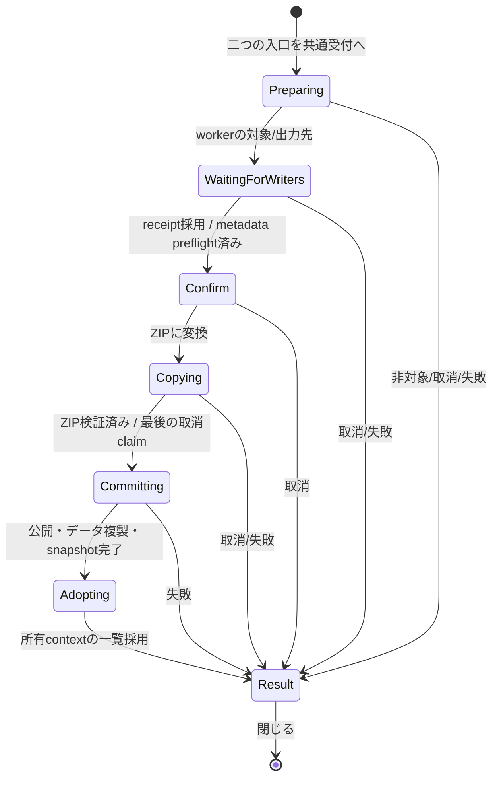

# §1.242 画像だけのフォルダを ZIP に変換する設計案

作成: 2026-10-12。初回調査基準: `next-book` / `05f7783cd`。
改訂: `53e90f8ef`への独立設計レビューREVISE（P2 5件・P3 2件）と2026-10-12利用者決定を反映。
状態: **設計R3の独立レビューACCEPT（利用者報告、対象`7346683c6`）。P3のRemoteタグ試験文言を訂正。ZIP変換の製品入口・利用者データの複製・同名3択・マニュアルを接続済み。最終test-fullはPASS。実装の独立レビュー・実機確認は未実施。検証記録は`target/G-1242-zip-msg.txt`。**

G4F切り離し後の独立した機能。本の構成のfolder adapter、folder構成の保存・復元、
sidecar v2を復活させない。G1〜G4のZIP/PDF/EPUBと、既存のfolder閲覧・編集を維持する。
本の構成と同じく次々回releaseの候補であり、今回masterへ統合する指示ではない。

## 1. 利用者決定と設計で提案する部分

以下は2026-10-12の利用者決定であり、レビューで都合よく弱めない。

1. `親/フォルダ名/` から `親/フォルダ名.zip` を作る。画像bytesをそのまま
   `CompressionMethod::Stored` で格納する。元folderは残し、削除・ごみ箱送りをしない。
2. 同名ZIPがあればエラー。上書き・連番・別名出力をしない。
3. タグ、★、編集、しおり等は初回利用からZIP側へ複製する。元側の登録を消さない。
   **タグの後続決定（2026-10-12）**: 全画像のタグを集め、変換したZIP本体のタグにする。
   元画像のタグはそのまま。ZIPページごとのタグは今回の範囲外。既存のZIP本体タグ操作を維持する。
4. 変換はモーダル。他の操作と組み合わせてsupersession/rollbackを作る案は採らない。
5. folder右クリックと、folderで本の構成を開こうとしたときの案内に「ZIP に変換」を置く。
6. **後続決定・案B（2026-10-12）**: 環境設定「同名ファイル」の既存folder/本のboolを
   「本を表示 / フォルダを表示 / 両方表示」の1つの3択へ置き換える。新規の既定は「本を表示」。
   ZIPだけでなくPDF/EPUB/RAR/7z/LZHへ共通に適用する。反対向きのboolは追加しない。
   一覧とCtrl+↑↓等へ適用し、公開時に更新履歴と「重要な変更点」へ記載する。
   released boolは**旧ON（既定を含む）→「本を表示」、旧OFF→「両方表示」**へ移す
   （2026-10-12利用者決定、§8.3）。「重要な変更点」で告知し、「フォルダを表示」への戻し方を案内する。
7. まれな失敗は既定の割り切り（ログ + 通知、可能ならこの操作の未完成ZIPを除去）。

以下の取消境界、完了後の選択、データ複製の詳細は設計提案。旧同名設定の移行方針は利用者決定済み。
コレクションは2026-10-12利用者決定により引き継がず、元の画像・folderへの登録を保持する（§5）。

## 2. コードで確認した境界

| 現行コード | 確認した事実 / 今回の使い方 |
| --- | --- |
| `app/folder_scan.rs::is_image_only_book_contents`、`image_folder_page_count` | 非空、container無し、認識されたmediaが全てImageという共通述語。非対応textは判定に影響しない。通常閲覧ではhidden/種類設定の投影もある |
| `app/book_materialization.rs::materialize_folder_listing*` | 同名除外は行・metadata・sort metadataを対で更新する。製本folderは別扱い |
| `folder_tree.rs::sorted_subdirs_for_nav_observed`、`FolderTreeOptions` | 実folderと本を同じ並びへ入れ、ZIP stemで変換書庫を除外。除外された現在位置をanchorとして辿る経路もある |
| `archive_converter.rs::store_options`、`convert_to_zip_with_password` | Stored、ZIP64、finish/flush、CRC検証、最終no-clobber公開がある。ただし固定`*.zip.part`を事前削除する処理は今回へ流用しない |
| `rename_key_migration.rs::STORES`、`copy_stores_impl` | path正規化とstore一覧の正本。既存copyはuniqueな全storeをINSERT OR IGNOREで写す。全表の無差別copyは今回に不適切 |
| `app.rs::copy_book_page_edit_key` | 製本の既存copyには補正・各mask・local adjust・crop・comic・rating・tagsがある。UI同期DB APIを今回のworkerから使う形へ分け、UIからそのまま呼ばない |
| `app/book_composition_editor.rs` のfolder受付、`App.fs_feedback_toast` | 現行folder案内は文字列/時刻/寿命だけのtoastで、actionを保持しない。全toastの再設計ではなく本変換ownerの確認画面へ接続する |
| `rating_db.rs::RatingMeta` / `RatingItemKind` | kind/source_path/entry_name等も保存。Image行のkeyだけZIP用に変えても評価一覧の復元は正しくならない |
| `app.rs::enqueue_visible_tag_prewarms` / `hydrate_ratings_from_xmp`、`tag_prewarm.rs` | 現行XMP評価読取りは表示近傍の物理Imageのみ。設定`write_rating_to_xmp`、DB優先、App共有の明示解除/世代を尊重する。変換は全manifestへ同じ判定をworkerで適用する |
| `app/metadata_ops.rs::tag_item_path`、`tag_ops.rs`、`tag_view.rs` | ZipImageのページkeyはタグ一覧/編集の対象ではない。全画面のタグ操作はZIP本体へ付く。今回もその本体keyだけを作る |
| `book_bookmarks.rs` | ImageFolder/RelativePathとZip/ArchiveEntryが既存型。専用serviceと自動採番idを持つ |
| `book_resume_db.rs::PageIdentity`、`spread_shift/model.rs::SpreadShiftPageRef` | Image/RelativePathとArchive/ArchiveEntryを区別。保存番号だけのcopyではない |
| `sidecar.rs`、`sidecar_import.rs`、`app/sidecar_restore.rs` | v1 DAT、pending writerのimmutable snapshot、検証token、Checkingの所有境界がある |
| `ui_dialogs/metadata_transfer.rs::metadata_transfer_writers_busy` | 送信済editor保存票の採用まで待ち、その後にcontext/tag/migration等のwriterを静止させる。previewも保存票待ちを持つ |
| `rename_key_migration.rs::StoreMaintenanceLease` | 既存lease取得順はEPUB coverage → spread shift → composition。新しいDB排他ownerを並立させない |
| `adjustment.db.favorite_view_states`、`favorite_view_state.rs`、`settings.rs::FavoriteViewState` | Settings内favoritesやfavorite_paramsとは別の永続表示状態。専用FIFO writerと500ms debounceがあり、既定見開き/読書方向/指定倍率等を新UUIDへ複製する |
| `smart_folder.rs::scan_one_directory / normalize_smart_folder_candidates`、`subfolder_expansion.rs::scan_one_directory` | 旧同名設定はディレクトリ内候補の投影にだけ適用。再帰先は先に登録済みで、子の画像/本セルは親の同名省略で消えない（§8.2.1） |
| `remote_ipc/session.rs::with_local_composition_admission` | Local受付とRemote acquireの短いmutex境界があるが、callback終了後の長い処理の排他leaseではない |
| `settings_transfer.rs` | 同名設定はportable preferences対象。現行assertは全457 / 対象144 / 除外313、wire142。これはコード値であり今回実行した試験数ではない |
| `settings_db.rs::RemoteListingSettings` / `load_into_settings_inner`、`settings_transfer`のv1 parse | 現行boolはDB、Remoteの最新設定overlay、preferences wireに存在する。runtimeの3択だけでなく各読取/保存と旧形式の互換入口を変更する必要がある |

本設計のレビュー根拠は上のコード、[アーキテクチャ](architecture-overview.md)、
[仮想folder](virtual-folders.md)、[非同期](async-architecture.md)、
[補正/sidecar](preset-and-adjustment.md)、[UI応答性§4](ui-responsiveness.md#4-新機能追加時のチェックリスト)、
[Remote](web-remote-plan.md)、[Collection](collection-implementation-plan.md)、
[detached憲法§2](detached-rework-plan.md#2-憲法-全ステージ共通の不変条件禁止事項-最重要)。

## 3. 対象判定と格納する画像

### 3.1 判定

実folderの直下だけをworkerで完全走査し、既存`is_image_only_book_contents`へ分類結果を渡す。
新しい「画像だけ」判定式や、拡張子からのfolder/file推測をUIへ追加しない。
変換は保存操作なので、**表示フィルタで隠した画像・障害物を無かったことにしない**。
走査入力はhiddenを含む、種類除外・同名画像除外前の全実体とする。これは通常の閲覧判定を
変更する指示ではなく、同じ述語を使う保存操作の入力契約。表示上は本でも非対象となる
ケースを確認画面で説明する。`fs_entry`のアプリ内部項目とAppleDoubleの既存除外は維持する。

| 内容 | 変換 |
| --- | --- |
| 認識済み画像が1枚以上、子containerなし | 対象。RAW・アニメーションを含め、元bytesを格納 |
| 画像 + text/JSON/XMP等の非対応ファイル、DAT/明示転送bundle | 対象。画像だけを格納し、非対応ファイルとbundleは元folderに残す。確認画面で画像以外を入れないと明記 |
| 画像 + 認識された動画/音声 | 非対象。表示設定で隠されていても同じ |
| 実サブfolder、ZIP/CBZ/PDF/EPUB/対応書庫がある | 非対象。再帰・入れ子展開をしない。アプリ内部管理項目の既存除外だけは例外 |
| 空 / 画像0枚 | 非対象 |
| 製本root直下の本folder | 今回は非対象。製本の操作owner・順序ファイルを別の形へ変える機能ではない |
| directory junction/symlink、画像のreparse/非regular実体 | 非対象。外部の木へ越境しない |
| 完全走査失敗、読めない画像、入力の途中変更 | 全体失敗。部分的に成功した列を変換しない |

入口は既存の取得済み候補だけから描画し、クリック後のworker判定を正とする。
通常folderの右クリックでは候補操作を表示してよい。描画時に中身を走査して非表示にしない。

### 3.2 manifestとbytes

全認識画像を格納する。同名拡張子省略・タグ/★facet・現在のチェック選択・Hidden等を
格納対象の削除条件にしない。全体設定で非表示の画像も含む旨を確認画面へ出す。
各entryは直下の元filename。外側にfolder名のdirectoryを付けず、改名・数字付加・重複名一意化をしない。
格納順は共通の本の名前順を使う。画像内EXIF/XMP/ICC等もbytesとともに保持し、編集を焼き込まない。

UTF-8へ損失なく表せる名前、ZIP entry/構成の共通安全規則、case正規化後の一意性を検査する。
`..`・絶対指定・separator偽装・正規化衝突等で1対1対応が作れなければ、作成前に拒否する。
unsafe名でも元folderの従来閲覧を止めたり、元の名前を変更したりしない。

workerはsource directoryのidentityと画像ごとのidentity/size/mtimeを捕捉する。
Windowsではコピー中の画像handleをread-onlyかつ書込/削除共有無しで保持し、各画像を
固定サイズbufferでストリーミングする。全画像bytesを一括RAMへ載せない。
確認後に増減/差替えがあれば書込み前・完了前の再照合で失敗。追従・自動再走査はしない。
sourceを長時間占有するための全画像handle一括保持も避ける。
Stored + ZIP64を用い、完成後はentry数/名前/CRCを検証する。
物理folderに展開爆弾対策の4 GiB/32 GiB上限を機械的に移さない。ZIP64、OSと既存readerの
表現可能範囲を事前検査し、他の画像を黙ってskipして上限へ収めない。

## 4. 利用者データの対応と棚卸し

`F = 親/本`、`Z = 親/本.zip`、`n = p001.jpg` とする。
immutable manifestは実パス `F/n` ↔ literal entry `n` を持つ。

- page key: `normalize_keep_drive(F/n)` → `zip_entry_key(Z,n)`。
- container key: `F` → `Z`。driveを落とす表は各storeの既存normalizerを使う。
- `BookScopeKey(F, "")` → **既存line E所有の** `BookScopeKey(Z, "")`。
  key/root/DBを再定義しない。folder値をZIPのdomainへ変換する処理を限定的に持つ。
- source raw path・lookup key・sidecar相対keyを別の用途として扱う。
  source pathを文字列置換しただけで全表へ使い回さない。
- 画像とZIPのcontent fingerprintは等価でない。source画像の物理hash行をvirtual keyへコピーしない。

以下は**成功条件に含む複製**。既存行の不存在と読取り失敗を区別する。
missing DBはデータなしと扱えるが、存在するDBの未知schema/読取失敗を空扱いして進めない。

| データ / 保存先 | 複製する内容と変換 | owner / 注意 |
| --- | --- | --- |
| `tags.db.item_tags` / `tag_item_state` | 全manifest画像とfolder自身の有効タグの和集合→ZIP本体Z。tag_keyで重複除去し、明示空/decidedを尊重 | §4.2。TagsDb既存型・tag writerの完了を待つ。ZIPページkeyのタグ行は作らず、tag定義も増殖させない |
| `rating.db.ratings` | 画像★→ZipImage★、folder★→ZipFile★。DB評価の時刻を保持し、XMP-only評価も全manifestから補う | §4.3。kindを6/3に、source_pathをZ、entry_nameをnへ変換。元Image/Folderの復元metadataをそのまま写さない。評価一覧から実際に開けることを検査 |
| `adjustment.db.page_params` | AI指定を含むAdjustParams | page keyだけ変換。焼き込みなし |
| `rotation.db.rotations` | 非破壊回転角 | ZIP page keyへ。Exif orientationと別に保存 |
| `mask.db.masks` / `conceal.db.conceal_entries` | bitmap/vectorと保存付随情報 | 同一bytesなので座標・寸法を保持。BLOB/JSON全件をUIでcloneしない |
| `local_adjust.db.local_adjust_pages` | 全レイヤー・マスク・設定 | 各layer id/順序を保持。source page内のidを再採番しない |
| `comic.db.comic_entries` / `export_crop.db.export_crop_pages` | 注釈、cropと基準寸法、対応asset参照 | shared stamp/LUT等の参照は従来の同profile資源。関連payload内の絶対source参照は型の既存検査を通し、keyだけのcopyで検証を省かない |
| `view_trim.db.view_trim_pages` | 全個別余白指定 | 未保存分も既存FIFO保存後に読み込む |
| `view_trim.db.view_trim_books` | Fの本別状態→Z | 行全体を保持。page側と異なるnormalizerを使う |
| `spread.db.spreads` と `final_cover_spreads` / `singleton_spread_placements` / `singleton_spread_endpoint_placements` / `page_alone_preferences` | 本別のmode・flow・direction・表紙/端/単独配置の指定をF→Z | mode-only / 未設定 / explicit OFFを保持。binding/directionを勝手にLTRで埋めない。新しい並びを読むのは既存共通resolver |
| `spread_shift.db.spread_shifts` | F空prefixの保存anchor。RelativePath(n)→ArchiveEntry(n) | service FIFOの完了と既存maintenance/snapshot公開を用いる。sessionだけのshiftは新しい本へ永続化しない |
| `book_resume.db.book_resume` | FのReadingPosition・meter。Image(F/n)→Archive(Z,n) | writer FIFOをfence。identityからZIPで解決し、index hint/meterをZIPの共通順へ対応させる。legacy identity無しはsource共通列で対応が証明できる範囲だけidentityを補う。範囲外は元のraw値とidentity無しを保持し、勝手にclampしない |
| `book_bookmarks.db.book_bookmarks` | ImageFolder/RelativePath(n)→Zip/ArchiveEntry(n)。title・登録時刻・hintも保持 | 専用serviceの複製command、destination id新規採番。source id/行は保持。安全な既存Missing参照も消さず型を変換 |
| `reading_history.db.reading_history` | Fの既存履歴があればZのZip履歴を複製。path/key/kindを書き換え、時刻・既存位置を保持 | 専用writer。変換した時刻を「読んだ時刻」にしない。成功後の選択だけで閲覧履歴を追加しない |
| `folder_thumb_pins.db.folder_thumb_pins` | F自身のpinをZへ。File(n,Image)→ZipEntry(zip_rel空,n) | payloadも変換。親folderがFを指すpinは変更しない。元pinも保持 |
| `settings.db` favorites / `adjustment.db.favorite_params` | Fそのものを指すお気に入りがあればZ用に複製し、新UUID。名前は「元の名前 (ZIP)」。index flagsと専用標準設定を対応する新UUIDへ複製 | Settings保存ownerとAdjustment owner。親rootのお気に入り・全体標準は共通のまま |
| `adjustment.db.favorite_view_states` | 対応するsource UUIDの永続`FavoriteViewState`全体→新UUID。未設定の指定倍率は未設定のまま | §4.4。`FavoriteViewWriteDebounce`の未送信分をflushし、専用`FavoriteViewStoreWriter`のFIFO完了・採用まで成功に含める |
| 自動 `mimageviewer.dat` v1 | まず既存source復元の不足行補充を完了。成功時はPのDATへ `本.zip::n` の編集と `本.zip` 本体の集約タグをmergeする | §6。ZIPページタグ/v2化/ZIPへのDAT埋込/FのDAT丸コピーをしない。backups OFFでも中央DBの複製は必須 |

明示されたNone/空値、未設定、明示解除を区別する。
copy先に同値の残存行がある場合はno-opとして検証できるが、**異なる利用者データが既にある場合は
書込み前に全体を止める**。ファイルが無いからDBも空とは推測しない。
競合検査にはPのDATのdestination相対key（disk/pending snapshotの両方）、お気に入り、
専用actorの登録も含める。中央DBが空でも古いDATや登録を無条件mergeで上書きしない。
`INSERT OR IGNORE`で古いtargetを優先したまま「引継ぎ成功」と報告せず、古いtargetを上書きもしない。
通知: 「作成先に以前の登録や編集が残っているため、ZIP を作れませんでした。元のフォルダは残っています。」
target keyの現在非採用ImageFolder構成行もこの競合検査の対象。

### 4.1 複製しないもの

| データ | 扱い / 理由 |
| --- | --- |
| `book_composition.db` のfolder値 | G4Fは切り離し済み。休眠値をZIP構成として復活させない。F側は保持。成功後ZIPのeditorを利用者が別操作で開く |
| `adjustment.db.sidecar_sync`、`tags.db.tag_sidecar_sync`、DAT消費receipt | folder・disk token・snapshotに属する復元済み印。他の場所へコピーしない |
| `content_identity.db` の物理image hash/辞退組 | sourceの台帳は保持。Zは既存Edit ledgerへ、複製した復元可能データの公開後に新しいrootとして観測する。元画像→virtual pageの物理hashコピーなし |
| `edit_preview_cache.db`、catalog、Auto aspect、AI/Susie/画像metadata cache、fts/search/similar/name索引 | 再生成可能。destinationは現在のstampで新規生成・差分登録。source/sibling cacheを一括clearしない |
| 動画・音声のpin/bookmark/再生位置/既読/音声選択/normalize | この変換の対象mediaではない |
| `mimageviewer.meta.miv` の明示転送bundle | 元folderに保持。型/fingerprintが変わるので丸copy/自動importしない。成功後の明示exportは既存機能でZをexport可能 |
| saved search / Smartの定義・parent root・全体設定 / session UI状態 | 画像に付く値ではなく登録された規則/閲覧状態。sourceは残るので元参照は有効。rootやフィルタを勝手に書き換えない |
| 画像以外の付随ファイル | 元folderに保持。ZIPには入れないことを確認画面に明記 |

### 4.2 タグは全画像からZIP本体へ集約する

2026-10-12利用者決定。post-fenceのworkerが全manifestの`F/n`とF自身のタグを読み、
既存tag_key正規化による和集合をZの実ファイルkeyへ用意する。未訪問/hidden/種類・facet除外の
画像も対象。DATだけのタグは§6.3の不足行補充後に読む。sourceの明示空/decidedによって
復元を拒否された旧タグを和集合へ戻さない。ある画像の空指定が他画像のタグを消す意味にはしない。
同じtag_keyは1件とし、元applied_atの最古値を保持、同時刻の表記差はmanifest順
（F自身を先頭）で決める。source各行の時刻/表記/decided状態は変更しない。

空でない和集合はZのタグとして保存する。空でもsourceにdecided状態があれば、Zへ既存の
明示空状態を保存して旧sidecarによる復活を防ぐ。source全て未設定なら空の決定行を捏造しない。
集約結果の状態は既存TagsDbのimport由来として記録し、各画像の状態を1件のZへ機械的に複写しない。
destinationの異なる既存タグ/状態は§4の事前競合で止め、無条件unionで上書きを隠さない。

中央DB、親PのDAT v1、cache/索引の公開は全てZIP本体keyを使う。`Z::n`のタグを作らず、
tag一覧/検索、ZIPセルの表示、PC全画面の付与/削除で確認する。
PC で本体タグを付与/削除し、Remote のタグ一覧・検索・open に反映されることを確認する。
ZIPページタグの型・検索・UI・wire拡張は今回行わない。元画像を対象にした既存操作は維持する。

### 4.3 XMP-only評価の全manifest準備

現行の表示近傍prewarmに依存せず、post-fence workerが全manifestの物理画像を対象にする。
`write_rating_to_xmp`と既存format/magic/parse規則を使い、設定OFFではXMPから評価を補わない。
DBにある評価を正本とし、XMPと異なっていてもDB値・時刻をコピーする。DB未登録の場合にだけ
XMPから有効な★を読む。埋込bytesをZIPへ入れたことを評価DBの引継ぎの代用にしない。

workerへ渡すのは、既存App共有`rating_session_writes`のmanifest該当keyの世代/明示解除事実と
既存設定snapshot。所有contextだけのcacheや未訪問idxを正本にしない。未完了のXMP書込みは
§6.2で先に完了・採用し、旧XMPを読んで明示解除を復活させない。sourceの最新明示解除は
DB行が無くてもXMP補充より優先し、既存hydrationの世代照合も共有する。
解除はZIP側のcopy payloadにも0の決定として含め、通常の共有rating公開境界へ対応keyを渡す。
存在しない0行を永続DBにあると仮定したり、解除を保存する第二の台帳を作ったりしない。

XMP由来の★は読取り準備としてcopy payloadへ含め、今回のためだけにsource DBへ先行commitしない。
destinationではZipImageのmetadataと既存import由来の時刻規則で保存する（XMPから読んだだけの
値に、元に無い利用者評価時刻を捏造しない）。読取りは一画像ずつworkerで行い、UIや全画像bytesの
一括snapshotへ移さない。評価一覧からZ,nを開くこと、ZIP内セルと全画面で★が出ることまで検証する。

### 4.4 お気に入り永続表示状態

`favorite_params`と別表の`adjustment.db.favorite_view_states`を別ownerとして扱う。
変換開始時に既存のcontext表示状態reconcileを行い、`FavoriteViewWriteDebounce`の未送信Setと
deferred commandを既存送信経路へ全てflushする。500ms経過や次の入力を待たない。
先行Set/Remove/ClearのFIFO結果を採用してからsource UUIDの保存状態をworkerで読む。

複製対象の各お気に入りについてold UUID→new UUIDを同じcopy planへ持ち、永続表示状態の
全フィールド（一覧/列数/順序/既定見開き/読書方向/指定倍率）を新UUIDへ専用writerでSetする。
指定倍率のNoneと明示無効を区別し、sourceに行が無い場合は新UUIDにも行を作らず継承を保持する。
Settings保存とfavorite_paramsとこのSetの結果回収・既存mapへの採用を成功条件に含める。
source UUID/値、兄弟のoverlayを変更せず、新UUIDへ切り替わる表示を勝手に起動しない。
第二のDB writer、待機用sleep/独自retry、変換専用debounceを作らない。

## 5. コレクションは元の登録を保持する（2026-10-12利用者決定）

コレクションはZIP側へ複製しない。元folder・元画像への既存参照、entry ID、手動順、
shuffle seed、revision、テキスト入出力を変更しない。元folderを残すので従来どおり開ける。
後で元folderを削除すると、その登録は既存の「見つからない」になる。
manualにもこの点を一行記載する。

利用者がこの範囲縮小を明示決定したため、旧§5のCollection A（ZIP内ページnamespace/schema/
PC・Remote consumerの拡張）、旧§5.1の容量検査とclone command、旧§5.2のテキスト形式拡張を
設計と実装範囲から外した。型付きJSON行を追加する案は採用しない。
Collectionを変換先のデータ競合・引継ぎ件数へ含めず、容量不足でも変換を拒否しない。
chunk 1の基盤にはCollection用の型・command・DB変更はなかったため、撤去する実装はない。

## 6. 所有境界、非同期、モーダル

### 6.1 操作owner

Appにprocess全体で1つのtypedな変換request ownerを置く。新機能のrequest/phaseを
互いに独立な`show/working/saving/cancelled`のbool群へ分割しない。
source path、destination、起点ViewerContextIdと表示世代、manifest、cancel/control、
worker receiver、完了の選択intentを同じownerへ束ねる。

全phaseの間は操作を受け付けない。Resultもボタンを閉じるまでmodal。
common modal/admissionをmain・fullscreen・F12・native videoで共用し、キーボード、wheel、
toolbars、history、drag/drop、gamepad、別窓操作、第二の変換、metadata import/export、
rename/delete/製本/capture、設定変更、外部open要求を同じ入口境界で止める。
隠れたUIに別の操作可能性を残さない。描画・必要な完了pollを止める仕様ではない。
popupやContext-menuだけの見かけのdisableで代用しない。

受理済み旧open/scanの完了を先に既存ownerで静止/退役させ、書込みのsnapshotを固定する。
新たな処理をcancelして何度もやり直す専用の再開機構は作らない。
背景readerの再開は既存metadata transferのreader停止/再開境界を共有する。
大量metadata/UI整形はworker準備、UIは固定の進捗値とbounded結果を表示するだけ。

### 6.2 既存保存ownerを経由する開始条件

WaitingForWritersは既存metadata transferのbody側の受付静止条件を共通helperとして使用する。
Preparingの先行workerはFSの対象/概算だけを調べる。metadata previewのためにleaseを先取りしない。
旧writerを静止させた後のworkerがsource補充・target競合・copy件数を準備し、Confirmへ渡す。
Confirm中も同じ操作ownerがwriter資源/maintenanceを保持し、確認後に第二のsnapshot正本を作らない。
既存writerが更新したsource画像bytesのstampは、このpost-fence preflightで初めて確定する。
事前FS概算から変わったことだけで、自分が待っていたXMP保存を外部変更として拒否しない。
Confirm後の外部変更は§3.2どおり失敗させる。source directoryのmtimeだけで画像集合の変更を
判定せず、directory identityと画像集合/各画像stampを使う（自分のDAT保存を変更扱いしない）。
editorの送信済保存票は所有窓退役後も**既存の唯一の完了採用owner**で回収する。
その前にcomposition/shift maintenanceを取得しない。tag/XMP reader、migration queue、
bookmark、capture/export、Checking等の旧writerも同じ境界へ接続する。

全viewer contextの未保存trim/editはそれぞれの既存FIFOへ送り、receiptにより保存を確認する。
modalになった時点でqueueが空だったという観測だけで完了としない。
既存helperが列挙するbusy条件だけで棚卸し全部の完了を証明したことにしない。
resume/history/settingsの受理済み保存、bookmarkの先行変更にも各既存FIFOの
read/command receiptを用いる。今回必要なsource読取りとcopy commandをそのownerへ通し、
test-only barrierを製品の完了証明として呼ばない。
お気に入り表示状態の未送信debounce/deferredを§4.4どおりflushし、専用FIFOの結果採用も待つ。
全manifestのXMP評価準備（§4.3）をpost-fence preflightへ含める。
source/destination/parentのsidecar cacheは既存のworker resources handoffで移す。
Checking・定期・終了flushが旧Arcを書き戻せる別の予約を残さない。
worker所有中にsidecarをUIへ再挿入せず、結果receiptとsnapshotを対にして一度だけ採用する。
同じデータへの第二のwriter、単独のflush除外bool、別のコピー用DB serviceを作らない。

DB照合/補充・コピー・serialized sidecar mergeはworkerに置く。
preflightのcopy planは対応key/型/件数で、全画像・全mask BLOBの巨大snapshotをRAMへ複製しない。
lease/resource所有下の安定したsourceをbounded batchで読み、各storeの既存検証済み型を使う。
取得する既存StoreMaintenanceLeaseの順を守り、同じleaseを借りて再取得しない。
page edit/rating/tagの既存epoch guardを最終Z公開前から更新完了まで保持し、
途中のstore集合を準備結果として採用させない。indexer/watchの発見と閲覧への公開を区別し、
modal中の新openと旧prepared結果の採用を入口/既存request ownerで止める。
bookmark/settingsは各唯一のwriterへcommandと完了receiptを渡す。
workerがAppのUI DB handleを別スレッドから呼ぶ設計はしない。
service read snapshotの更新・maintenance解放・副作用receiptまでを完了結果へ含める。
成功/取消/通常errorの全terminalで、借りたDB/sidecar資源の返却と既存readerの再開を
同じ完了採用境界で行ってからmodalを閉じる。error表示だけで資源をworkerへ残さない。
worker切断等のまれな失敗ではログ/通知し、失った再生成可能cacheは既存read経路で再構築する。
sourceの未保存利用者値はそれより前のFIFO fenceで保存済みであることを必須にする。

### 6.3 sidecar v1

未訪問sourceにDATだけの編集/tagがある場合も、既存不足行補充を完了してからsnapshotを作る。
中央の明示空/解除をDATで復活させない。source DATの丸copyや、source sync印の転記をしない。
ZIP用のbackup置場はZの親P。`Z.filename::entry`という既存v1相対keyを使う。
このentry keyはページ編集用。集約タグは`Z.filename`の本体keyだけへ保存する（§4.2）。
Pの他の画像・他のZIPのtag/編集を保持したmergeを既存SidecarFile/writerで保存する。
編集backup/tag backupの既存二つの設定を尊重し、OFFでも中央の複製を省略しない。
source FのDATは保持。今までdirtyだった最新編集を保存することと、変換によるsourceデータ変更を区別する。
既存source不足行補充はConfirmより前に中央DBへcommitし得る。取消でこれや先行保存を巻き戻さず、
通常の復元として採用・保持する。sourceファイル/既存登録を失わない保証と、DBの完全不変を混同しない。

### 6.4 Remoteとの排他

RemoteActive/Acquiring/Draining中は変換の新規受付をしない。変換ボタンも同じ判定で無効。
Localの変換受付とRemote acquireの競争は、既存SessionHandle admission mutexで線形化する。
現行`with_local_composition_admission`は長い処理を保護しないため、callbackを使うだけでは不十分。

提案は、その既存受付境界に**同じ変換controlへの局所的な排他capability**を登録すること。
Appのphase/controlが唯一の正本で、Session側はそのcapabilityを参照し、独立したbusy boolや
複製phaseを持たない。先に変換受付が成立したとき、後から来るacquireは既存
`SessionStatus::LocalInUse`と「PC で ZIP を作成中です。完了してから接続してください。」を返し、
Local→Acquiringへ移さない。先にacquireが成立したときは変換のcallbackを実行しない。
短いmutex区間では登録/非blocking enqueueだけ行い、DB/FS・registry lock・待機をしない。
capabilityは完了採用まで保持し、取消/errorでも同じownerが一度だけ解放する。
長い変換を既存acquire timeoutまで待たせたり、Remoteの取得で変換を黙って破棄したりしない。

この内部受付だけならwireは既存LocalInUseを使え、IPC版変更は不要。
Collectionのsource型・wireは変更しない（§5）。
Remoteのfolder一覧も§8の共通同名規則へ接続する。既存folderのSetSpread・閲覧・編集は
G4F構成行へ戻さず、作成された実ZIPだけが構成対象になる。Remoteに変換入口は追加しない。

## 7. ファイル公開、取消、失敗、完了採用

### 7.1 正常順序

1. 出力名はfolderのfilename全体へ`.zip`を追加する。`with_extension`でfolder名の拡張子を
   置換しない。root/filenameは既存normalizerで損失なく一意に表せることも検査する。
   workerの事前判定でZの実在とtargetのauthoritativeデータ競合を調べる。
   親の候補を同じcase/lookup規則でも照合し、case-sensitive directoryにある`本.ZIP`等の
   同一lookup名の別実体も衝突にする。同名のdirectory/reparse/別種ファイルも衝突。
   既存物を削除しない。
2. Confirmの実行後、P内にこのrequest専用のtemp fileを`create_new`で作る。固定`本.zip.part`の
   既存ファイルを消してから使う処理を流用しない。隠されたtempは正常一覧の対象にしない。
3. 全画像をStoredで格納し、finish/flush/close後にCRCとmanifestを検証。
   列挙時の入力stampと最終stampを照合する。
4. 最後の取消受付とcommit開始を同じcontrol claimで線形化する。
   取消が先ならdestination複製/最終Z公開を行わない。既存保存・source不足行補充は保持する。
   commit開始が先なら取消不可の完了保存phaseへ進む。
5. **最終Zをno-clobberで公開してから**、検証済みmetadataを各既存ownerで複製する。
   先にmetadataだけ写す案は、最終公開で外部アプリが作った同名ZIPと衝突した際に
   その別ZIPのデータを汚すので採らない。公開したZはhandle/実体identityで操作所有を保持する。
6. データ・DAT・専用service snapshotの完了、index/ledgerの必要な受付receiptを回収する。
   成功はmetadata完了後にだけ報告する。途中のZをApp/Remoteへ成功として開かせない。
7. worker準備済みrefresh結果を所有contextへ一度だけ採用する。
   そのcontextを既存の親実folder一覧へ戻し、採用済み可視投影にZがあればその**path identity**を
   cursor/選択にする。Zが同名3択・種類・facet等で不可視なら、既存の操作後可視選択規則を使う。
   設定を強制変更せず、非表示idxを選択しない。空の可視列も既存規則に従う。
   自動fullscreen・本の構成editor自動openはしない。別context/兄弟の位置や列を変更しない。
8. modalを成功Resultへ進める。閉じてから通常のZIP閲覧/構成編集ができる。
   可視/不可視にかかわらず成功通知に出力先Zを出し、不可視でも作成失敗とは扱わない。

集約一覧/検索/collectionでfolderを右クリックした場合も、その操作の起点contextを
既存の「ある場所のfolderへ移動」経路でPへ戻す。起点のreturn stateを破壊して独自にitemsを差替えない。
F12起点は元の閲覧を維持して出力先を通知し、親一覧への移動・ZIP選択は行わない
（2026-10-13 coordinator判断、利用者の既決事項の範囲内）。request ownerはprocess側に残るため、
窓の退役と保存結果の所有を混同しない。detached連携は§11へ記録する。
起点のcloseが完了後の予定動作になった場合は、保存receiptだけ回収して既存closeへ進む。
既に退役したcontextへの選択は行わず、別の窓やmainへ暗黙に選択先を付け替えない。

起床はworkerのprogress/terminal sendと既存pending wake契約へ接続し、fullscreenの早期return前の
display-independent pollから回収する。利用者の次の入力を待って完了する状態を残さない。

### 7.2 取消と終了

Preparing/Confirm/WaitingForWriters/Copyingで「取消」またはIME-safe Escape。
worker中の取消はsignal送信後、terminal receiptまではmodal ownerを保持する。
コピーchunk/画像境界/CRC検査/最終claimでcancelを確認する。
commit前取消でも、先行した通常の保存とsource DAT不足行補充は保持し、destination複製と
最終ZIP公開だけを行わない。この操作のtempは除去する。source補充の巻戻し用状態を追加しない。
Committing/Adoptingは取消ボタンを無効にし「保存を完了しています」と表示。
×/Escapeで隠して裏に保存workerだけ残さない。

通常のアプリ終了要求は、commit前なら取消、commit開始後なら既存close barrierで
receipt/採用まで終了を延期する。UI threadのjoinやsleep待ちはしない。
OS強制終了・電源断を通常の取消契約へ偽装せず、下のまれな失敗方針で扱う。

### 7.3 まれな失敗

DB/FS障害はログと日本語通知。再試行loop、独自journal、補償transaction列、次回自動再開、
回復中の回復を作らない。source files/source利用者行は常に保持する。
元のfolderと画像、変換先にあったデータを削除して復旧しない。

- commit前: この操作のtempだけ除去。最終Z公開/destination複製無し。
  既存保存とsource不足行補充は保持し、中央DB全体の変更無しとは保証しない。
- 公開競合: 既存Zを保持。metadata複製はまだ行っていない。
- commit後の複製失敗: 成功として開かず、この操作が公開したZだけをidentity確認して除去する。
  外部差替えされた同名Zは消さない。既にcommitしたコピー行は再取得/巻戻ししない。
  元行が残るのでデータ損失は無い。次の手動実行では同値行はno-op、異なる残存行は§4の競合エラー。
- DAT保存失敗も成功条件を満たさない。cleanupも失敗した場合はもう一段の回復を作らず、
  残った出力pathと元folderが保持されている旨を通知する。
- 強制終了後にcomplete ZIPやコピー済み行が残っていても、同名ファイルを自動上書きしない。
  操作が完了済みかのpersistent pending正本を追加しない。

途中失敗時にtarget ZIPが残ると、新設定で元folderが一覧から省略される場合がある。
エラー通知に元folderの場所と、必要なら同名のfolderと本の設定を「フォルダを表示」または
「両方表示」にして開けることを明記する。
除去できなかったZIPを、再実行で黙って削除する処理はしない。

## 8. 同名のfolderと本を1つの3択で扱う（案B・利用者決定2026-10-12）

### 8.1 唯一の設定と共通pure policy

既存`skip_zip_if_folder_exists`（既定ON、v0.3.0からreleased）のruntime boolを、
提案field `Settings.same_name_folder_book: SameNameFolderBookPolicy`へ置き換える。
値は `PreferBook / PreferFolder / ShowBoth`、新規設定のDefaultは`PreferBook`。
保存用のcanonical値は `prefer_book / prefer_folder / show_both`を提案する。
旧boolは互換読取りの入力にだけ使い、live Settings・UI・worker・Remoteに二重の正本を残さない。
`skip_folder_if_zip_exists`は作らない。旧boolからruntimeの反対向きboolを導出して配る案も採らない。

表示ラベル:
「同名のフォルダと本 (ZIP/PDF/EPUB/RAR/7z/LZH) がある場合」
選択肢: **「本を表示」 / 「フォルダを表示」 / 「両方表示」**。

| 選択 | 同名の実folderと、表示対象の本fileがある場合 |
| --- | --- |
| 本を表示（新規の既定） | 本fileを残し、folderを省略 |
| フォルダを表示 | folderを残し、同名の本fileを省略 |
| 両方表示 | folder/本の相互省略を行わない |

本はZIP/PDF/EPUB/RAR/7z/LZHを同じ規則で扱う。ZIP/CBZ等の既存の同種別別名も
現行の本資格を維持する。変換書庫のIgnore、非先頭volume等は既存のworker分類に従い、
本として提示しない候補を優先してfolderを消さない。
`.zip`/`.pdf`という名前の実directoryを本fileと推測しない。folder名全体と本fileのstemを
既存case/path規則で照合する（`本.pdf` folderの相手は`本.pdf.zip`等）。
純粋関数の入力はworkerが確定した実体種類・照合名・3択で、関数内にFS/DB I/Oを入れない。

source種類/hiddenの採否を済ませ、各producerの旧folder/本の同名除外位置を共通3択へ置き換える。
本同士の`skip_archive_if_zip_exists`（ZIP/CBZ優先）と`skip_epub_if_pdf_exists`（PDF優先）は
独立した既存設定として維持する。既存のfilter順・後段facet・再帰探索範囲を組み替えない。
同名の本が複数あるときも、それらの生存候補を3択へ渡す。folderを省略する側の本が
別filterで全部消えた後に、folderだけが省略された結果を作らない。
逆に「フォルダを表示」で本が省略されても、同じ集合のfolderを再度省略しない。
種類設定で本を対象外にした場合はfolderを残す。rating/tag等の既存後段facetの意味は変えない。

### 8.2 接続するproducerと設定の適用

- `book_materialization`の通常一覧、共通folder scanを使うSmart / subfolder expansion / Remote。
  各producerの既存ディレクトリ内候補へ一つのpure policyを呼び、行・display metadata・sort metadataを対で省略する。
  formatごとの分岐へ別々のbool条件を増やさない。
  Smart/subfolder expansionの再帰先と再帰生成行には§8.2.1の境界を維持し、集約完了後の全件filterは加えない。
- `FolderTreeOptions`、sorted_subdirs、DFS、Ctrl+↑↓。旧`skip_zip`のboolを同じenumへ置換する。
  各child folderの新規内容走査はしない。省略された現在folder/本のanchorは位置探索に保持し、
  次/前の着地対象からだけ外す。画像なしfolderを飛ばすlimitとは別の同名規則で、limit=0でも適用する。
- folder scan signature / page-count cache条件 / nav memo / prepared settings snapshotへ3択全値を含める。
  Preferences OKの既存reload・表示の閉じて再作成を使い、専用live追従を作らない。
- Remoteの`settings_db::RemoteListingSettings`、読取projection/overlayもenumへ置換する。
  起動時boolを持ち続けず、確定後の次の一覧・移動要求で最新の選択を使う。
  Remote内部の設定読取りも§8.3の互換decoderを共有する。新しいRemote操作/wire fieldは加えない。
- 直接path指定、既存history/bookmark、明示collection登録を無効化しない。
  source行や検索定義を書換え/削除する設定ではない。

### 8.2.1 Smart / subfolder expansionの現行範囲を維持する

調査基準`53e90f8ef`。旧`skip_zip_if_folder_exists`は、親の同名folderを根拠に
**そのディレクトリ内の本候補を省略する設定であり、探索先の枝刈りではない**。

| producer / 現行境界 | 旧ONの作用 | 3択で維持する範囲 |
| --- | --- | --- |
| Smart `scan_one_directory`の`subdirs.push` → `normalize_smart_folder_candidates` | 再帰先を先に登録。直下Folder/Zip/Pdf/Archive候補の本側を省略し、その後rule/facetへ渡す | 同じ直下候補をpolicyへ渡す。「本を表示」は親に出すfolder行だけを省略。`subdirs`は変更しない |
| subfolder expansion `scan_one_directory`の`subdirs.push` → container retain | 子を先に探索予定へ登録。現在ディレクトリの`real_folder_names`を根拠に、表示対象Zip/Pdf候補を省略 | 同じ直下候補とfolder照合情報をpolicyへ渡す。親走査は元々folder行を出さないので、「本を表示」で削るfolder行はそこには無い。子の探索予定は変更しない |
| subfolder expansionの子ディレクトリ走査での`image_folder_books`折畳み | 子自身の内容からFolder本セルを出し、親の兄弟ZIPを見直さない | この自己生成セルを親の省略maskで消さない。OFFなら配下画像を従来どおり出す |

例えばPに画像folder FとF.zipがあり、再帰が有効な場合:

| 結果 | フォルダを表示（旧ON相当） | 本を表示 | 両方表示（旧OFF相当） |
| --- | --- | --- | --- |
| Smartの親候補 | F、F.zip無し | F.zip、親のF行無し | FとF.zip |
| Smartの配下画像 | 従来ruleで一致する画像を保持 | 同じ画像を保持 | 同じ画像を保持 |
| subfolder expansion、画像folder本扱いON | 子走査で生成したFセル | F.zipと子走査で生成したFセル | F.zipと子走査で生成したFセル |
| subfolder expansion、画像folder本扱いOFF | F配下画像 | F.zipとF配下画像 | F.zipとF配下画像 |

この再帰結果でFとF.zipが共に残る場合も、親の表示方向だけを変える承認範囲内であり、
それを見た目の重複として後から全件除外しない。種類/hidden/rule/画像folder本扱い/深さ制限は従来のまま。
subfolder expansionに現状無いArchive行や新しい走査先を今回追加して全形式の見かけを揃えない。
pure policy自体は全対象形式を扱い、各producerは現行の資格・提示可能種類だけを入力する。
明示Smart source F、明示subfolder expansion root F、直接open/history/bookmark/collectionのFは
親の候補行が省略されても走査/open可能。rootを同名policyで退役させたり定義を書き換えたりしない。

受入は直下policyの単体試験に加え、実walkerの再帰完了snapshotとprepared itemsまで確認する。
Smartの複数source/重複rootとinclude_descendants OFF、subfolder expansionの本扱いON/OFF、
明示root、hidden/種類/rule/facet/深さ制限で旧ON→「フォルダを表示」、旧OFF→「両方表示」の
旧結果との一致を固定する。「本を表示」でも到達ディレクトリ・配下結果が増減しないことを検査する。
**再帰を刈る/再帰生成セルや配下画像へ適用を拡張する変更はこの設計に含めない。**
実装でこの範囲を保てない前提が見つかった場合は、その時点で止めて設計担当へ報告する。

### 8.3 リリース済みboolの設定DB移行 — 利用者決定2026-10-12

このboolはGの未リリースデータではない。CLAUDE.md「永続データ・スキーマ変更」の
released側の規則に従い、旧設定の読取り・新形式の保存・互換/版gate・移行試験を用意する。
旧JSONからsettings.dbへの既存移行、backupの復元、portableの旧DBも同じ入口で読む。
旧DBを削除/作り直しして新既定へ揃える手段は採らない。

**旧ONを利用者が明示的に選んだか、既定ONのままかは判別できない。**
`true == 旧既定`は値の一致であり、未変更の証拠ではない。保存時刻、app_version、
お気に入り、他の設定等から推測しない。利用者はこの区別不能を含め、
**旧ON（既定・明示選択とも）→「本を表示」、旧OFF→「両方表示」**と決定した（2026-10-12）。
旧settings DBと旧preferencesの取り込みに同じ読み替えを適用する。

| 保存入力 | 読み替え | 契約 |
| --- | --- | --- |
| 有効な新3択がある | その値を保持。旧boolが共存しても新値が正本 | 保存済みの3択を保持 |
| 新3択無し、旧ON | 「本を表示」 | **利用者決定。既定・明示選択とも変更される** |
| 新3択無し、旧OFF | 「両方表示」 | 利用者決定。旧OFFの相互省略無しを保持 |
| 新旧とも無い新規/既定設定 | 「本を表示」 | 新既定の利用者決定 |
| 新3択が未知値/型不正 | 既存Incompatible/保存保護経路。旧boolへfallbackしない | 空扱い・既定による上書きを禁止 |
| 旧boolだけが型不正 | 既存の検証/保存保護経路。ON/OFFを推測しない | 不正データを削除しない |

旧ON→「フォルダを表示」とする旧表示保持案は採らない。既定ONだった大多数の既存環境を
本優先へ移す目的に合わせる。「重要な変更点」で明示選択も含む変更を告知し、
以前の見え方へ戻す場所として環境設定「同名ファイル」の「フォルダを表示」を案内する。

実装では、raw旧値を確認してから共有decoderでenumへ射影し、通常のSettings保存
transactionで新keyを保存して旧grouped keyを退役させる。新値の保存と旧keyの扱いは同一commitにする。
新keyの存在を優先するため、保存した「フォルダを表示」を再起動で新既定へ戻さない。
新keyがまだ保存されていない旧DBは、次回も同じ旧入力から同じ決定済みの値へ読める。
新enumのserde defaultを先に埋めて旧OFFの存在を失う読取りはしない。
loaderだけでなく、Settings save/build projectionとRemote subset読取りを棚卸しする。
`schema_meta.app_version`は既存どおり正常save commit時の記録とし、loadだけで保存済み版を偽らない。
既存のfuture-schema/enum/保存元版の保護を維持し、旧バイナリが新設定を壊さない版gateも検証する。

移行のDB読取/保存は既存Settings ownerへ置く。失敗時はログ + 通知と既存保存保護を使い、
空DB化、独自retry、回復中の回復、移行専用の第二writerを作らない。
新しいlive bool/carrierや、移行済みだけを表す独立したApp状態は追加しない。

### 8.4 settings_transferの旧形式とportable

- registryの旧bool fieldを新enumへ置換し、exportはcanonicalな新key/3択だけを出す。
  古いboolと新enumを同時に書き出す二重表現、3択を旧boolへ落とすlossy exportは行わない。
- 旧preferences v1の`skip_zip_if_folder_exists: true/false`はcompat read aliasとして受ける。
  §8.3の決定どおり旧ON→「本を表示」、旧OFF→「両方表示」とする同じ変換関数を使い、
  DB/transferで異なる移行結果にしない。
  旧aliasはlive Settings fieldでも新wireの通常fieldでもない。
- 新旧key共存時は有効な新enumを優先し、二回setterを走らせない。
  新keyが不正ならこの項目をissueとして適用せず、旧aliasへfallbackしない。他の有効項目は
  既存部分importの契約で適用できる。旧boolの型不正もissueにする。
- 新旧keyとも無い古い部分preferencesでは、既存の部分適用どおりdestinationの現在値を維持。
  新規/欠落settings DBの既定採用と、preferencesの項目欠落は混同しない。
- 新keyは既存preferences v1の追加/置換キーとして扱う案。旧版readerは未知項目の既存報告を行い、
  この3択は適用できない。旧版向け完全互換と称さず、既存importの未知件数/通知を検査する。
  format変更が必要と判明した場合は版gateを別途見直し、旧v1読取りを残す。
- portableも通常profileと同じSettings decoder/保存/transferで扱い、portable専用のboolを残さない。
  コピーした旧portable DB、`--data-dir`、新規portableでの新既定、再起動後の3択保持、
  profile間の相互importを検査する。
- exhaustive Settings分類、wire keys、accepted/changed/unknown counts、変化fixtureを更新する。
  現行457/144/313・wire142から件数の増減を予測して完了記録にしない。
  field置換とread aliasの扱いを分け、実試験で得た数値でassertと転送文書を更新する。

### 8.5 更新履歴と重要な変更点

これはv0.3.0以来の見え方を変えるreleased設定の変更。対象releaseではCHANGELOGと
`src/version_highlights.rs`の**must_read**へ載せ、manual「同名ファイル」も3択へ更新する。
portable/インストーラ更新の双方、版を飛ばした更新でも既存highlight選択の契約で告知する。
移行方針は2026-10-12利用者決定として確定し、release版番号は設計段階で埋め込まない。
2026-10-12の実装指示では次の版番号が未決定のため、今回は以下の文案のみを保持する。
`version_highlights::TABLE`とCHANGELOGは変更しない。manualは版番号なしで更新する。

告知文案（決定済みの移行と戻し方を含む）:
「同名のフォルダと本の表示を「本を表示 / フォルダを表示 / 両方表示」から選べるようにしました。
新しい既定は「本を表示」です。ZIP/PDF/EPUB/RAR/7z/LZHに共通で、一覧と前後のフォルダ移動に
適用されます。以前の設定がオンの場合は、既定のままでも自分で選んだ場合でも「本を表示」へ
切り替わります。オフの場合は「両方表示」を維持します。元のファイルやフォルダは削除されません。
以前のフォルダ優先の見え方に戻すには、
環境設定の「同名ファイル」で「フォルダを表示」、両方を見るには「両方表示」を選んでください。」

## 9. UI、マニュアル、更新履歴

folder右クリックの「ZIP に変換…」と、構成対象外案内の「ZIP に変換」は同じrequest開始へ通す。
後者は現在folder/contextを捕捉し、構成editorのdraftや構成保存票を作らない。
案内本文は維持: 「画像だけのフォルダでは本の構成を作れません。ZIP に変換してから行ってください。」
現行の案内はaction無しのtoastなので、それへcallbackや別のpending boolを追加しない。
構成対象外の受付を本変換ownerのPreparing→Confirmへ通し、その同じ確認画面に案内本文と
「ZIP に変換」buttonを表示する。既存toastとの重複表示、独立した案内modal、
構成editor stateを経由した二段modalを作らない。入口の由来はrequestのtyped purposeとして
保持して表示を変え、確認を押すまでZIP作成やdestinationデータ複製をしない。

確認画面はsource、固定出力先、画像数/概算bytes、引継ぎ件数、元folder保持、
画像以外を格納しないこと、全画像を対象にすることを表示。「ZIP に変換」「取消」。
保存先入力・別名・圧縮率・元を削除するcheckboxを加えない。
進捗は「画像を ZIP に保存しています」「登録や編集を引き継いでいます」「一覧を更新しています」。
成功は「ZIP を作成しました。元のフォルダは残っています。保存先: ＜出力先＞」。
出力ZIPの可視性は成功条件としない。不可視なら既存の可視選択規則に従い、設定は変えない。
失敗も実際のpath付きの簡潔な通知。
内部名（scope、ledger、maintenance、token）を利用者の画面へ出さない。

ダイアログはCLAUDE.mdのIME helpers、theme/弱文字/警告色、wheel/key guard、
固定操作行、長いpathの折返し、scrollbar予約幅を守る。1093×614 / 1366×728、
100%/200%、Light/Darkでも取消・確定・閉じるが到達可能なsnapshotと実入力試験を用意する。
新しいglobal shortcutは今回追加しない。Escape等はdialog-localとしてkeymap-specへ記録し、
新しいcontext-menu項目の識別子/操作カスタマイズは既存の項目管理へ登録する。

実装時にmanualのbooksページ、folder右クリック/操作説明、環境設定「同名ファイル」の3択を更新する。
更新履歴と`src/version_highlights.rs`の「重要な変更点」は§8.5の文案を使い、版番号決定後に登録する。
released設定の移行説明は§8.3の2026-10-12利用者決定に従う。設計段階で出荷済みの機能としてmanualへ書かない。

## 10. 実装分割と受入条件

実装開始条件: §5のCollection保持、§6.4のRemote排他capability、§7の公開/データ複製/rare failure、
source/destination sidecar所有の設計レビューを終える。案Bの3択と§8.3の旧ON/OFF移行は
2026-10-12利用者決定済み。別の親coordinatorや自動追加review gateは作らない。

1. **判定/manifest/Stored出力**: App/UI無しのmanifest・entry対応とworker、no-clobber公開。
2. **利用者データ/owner**: 型付きcopy payloadと既存writer/FIFO/maintenance/sidecar receiptの接続。
3. **Collection保持**: 利用者決定で型拡張・複製を除外。既存登録・順序・revision不変を検証する。
4. **入口/完了選択/同名設定**: modal各surface、3択の共通policy、released bool移行、
   Preferences/旧新transfer/portable/manual/release通知文案。旧runtime boolを残した二段実装にしない。
5. **統合gateと引継ぎ**: 下記回帰・snapshot・full gate。既存Rare failureの過剰な回復状態を追加しない。

最低限の自動受入fixture:

- 対象表の全case、非対応text/DAT/bundleが元に残る、hidden/種類除外/同名画像省略でも全画像bytesを格納。
- Stored/ZIP64、元bytesの完全一致、名前/CRC/枚数、元file/folder不変、同名existing/公開直前競合/既存part不変。
- source途中変更、unsafe/非UTF/case衝突/reparse拒否。拒否後も従来folder閲覧と編集が可能。
- 棚卸しの各authoritative値・明示空・Missing参照・元行/元id保持。評価/タグ一覧とZIPの実openから検証。
- タグは複数画像の和集合とF自身のタグをZ本体へ集約。重複tag_key/時刻/表記差、未訪問/hidden/種類・facet除外、
  DAT-only、画像ごとの明示空、全て空/未設定、残存target競合、backup ON/OFFを確認。
  `Z::n`タグが作られず、親DATの本体key、タグ一覧/検索/ZIPセル、PC全画面の本体付与/削除で利用できる。
  PC で本体タグを付与/削除し、Remote のタグ一覧・検索・open に反映される。
- 全manifestの未訪問/hidden/種類・facet除外画像のXMP-only★。設定ON/OFF、DBとXMP不一致、
  明示解除0と先行XMP writerの完了順、format/magic非対応、評価無しを確認。
  変換後の評価一覧から実ZIPページへopenし、ZIP内セル/全画面の★を確認。sourceへの不要なXMP補充commit無し。
- bookmark/resume/shiftは型変換したidentityへ実consumerで着地。Single/Spread/Split、mode-only、RTL/表紙の一致。
- DATだけのsource補充、backup OFF、Pの他ZIP/画像値保持、旧pending Arc/Checking/終了flushの完了順序。
- editor保存→所有窓終了→別folderから変換開始。保存票の採用前にmaintenanceを取らず、worker拒否/古いflushが出ない。
- dirty trim/tag/edit/migration完了→copyの順序を実worker信号で固定。sleep/retryで正しい順序を偶然待たない。
- お気に入り表示状態を変更直後、500ms前の未送信debounceがある状態で変換開始。
  source Set/Remove/Clear→fence→新UUIDへのSet→結果採用を実FIFOで固定し、再読取とZIP側お気に入りconsumerで
  既定見開き/読書方向/指定倍率（None/明示無効含む）の一致、source UUID/兄弟overlay不変を確認。
- Collectionのfolder/個別画像登録、entry ID、手動順、shuffle seed、revisionが変換で不変。
  元画像を引き続き開け、元folderを後で削除した場合は既存のmissing表示になる。
- 取消の全phase、最終claim前後、root/F12 close、worker失敗・progress無しでも完了採用。
  sourceファイル/既存登録とsiblingを保持。source DAT補充済み→Confirm取消と先行dirty保存→Copying取消では
  保存/補充を保持してsnapshotを採用し、destination複製/最終ZIP無し/temp除去/資源返却を確認する。
- 完了選択は3択×種類/facetでZ可視/不可視（可視列空も含む）を検査。可視ならZのpath identity、
  不可視なら既存の可視選択、通知は全て出力先付き。F12/集約一覧起点、起点退役で兄弟選択不変、設定変更無し。
- Remote acquireと変換受付の両順序。LocalInUseでphase/generationが変わらず、変換完了後は通常取得可能。
- 3択×ZIP/PDF/EPUB/RAR/7z/LZH（既存別名含む）、同名の本が複数ある場合、本同士の既存優先設定との組合せ。
  `.zip`/`.pdf`名の実folder、`本.pdf`folder、種類非表示/hidden/Ignore/non-first volume、表示候補無しの場合。
- 通常一覧 / Ctrl+↑↓ / sorted_subdirs/DFS / Smart / subfolder expansion / Remoteで同じpure policyを使用。
  省略されたcurrent folder/本anchorの前後、limit=0、明示「フォルダを表示」で旧表示を再現、source直接open維持。
- Smart/subfolder expansionは§8.2.1の実walker再帰完了結果を検査。親行の省略と配下の保持を分け、
  本セル再出力/配下画像/明示source rootを一括filterで消さない。旧ON/OFF相当の結果はHEADの既存範囲と一致。
- 新規設定の既定「本を表示」、旧DBのON/OFF/欠落、旧JSON→DB、backup復元、移行前後の正常保存、再起動。
  旧ONの明示選択/既定を区別できると偽ったfixtureを作らず、双方「本を表示」、旧OFFは「両方表示」を検査する。
  新enumがある場合は3値全てを保持し、旧bool共存で上書きしない。未知enum/型不正/future schemaの保存保護も検査。
- 新enumの全値export/import、旧preferences ON/OFF互換読取り、項目欠落で現在値維持、新旧キー共存/不正/重複。
  旧版readerで新keyが未知項目となること、二重setter/旧boolへのlossy exportが無いこと、全項目coverageを検査。
- 通常profile/旧portable DB/新規portable/`--data-dir`の同じ移行・保存再読取・相互transfer。
  Remote最新設定overlayとSettingsのdecoder結果も一致。分類/wire/accepted/changed/unknownの実数を記録する。
- §8.5の告知文案に3択・既定/移行の見え方変更と戻し方を記載。今回はCHANGELOGと
  version_highlightsのTABLEへ登録しない。版番号決定後のrelease作業でmust_readへ登録し、
  通常更新/版飛ばし/portable更新の告知選択を既存helperで検査する。
- 入口二つの実入力・背面wheel/key拒否・IME中Escape・小画面/長文/全phaseのUI snapshot、glyph lint。

検証計画はfmt、normal/portable check、対象lib filters、integration/UI snapshot、最後に
`scripts/test-full.ps1`。各commandの実数/exit/logを記録し、既知の別失敗と新失敗を区別する。
実アプリ起動は通常開発へ混ぜず、別途明示了承済みの確認枠にする。

設計R3の独立レビューACCEPTは利用者報告として記録する。master統合後、manifest/Stored出力、
既存ownerによるデータ複製、modalの二つの入口、完了採用、3択と移行を製品へ接続した。
実行したcommand・実数・制約と残る実機確認は`target/G-1242-zip-msg.txt`へ記録する。
実装の独立レビュー・実機受入は別途行う。製品起動は行わない。

## 11. 実装で確認した前提の相違と決定（2026-10-13 coordinator）

### 11.1 F12起点の完了表示

§7.1の「同じViewerContextIdを親実folder一覧へ戻す」は、現行のdetached viewerに経路がない。
detachedはviewer専用で一覧を描かず、`JumpToPhysicalFolder`のscan完了はmain専用として拒否する。
既存のfolder移動はroot/mainへ送られ、ContextTableのpromoteもmainを退避して新しいmainを作る操作であり、
起点childを同じIDの一覧へ変える操作ではない。単にfullscreen idxを空にしても一覧にはならない。

**決定済み**: F12起点は元の閲覧を維持し、成功通知で出力先ZIPを示す。
一覧を持つ起点だけで§7.1の親一覧復帰・可視ZIP選択を行う。mainや兄弟へ選択を付け替えない。
mainへの移動やdetached一覧の所有変更は追加しない。

### 11.2 同じ版番号の開発binaryと旧writerの保護

実装基準HEADの版番号は公開版と同じ4.6.0。既存のsettings DB保護は
`schema_meta.app_version`がreaderより新しいときに拒否する。旧writerの
`write_settings_kv`は全行をDELETEして既知のfieldだけを書き直すので、同じ4.6.0では
新3択keyを無視した旧readerの保存によって利用者が選んだ3択が失われる。
schema_versionの値は旧readerが比較しないため、markerだけを上げても解消しない。

**決定済み**: 版番号未決定の開発確認を明示的な隔離`--data-dir`に限定し、公開時に決まる
Gの新しい版番号で既存app_version gateを働かせること。DBへ架空の未来版を保存したり、
旧boolとの二重保存を加えたりしない。利用者に渡す確認手順は全て`--data-dir`付きとする。
旧DB/旧transfer/portableの読取り互換と、将来版の既存保存保護の試験は別々に記録する。
