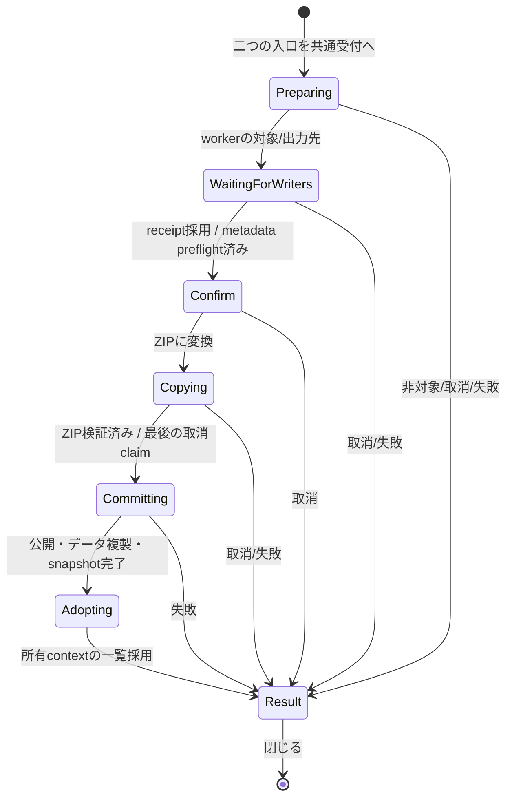

# §1.242 画像だけのフォルダを ZIP に変換する設計案

作成: 2026-10-12。調査基準: `next-book` / `05f7783cd`。
状態: **設計案・独立設計レビュー前。実装していない。**

G4F切り離し後の独立した機能。本の構成のfolder adapter、folder構成の保存・復元、
sidecar v2を復活させない。G1〜G4のZIP/PDF/EPUBと、既存のfolder閲覧・編集を維持する。
本の構成と同じく次々回releaseの候補であり、今回masterへ統合する指示ではない。

## 1. 利用者決定と設計で提案する部分

以下は2026-10-12の利用者決定であり、レビューで都合よく弱めない。

1. `親/フォルダ名/` から `親/フォルダ名.zip` を作る。画像bytesをそのまま
   `CompressionMethod::Stored` で格納する。元folderは残し、削除・ごみ箱送りをしない。
2. 同名ZIPがあればエラー。上書き・連番・別名出力をしない。
3. タグ、★、編集、しおり等は初回利用からZIP側へ複製する。元側の登録を消さない。
4. 変換はモーダル。他の操作と組み合わせてsupersession/rollbackを作る案は採らない。
5. folder右クリックと、folderで本の構成を開こうとしたときの案内に「ZIP に変換」を置く。
6. 環境設定「同名ファイル」に、同名ZIPがあるfolderを省略する設定を追加する。既定ON。
   一覧とCtrl+↑↓の両方へ適用し、公開時に更新履歴と「重要な変更点」へ記載する。
7. まれな失敗は既定の割り切り（ログ + 通知、可能ならこの操作の未完成ZIPを除去）。

以下の取消境界、完了後の選択、同名設定の優先順位、データ複製の詳細は設計提案。
特に§5のCollection個別画像参照は既存機能の型拡張を要する。これを含む範囲を
独立レビューと設計担当の確認で閉じてから実装する。引継ぎを後の版へ黙って延期しない。

## 2. コードで確認した境界

| 現行コード | 確認した事実 / 今回の使い方 |
| --- | --- |
| `app/folder_scan.rs::is_image_only_book_contents`、`image_folder_page_count` | 非空、container無し、認識されたmediaが全てImageという共通述語。非対応textは判定に影響しない。通常閲覧ではhidden/種類設定の投影もある |
| `app/book_materialization.rs::materialize_folder_listing*` | 同名除外は行・metadata・sort metadataを対で更新する。製本folderは別扱い |
| `folder_tree.rs::sorted_subdirs_for_nav_observed`、`FolderTreeOptions` | 実folderと本を同じ並びへ入れ、ZIP stemで変換書庫を除外。除外された現在位置をanchorとして辿る経路もある |
| `archive_converter.rs::store_options`、`convert_to_zip_with_password` | Stored、ZIP64、finish/flush、CRC検証、最終no-clobber公開がある。ただし固定`*.zip.part`を事前削除する処理は今回へ流用しない |
| `rename_key_migration.rs::STORES`、`copy_stores_impl` | path正規化とstore一覧の正本。既存copyはuniqueな全storeをINSERT OR IGNOREで写す。全表の無差別copyは今回に不適切 |
| `app.rs::copy_book_page_edit_key` | 製本の既存copyには補正・各mask・local adjust・crop・comic・rating・tagsがある。UI同期DB APIを今回のworkerから使う形へ分け、UIからそのまま呼ばない |
| `app/book_composition_editor.rs` のfolder受付、`App.fs_feedback_toast` | 現行folder案内は文字列/時刻/寿命だけのtoastで、actionを保持しない。全toastの再設計ではなく本変換ownerの確認画面へ接続する |
| `rating_db.rs::RatingMeta` / `RatingItemKind` | kind/source_path/entry_name等も保存。Image行のkeyだけZIP用に変えても評価一覧の復元は正しくならない |
| `book_bookmarks.rs` | ImageFolder/RelativePathとZip/ArchiveEntryが既存型。専用serviceと自動採番idを持つ |
| `book_resume_db.rs::PageIdentity`、`spread_shift/model.rs::SpreadShiftPageRef` | Image/RelativePathとArchive/ArchiveEntryを区別。保存番号だけのcopyではない |
| `sidecar.rs`、`sidecar_import.rs`、`app/sidecar_restore.rs` | v1 DAT、pending writerのimmutable snapshot、検証token、Checkingの所有境界がある |
| `ui_dialogs/metadata_transfer.rs::metadata_transfer_writers_busy` | 送信済editor保存票の採用まで待ち、その後にcontext/tag/migration等のwriterを静止させる。previewも保存票待ちを持つ |
| `rename_key_migration.rs::StoreMaintenanceLease` | 既存lease取得順はEPUB coverage → spread shift → composition。新しいDB排他ownerを並立させない |
| `collection_store/{model,path,db,runtime}.rs` | FileSystemPathのみ。登録pathは実パスで、ZIP内ページnamespace/kindは無い。collection actorが唯一のwriter |
| `crates/remote-ipc/src/lib.rs`、`remote_ipc/persistent_collections.rs` | Collectionのwireには既にRemoteAddress/ZipEntry、Image、opaque source_identityがある。内部source型拡張だけでwire変更が必須とは限らない |
| `remote_ipc/session.rs::with_local_composition_admission` | Local受付とRemote acquireの短いmutex境界があるが、callback終了後の長い処理の排他leaseではない |
| `settings_transfer.rs` | 同名設定はportable preferences対象。現行assertは全457 / 対象144 / 除外313、wire142。これはコード値であり今回実行した試験数ではない |

本設計のレビュー根拠は上のコード、[アーキテクチャ](architecture-overview.md)、
[仮想folder](virtual-folders.md)、[非同期](async-architecture.md)、
[補正/sidecar](preset-and-adjustment.md)、[UI応答性§4](ui-responsiveness.md#4-新機能追加時のチェックリスト)、
[Remote](web-remote-plan.md)、[Collection](collection-implementation-plan.md)、
[detached憲法§2](detached-rework-plan.md#2-憲法-全ステージ共通の不変条件禁止事項-最重要)。

## 3. 対象判定と格納する画像

### 3.1 判定

実folderの直下だけをworkerで完全走査し、既存`is_image_only_book_contents`へ分類結果を渡す。
新しい「画像だけ」判定式や、拡張子からのfolder/file推測をUIへ追加しない。
変換は保存操作なので、**表示フィルタで隠した画像・障害物を無かったことにしない**。
走査入力はhiddenを含む、種類除外・同名画像除外前の全実体とする。これは通常の閲覧判定を
変更する指示ではなく、同じ述語を使う保存操作の入力契約。表示上は本でも非対象となる
ケースを確認画面で説明する。`fs_entry`のアプリ内部項目とAppleDoubleの既存除外は維持する。

| 内容 | 変換 |
| --- | --- |
| 認識済み画像が1枚以上、子containerなし | 対象。RAW・アニメーションを含め、元bytesを格納 |
| 画像 + text/JSON/XMP等の非対応ファイル、DAT/明示転送bundle | 対象。画像だけを格納し、非対応ファイルとbundleは元folderに残す。確認画面で画像以外を入れないと明記 |
| 画像 + 認識された動画/音声 | 非対象。表示設定で隠されていても同じ |
| 実サブfolder、ZIP/CBZ/PDF/EPUB/対応書庫がある | 非対象。再帰・入れ子展開をしない。アプリ内部管理項目の既存除外だけは例外 |
| 空 / 画像0枚 | 非対象 |
| 製本root直下の本folder | 今回は非対象。製本の操作owner・順序ファイルを別の形へ変える機能ではない |
| directory junction/symlink、画像のreparse/非regular実体 | 非対象。外部の木へ越境しない |
| 完全走査失敗、読めない画像、入力の途中変更 | 全体失敗。部分的に成功した列を変換しない |

入口は既存の取得済み候補だけから描画し、クリック後のworker判定を正とする。
通常folderの右クリックでは候補操作を表示してよい。描画時に中身を走査して非表示にしない。

### 3.2 manifestとbytes

全認識画像を格納する。同名拡張子省略・タグ/★facet・現在のチェック選択・Hidden等を
格納対象の削除条件にしない。全体設定で非表示の画像も含む旨を確認画面へ出す。
各entryは直下の元filename。外側にfolder名のdirectoryを付けず、改名・数字付加・重複名一意化をしない。
格納順は共通の本の名前順を使う。画像内EXIF/XMP/ICC等もbytesとともに保持し、編集を焼き込まない。

UTF-8へ損失なく表せる名前、ZIP entry/構成の共通安全規則、case正規化後の一意性を検査する。
`..`・絶対指定・separator偽装・正規化衝突等で1対1対応が作れなければ、作成前に拒否する。
unsafe名でも元folderの従来閲覧を止めたり、元の名前を変更したりしない。

workerはsource directoryのidentityと画像ごとのidentity/size/mtimeを捕捉する。
Windowsではコピー中の画像handleをread-onlyかつ書込/削除共有無しで保持し、各画像を
固定サイズbufferでストリーミングする。全画像bytesを一括RAMへ載せない。
確認後に増減/差替えがあれば書込み前・完了前の再照合で失敗。追従・自動再走査はしない。
sourceを長時間占有するための全画像handle一括保持も避ける。
Stored + ZIP64を用い、完成後はentry数/名前/CRCを検証する。
物理folderに展開爆弾対策の4 GiB/32 GiB上限を機械的に移さない。ZIP64、OSと既存readerの
表現可能範囲を事前検査し、他の画像を黙ってskipして上限へ収めない。

## 4. 利用者データの対応と棚卸し

`F = 親/本`、`Z = 親/本.zip`、`n = p001.jpg` とする。
immutable manifestは実パス `F/n` ↔ literal entry `n` を持つ。

- page key: `normalize_keep_drive(F/n)` → `zip_entry_key(Z,n)`。
- container key: `F` → `Z`。driveを落とす表は各storeの既存normalizerを使う。
- `BookScopeKey(F, "")` → **既存line E所有の** `BookScopeKey(Z, "")`。
  key/root/DBを再定義しない。folder値をZIPのdomainへ変換する処理を限定的に持つ。
- source raw path・lookup key・sidecar相対keyを別の用途として扱う。
  source pathを文字列置換しただけで全表へ使い回さない。
- 画像とZIPのcontent fingerprintは等価でない。source画像の物理hash行をvirtual keyへコピーしない。

以下は**成功条件に含む複製**。既存行の不存在と読取り失敗を区別する。
missing DBはデータなしと扱えるが、存在するDBの未知schema/読取失敗を空扱いして進めない。

| データ / 保存先 | 複製する内容と変換 | owner / 注意 |
| --- | --- | --- |
| `tags.db.item_tags` / `tag_item_state` | 全画像、folder自身のtag・applied_at・明示空/decided状態。page→entry、folder→ZIP本体 | TagsDb既存型・tag writerの完了を待つ。tag定義は共通のため増殖させない |
| `rating.db.ratings` | 画像★→ZipImage★、folder★→ZipFile★。時刻も保持 | kindを6/3に、source_pathをZ、entry_nameをnへ変換。元Image/Folderの復元metadataをそのまま写さない。評価一覧から実際に開けることを検査 |
| `adjustment.db.page_params` | AI指定を含むAdjustParams | page keyだけ変換。焼き込みなし |
| `rotation.db.rotations` | 非破壊回転角 | ZIP page keyへ。Exif orientationと別に保存 |
| `mask.db.masks` / `conceal.db.conceal_entries` | bitmap/vectorと保存付随情報 | 同一bytesなので座標・寸法を保持。BLOB/JSON全件をUIでcloneしない |
| `local_adjust.db.local_adjust_pages` | 全レイヤー・マスク・設定 | 各layer id/順序を保持。source page内のidを再採番しない |
| `comic.db.comic_entries` / `export_crop.db.export_crop_pages` | 注釈、cropと基準寸法、対応asset参照 | shared stamp/LUT等の参照は従来の同profile資源。関連payload内の絶対source参照は型の既存検査を通し、keyだけのcopyで検証を省かない |
| `view_trim.db.view_trim_pages` | 全個別余白指定 | 未保存分も既存FIFO保存後に読み込む |
| `view_trim.db.view_trim_books` | Fの本別状態→Z | 行全体を保持。page側と異なるnormalizerを使う |
| `spread.db.spreads` と `final_cover_spreads` / `singleton_spread_placements` / `singleton_spread_endpoint_placements` / `page_alone_preferences` | 本別のmode・flow・direction・表紙/端/単独配置の指定をF→Z | mode-only / 未設定 / explicit OFFを保持。binding/directionを勝手にLTRで埋めない。新しい並びを読むのは既存共通resolver |
| `spread_shift.db.spread_shifts` | F空prefixの保存anchor。RelativePath(n)→ArchiveEntry(n) | service FIFOの完了と既存maintenance/snapshot公開を用いる。sessionだけのshiftは新しい本へ永続化しない |
| `book_resume.db.book_resume` | FのReadingPosition・meter。Image(F/n)→Archive(Z,n) | writer FIFOをfence。identityからZIPで解決し、index hint/meterをZIPの共通順へ対応させる。legacy identity無しはsource共通列で対応が証明できる範囲だけidentityを補う。範囲外は元のraw値とidentity無しを保持し、勝手にclampしない |
| `book_bookmarks.db.book_bookmarks` | ImageFolder/RelativePath(n)→Zip/ArchiveEntry(n)。title・登録時刻・hintも保持 | 専用serviceの複製command、destination id新規採番。source id/行は保持。安全な既存Missing参照も消さず型を変換 |
| `reading_history.db.reading_history` | Fの既存履歴があればZのZip履歴を複製。path/key/kindを書き換え、時刻・既存位置を保持 | 専用writer。変換した時刻を「読んだ時刻」にしない。成功後の選択だけで閲覧履歴を追加しない |
| `folder_thumb_pins.db.folder_thumb_pins` | F自身のpinをZへ。File(n,Image)→ZipEntry(zip_rel空,n) | payloadも変換。親folderがFを指すpinは変更しない。元pinも保持 |
| `settings.db` favorites / `adjustment.db.favorite_params` | Fそのものを指すお気に入りがあればZ用に複製し、新UUID。名前は「元の名前 (ZIP)」。index flagsと専用標準設定を対応する新UUIDへ複製 | Settings保存ownerとAdjustment owner。親rootのお気に入り・全体標準は共通のまま。favorite内UI状態もUUIDを誤流用しない |
| `collection.db.collection_entries` | Fの本全体登録→ZのZip登録を追加。F/nの個別画像登録→Z,nの個別ページ登録を追加 | §5の型拡張が必要。既存actor経由。元entry id/参照は削除・差替えしない |
| 自動 `mimageviewer.dat` v1 | まず既存source復元の不足行補充を完了。成功時はPのDATへ `本.zip::n` の編集/tagをmergeする | §6。v2化・ZIPへのDAT埋込・FのDAT丸コピーをしない。backups OFFでも中央DBの複製は必須 |

明示されたNone/空値、未設定、明示解除を区別する。
copy先に同値の残存行がある場合はno-opとして検証できるが、**異なる利用者データが既にある場合は
書込み前に全体を止める**。ファイルが無いからDBも空とは推測しない。
競合検査にはPのDATのdestination相対key（disk/pending snapshotの両方）、お気に入り、
専用actorの登録も含める。中央DBが空でも古いDATや登録を無条件mergeで上書きしない。
`INSERT OR IGNORE`で古いtargetを優先したまま「引継ぎ成功」と報告せず、古いtargetを上書きもしない。
通知: 「作成先に以前の登録や編集が残っているため、ZIP を作れませんでした。元のフォルダは残っています。」
target keyの現在非採用ImageFolder構成行もこの競合検査の対象。

### 4.1 複製しないもの

| データ | 扱い / 理由 |
| --- | --- |
| `book_composition.db` のfolder値 | G4Fは切り離し済み。休眠値をZIP構成として復活させない。F側は保持。成功後ZIPのeditorを利用者が別操作で開く |
| `adjustment.db.sidecar_sync`、`tags.db.tag_sidecar_sync`、DAT消費receipt | folder・disk token・snapshotに属する復元済み印。他の場所へコピーしない |
| `content_identity.db` の物理image hash/辞退組 | sourceの台帳は保持。Zは既存Edit ledgerへ、複製した復元可能データの公開後に新しいrootとして観測する。元画像→virtual pageの物理hashコピーなし |
| `edit_preview_cache.db`、catalog、Auto aspect、AI/Susie/画像metadata cache、fts/search/similar/name索引 | 再生成可能。destinationは現在のstampで新規生成・差分登録。source/sibling cacheを一括clearしない |
| 動画・音声のpin/bookmark/再生位置/既読/音声選択/normalize | この変換の対象mediaではない |
| `mimageviewer.meta.miv` の明示転送bundle | 元folderに保持。型/fingerprintが変わるので丸copy/自動importしない。成功後の明示exportは既存機能でZをexport可能 |
| saved search / Smartの定義・parent root・全体設定 / session UI状態 | 画像に付く値ではなく登録された規則/閲覧状態。sourceは残るので元参照は有効。rootやフィルタを勝手に書き換えない |
| 画像以外の付随ファイル | 元folderに保持。ZIPには入れないことを確認画面に明記 |

## 5. Collection個別画像参照 — 実装前に閉じる重要な範囲

現行`CollectionSourceNamespace::FileSystemPath`、`CollectionSourcePath`とresolved kindには
ZIP内ページを表す値がない。`Z::n`を実パスとして入れる案、選んだ1枚をZIP全体の登録へ
置き換える案、source参照を削除する案は採らない。集合・順序・再生対象が変わるため。

**推奨A（引継ぎを完全にする案）**: 既存Collection sourceの型を拡張する。

- 既存namespaceへtypedなarchive entryを追加。rootの物理pathと検証済みliteral entryを
  対で保存する。新しい別名DBや、元画像への永続proxyは作らない。
- actor内のclone commandがsource id群に対応する新entry idを発行。元entryの隣へ追加し、
  元entry間の相対手動順・collection定義・shuffle seedを保持。重複target登録は同値ならno-op。
  namespace/root/entryの全てをsource identityとunique keyへ含める。別entryを同じZIP rootだけで
  同一sourceと扱わない。実体probeに使うpathはrootで、合成lookup keyをFile::openへ渡さない。
- `collection_entries`の型付きpayload保持を追加するなら、released schema v2からの
  migrationと既存backup手順が必要。Gの未リリースstoreだからmigration不要、とは扱わない。
- PCのprepare/playback/snapshot/openは既存ZIP page materializer・identity・required targetへ接続。
  後からそのZIPに構成が付いた場合もHidden/Missingを既存G3と同じ契約で解く。
- Remoteのcollection snapshot/address/navigationも同じtyped sourceを受ける。
  推奨は既存RemoteAddressのZipEntry、Image、PageSlot/Groupとopaque source_identityを再利用する。
  wire field/enum/address契約が変わらない実装なら現行v70を維持できる。追加・変更が必要と
  判明した場合は実装時の現行IPC版を1つ上げ、core/remote-webを同時更新する。
  新namespaceをraw filesystem pathだと解釈するconsumerを残さず、wire parity試験で確認する。
  numeric idやfilenameだけの独自ページアドレスを作らない。
- 同じcollectionの登録だけを実変更としてrevision更新。元/兄弟の閲覧contextを移動しない。

**B（利用者の明示的な範囲縮小が必要な案）**: folderの本全体登録だけZIP登録を複製し、
個別画像登録は元画像への有効参照として残す。Collectionの新型/wireを避けられるが、
「ZIP側へ最初から引き継ぐ」をその参照について満たさない。現在の利用者決定を根拠に
実装者がBを勝手に選ばない。

独立レビューではAのowner/type/consumer範囲を確認し、設計担当が採否を決める。
この論点を閉じるまで、引継ぎを満たした機能として実装開始・採択しない。

## 6. 所有境界、非同期、モーダル

### 6.1 操作owner

Appにprocess全体で1つのtypedな変換request ownerを置く。新機能のrequest/phaseを
互いに独立な`show/working/saving/cancelled`のbool群へ分割しない。
source path、destination、起点ViewerContextIdと表示世代、manifest、cancel/control、
worker receiver、完了の選択intentを同じownerへ束ねる。

全phaseの間は操作を受け付けない。Resultもボタンを閉じるまでmodal。
common modal/admissionをmain・fullscreen・F12・native videoで共用し、キーボード、wheel、
toolbars、history、drag/drop、gamepad、別窓操作、第二の変換、metadata import/export、
rename/delete/製本/capture、設定変更、外部open要求を同じ入口境界で止める。
隠れたUIに別の操作可能性を残さない。描画・必要な完了pollを止める仕様ではない。
popupやContext-menuだけの見かけのdisableで代用しない。

受理済み旧open/scanの完了を先に既存ownerで静止/退役させ、書込みのsnapshotを固定する。
新たな処理をcancelして何度もやり直す専用の再開機構は作らない。
背景readerの再開は既存metadata transferのreader停止/再開境界を共有する。
大量metadata/UI整形はworker準備、UIは固定の進捗値とbounded結果を表示するだけ。

### 6.2 既存保存ownerを経由する開始条件

WaitingForWritersは既存metadata transferのbody側の受付静止条件を共通helperとして使用する。
Preparingの先行workerはFSの対象/概算だけを調べる。metadata previewのためにleaseを先取りしない。
旧writerを静止させた後のworkerがsource補充・target競合・copy件数を準備し、Confirmへ渡す。
Confirm中も同じ操作ownerがwriter資源/maintenanceを保持し、確認後に第二のsnapshot正本を作らない。
既存writerが更新したsource画像bytesのstampは、このpost-fence preflightで初めて確定する。
事前FS概算から変わったことだけで、自分が待っていたXMP保存を外部変更として拒否しない。
Confirm後の外部変更は§3.2どおり失敗させる。source directoryのmtimeだけで画像集合の変更を
判定せず、directory identityと画像集合/各画像stampを使う（自分のDAT保存を変更扱いしない）。
editorの送信済保存票は所有窓退役後も**既存の唯一の完了採用owner**で回収する。
その前にcomposition/shift maintenanceを取得しない。tag/XMP reader、migration queue、
bookmark、capture/export、Checking等の旧writerも同じ境界へ接続する。

全viewer contextの未保存trim/editはそれぞれの既存FIFOへ送り、receiptにより保存を確認する。
modalになった時点でqueueが空だったという観測だけで完了としない。
既存helperが列挙するbusy条件だけで棚卸し全部の完了を証明したことにしない。
resume/history/settingsの受理済み保存、bookmark/collection actorの先行変更にも各既存FIFOの
read/command receiptを用いる。今回必要なsource読取りとcopy commandをそのownerへ通し、
test-only barrierを製品の完了証明として呼ばない。
source/destination/parentのsidecar cacheは既存のworker resources handoffで移す。
Checking・定期・終了flushが旧Arcを書き戻せる別の予約を残さない。
worker所有中にsidecarをUIへ再挿入せず、結果receiptとsnapshotを対にして一度だけ採用する。
同じデータへの第二のwriter、単独のflush除外bool、別のコピー用DB serviceを作らない。

DB照合/補充・コピー・serialized sidecar mergeはworkerに置く。
preflightのcopy planは対応key/型/件数で、全画像・全mask BLOBの巨大snapshotをRAMへ複製しない。
lease/resource所有下の安定したsourceをbounded batchで読み、各storeの既存検証済み型を使う。
取得する既存StoreMaintenanceLeaseの順を守り、同じleaseを借りて再取得しない。
page edit/rating/tagの既存epoch guardを最終Z公開前から更新完了まで保持し、
途中のstore集合を準備結果として採用させない。indexer/watchの発見と閲覧への公開を区別し、
modal中の新openと旧prepared結果の採用を入口/既存request ownerで止める。
bookmark/collection/settingsは各唯一のwriterへcommandと完了receiptを渡す。
workerがAppのUI DB handleを別スレッドから呼ぶ設計はしない。
service read snapshotの更新・maintenance解放・副作用receiptまでを完了結果へ含める。
成功/取消/通常errorの全terminalで、借りたDB/sidecar資源の返却と既存readerの再開を
同じ完了採用境界で行ってからmodalを閉じる。error表示だけで資源をworkerへ残さない。
worker切断等のまれな失敗ではログ/通知し、失った再生成可能cacheは既存read経路で再構築する。
sourceの未保存利用者値はそれより前のFIFO fenceで保存済みであることを必須にする。

### 6.3 sidecar v1

未訪問sourceにDATだけの編集/tagがある場合も、既存不足行補充を完了してからsnapshotを作る。
中央の明示空/解除をDATで復活させない。source DATの丸copyや、source sync印の転記をしない。
ZIP用のbackup置場はZの親P。`Z.filename::entry`という既存v1相対keyを使う。
Pの他の画像・他のZIPのtag/編集を保持したmergeを既存SidecarFile/writerで保存する。
編集backup/tag backupの既存二つの設定を尊重し、OFFでも中央の複製を省略しない。
source FのDATは保持。今までdirtyだった最新編集を保存することと、変換によるsourceデータ変更を区別する。

### 6.4 Remoteとの排他

RemoteActive/Acquiring/Draining中は変換の新規受付をしない。変換ボタンも同じ判定で無効。
Localの変換受付とRemote acquireの競争は、既存SessionHandle admission mutexで線形化する。
現行`with_local_composition_admission`は長い処理を保護しないため、callbackを使うだけでは不十分。

提案は、その既存受付境界に**同じ変換controlへの局所的な排他capability**を登録すること。
Appのphase/controlが唯一の正本で、Session側はそのcapabilityを参照し、独立したbusy boolや
複製phaseを持たない。先に変換受付が成立したとき、後から来るacquireは既存
`SessionStatus::LocalInUse`と「PC で ZIP を作成中です。完了してから接続してください。」を返し、
Local→Acquiringへ移さない。先にacquireが成立したときは変換のcallbackを実行しない。
短いmutex区間では登録/非blocking enqueueだけ行い、DB/FS・registry lock・待機をしない。
capabilityは完了採用まで保持し、取消/errorでも同じownerが一度だけ解放する。
長い変換を既存acquire timeoutまで待たせたり、Remoteの取得で変換を黙って破棄したりしない。

この内部受付だけならwireは既存LocalInUseを使え、IPC版変更は不要。
§5 AのCollection内部source拡張も、既存wireで表現できるかを別に検査し、変更時だけ版を上げる。
Remoteのfolder一覧も§8の共通同名規則へ接続する。既存folderのSetSpread・閲覧・編集は
G4F構成行へ戻さず、作成された実ZIPだけが構成対象になる。Remoteに変換入口は追加しない。

## 7. ファイル公開、取消、失敗、完了採用

### 7.1 正常順序

1. 出力名はfolderのfilename全体へ`.zip`を追加する。`with_extension`でfolder名の拡張子を
   置換しない。root/filenameは既存normalizerで損失なく一意に表せることも検査する。
   workerの事前判定でZの実在とtargetのauthoritativeデータ競合を調べる。
   親の候補を同じcase/lookup規則でも照合し、case-sensitive directoryにある`本.ZIP`等の
   同一lookup名の別実体も衝突にする。同名のdirectory/reparse/別種ファイルも衝突。
   既存物を削除しない。
2. Confirmの実行後、P内にこのrequest専用のtemp fileを`create_new`で作る。固定`本.zip.part`の
   既存ファイルを消してから使う処理を流用しない。隠されたtempは正常一覧の対象にしない。
3. 全画像をStoredで格納し、finish/flush/close後にCRCとmanifestを検証。
   列挙時の入力stampと最終stampを照合する。
4. 最後の取消受付とcommit開始を同じcontrol claimで線形化する。
   取消が先ならDB/最終Zに一切書かない。commit開始が先なら取消不可の完了保存phaseへ進む。
5. **最終Zをno-clobberで公開してから**、検証済みmetadataを各既存ownerで複製する。
   先にmetadataだけ写す案は、最終公開で外部アプリが作った同名ZIPと衝突した際に
   その別ZIPのデータを汚すので採らない。公開したZはhandle/実体identityで操作所有を保持する。
6. データ・DAT・専用service snapshotの完了、index/ledgerの必要な受付receiptを回収する。
   成功はmetadata完了後にだけ報告する。途中のZをApp/Remoteへ成功として開かせない。
7. worker準備済みrefresh結果を所有contextへ一度だけ採用する。
   そのcontextを既存の親実folder一覧へ戻し、Zの**path identity**をcursor/選択にする。
   自動fullscreen・本の構成editor自動openはしない。別context/兄弟の位置や列を変更しない。
8. modalを成功Resultへ進める。閉じてから通常のZIP閲覧/構成編集ができる。

集約一覧/検索/collectionでfolderを右クリックした場合も、その操作の起点contextを
既存の「ある場所のfolderへ移動」経路でPへ戻す。起点のreturn stateを破壊して独自にitemsを差替えない。
mainが不在のF12起点でも同じViewerContextIdを使う。request ownerはprocess側に残るため、
窓の退役と保存結果の所有を混同しない。detached連携は実装前レビューと§11の変更記録を要する。
起点のcloseが完了後の予定動作になった場合は、保存receiptだけ回収して既存closeへ進む。
既に退役したcontextへの選択は行わず、別の窓やmainへ暗黙に選択先を付け替えない。

起床はworkerのprogress/terminal sendと既存pending wake契約へ接続し、fullscreenの早期return前の
display-independent pollから回収する。利用者の次の入力を待って完了する状態を残さない。

### 7.2 取消と終了

Preparing/Confirm/WaitingForWriters/Copyingで「取消」またはIME-safe Escape。
worker中の取消はsignal送信後、terminal receiptまではmodal ownerを保持する。
コピーchunk/画像境界/CRC検査/最終claimでcancelを確認する。
Committing/Adoptingは取消ボタンを無効にし「保存を完了しています」と表示。
×/Escapeで隠して裏に保存workerだけ残さない。

通常のアプリ終了要求は、commit前なら取消、commit開始後なら既存close barrierで
receipt/採用まで終了を延期する。UI threadのjoinやsleep待ちはしない。
OS強制終了・電源断を通常の取消契約へ偽装せず、下のまれな失敗方針で扱う。

### 7.3 まれな失敗

DB/FS障害はログと日本語通知。再試行loop、独自journal、補償transaction列、次回自動再開、
回復中の回復を作らない。source files/source利用者行は常に保持する。
元のfolderと画像、変換先にあったデータを削除して復旧しない。

- commit前: この操作のtempだけ除去。最終Z/中央DBは変更無し。
- 公開競合: 既存Zを保持。metadata複製はまだ行っていない。
- commit後の複製失敗: 成功として開かず、この操作が公開したZだけをidentity確認して除去する。
  外部差替えされた同名Zは消さない。既にcommitしたコピー行は再取得/巻戻ししない。
  元行が残るのでデータ損失は無い。次の手動実行では同値行はno-op、異なる残存行は§4の競合エラー。
- DAT保存失敗も成功条件を満たさない。cleanupも失敗した場合はもう一段の回復を作らず、
  残った出力pathと元folderが保持されている旨を通知する。
- 強制終了後にcomplete ZIPやコピー済み行が残っていても、同名ファイルを自動上書きしない。
  操作が完了済みかのpersistent pending正本を追加しない。

途中失敗時にtarget ZIPが残ると、新設定で元folderが一覧から省略される場合がある。
エラー通知に元folderの場所と、必要なら同名folder省略をOFFにして開けることを明記する。
除去できなかったZIPを、再実行で黙って削除する処理はしない。

## 8. 同名ZIPがあるfolderを省略する設定

提案field: `Settings.skip_folder_if_zip_exists: bool`、serde欠落時/Defaultともtrue。
表示: 「同名の ZIP がある場合、フォルダを省略」。対象は**実fileの `.zip`**。
CBZ/PDF/RAR等へ新設定の対象を黙って広げない。ZIPの内容validityではなく既存一覧でのfile資格を使う。
ZIP名の実directoryをZIPと推測しない。folder名全体とZIPのstemを既存case/path規則で照合する
（`本.pdf` folderの相手は`本.pdf.zip`、`本.pdf` fileではない）。

### 8.1 逆向き設定との優先順位

現行`skip_zip_if_folder_exists`も既定ONなので、各filterを独立にraw候補へ適用すると両方消える。
worker上の同じimmutable候補集合から共通pure policyで片側を決める。

| 新: folder省略 | 旧: 本側省略 | 実folder F + 同名実ZIP Zの表示 |
| --- | --- | --- |
| ON | ON | Zのみ（新規のZIP優先が先） |
| ON | OFF | Zのみ |
| OFF | ON | Fのみ（従来どおり） |
| OFF | OFF | 両方 |

source種類/hiddenの採否を済ませた**候補ZIP**を使う。種類設定等でZIPを表示しない場合、
それを優先して唯一のfolderまで消さない。既存の同名ZIP/CBZ→変換書庫、PDF→EPUB、
動画/音声→画像、重複画像の規則もこの生存候補と順序を共有し、二段の相互消去を検査する。
新規ZIP優先は対応するF/Zの選択を変える承認済み仕様で、他のname groupの順位を変えない。

### 8.2 接続するproducerと設定の適用

- `book_materialization`の通常一覧、共通folder scanを使うsubfolder expansion / Smart / Remote。
  行・display metadata・sort metadataを対で省略し、zipとfolderのcacheが同名だけで混ざらない。
- `FolderTreeOptions`とsorted_subdirs/DFS/Ctrl+↑↓。一覧と同じpure policyを呼び、
  新しく各child folderの内容を走査しない。省略された現在folderのanchorは位置探索のため保持し、
  次/前の着地対象からだけ外す。limit=0でも新設定は同名省略規則として適用する。
- folder scan signature / page-count cache条件 / nav memo / prepared settings snapshotへ新fieldを含める。
  Preferences OKの既存reload・表示の閉じて再作成を使い、専用live追従を作らない。
- 直接pathを指定したopen、既存history/bookmark、明示collection登録を無効化しない。
  既存collectionのsource行や検索定義を書換え/削除する設定ではない。
- `settings_transfer`のregistry/wire/変化fixtureへ追加。古いpreferencesにfieldが無い場合は、
  既存部分適用と同じく現在値を維持する。settings.db旧保存の欠落では既定trueを採用する。
  ON/OFF双方のexport/import、Settings保存再読取、portable/data-dirでの独立保存を検査する。
  現行457/144/313・wire142から追加分の件数を予測だけで完了記録にしない。
  実装時に実試験で得た件数でassertとsettings transfer文書を更新する。

release時の重要な変更点の文案:
「同じ場所に同名の ZIP があるフォルダは、一覧と前後のフォルダ移動で省略されます。
元のフォルダや画像は削除されません。両方を表示するには、環境設定の「同名ファイル」で
フォルダの省略と本側の省略をどちらもオフにしてください。」

## 9. UI、マニュアル、更新履歴

folder右クリックの「ZIP に変換…」と、構成対象外案内の「ZIP に変換」は同じrequest開始へ通す。
後者は現在folder/contextを捕捉し、構成editorのdraftや構成保存票を作らない。
案内本文は維持: 「画像だけのフォルダでは本の構成を作れません。ZIP に変換してから行ってください。」
現行の案内はaction無しのtoastなので、それへcallbackや別のpending boolを追加しない。
構成対象外の受付を本変換ownerのPreparing→Confirmへ通し、その同じ確認画面に案内本文と
「ZIP に変換」buttonを表示する。既存toastとの重複表示、独立した案内modal、
構成editor stateを経由した二段modalを作らない。入口の由来はrequestのtyped purposeとして
保持して表示を変え、確認を押すまでZIP作成やdestinationデータ複製をしない。

確認画面はsource、固定出力先、画像数/概算bytes、引継ぎ件数、元folder保持、
画像以外を格納しないこと、全画像を対象にすることを表示。「ZIP に変換」「取消」。
保存先入力・別名・圧縮率・元を削除するcheckboxを加えない。
進捗は「画像を ZIP に保存しています」「登録や編集を引き継いでいます」「一覧を更新しています」。
成功は「ZIP を作成しました。元のフォルダは残っています。」、失敗は実際のpath付きの簡潔な通知。
内部名（scope、ledger、maintenance、token）を利用者の画面へ出さない。

ダイアログはCLAUDE.mdのIME helpers、theme/弱文字/警告色、wheel/key guard、
固定操作行、長いpathの折返し、scrollbar予約幅を守る。1093×614 / 1366×728、
100%/200%、Light/Darkでも取消・確定・閉じるが到達可能なsnapshotと実入力試験を用意する。
新しいglobal shortcutは今回追加しない。Escape等はdialog-localとしてkeymap-specへ記録し、
新しいcontext-menu項目の識別子/操作カスタマイズは既存の項目管理へ登録する。

実装時にmanualのbooksページ、folder右クリック/操作説明、環境設定「同名ファイル」、
更新履歴とアプリの「重要な変更点」を同時更新する。設計段階で出荷済みの機能としてmanualへ書かない。

## 10. 実装分割と受入条件

実装開始条件: §5のCollection範囲、§6.4のRemote排他capability、§7の公開/データ複製/rare failure、
source/destination sidecar所有の設計レビューを終える。別の親coordinatorや自動追加review gateは作らない。

1. **判定/manifest/Stored出力**: App/UI無しのmanifest・entry対応とworker、no-clobber公開。
2. **利用者データ/owner**: 型付きcopy payloadと既存writer/FIFO/maintenance/sidecar receiptの接続。
3. **Collection参照**: Aを採るなら既存actor/schema/PC/Remote source consumerを一まとまりで完成。
4. **入口/完了選択/同名設定**: modal各surface、共通policy、Preferences/transfer/manual/release通知。
5. **統合gateと引継ぎ**: 下記回帰・snapshot・full gate。既存Rare failureの過剰な回復状態を追加しない。

最低限の自動受入fixture:

- 対象表の全case、非対応text/DAT/bundleが元に残る、hidden/種類除外/同名画像省略でも全画像bytesを格納。
- Stored/ZIP64、元bytesの完全一致、名前/CRC/枚数、元file/folder不変、同名existing/公開直前競合/既存part不変。
- source途中変更、unsafe/非UTF/case衝突/reparse拒否。拒否後も従来folder閲覧と編集が可能。
- 棚卸しの各authoritative値・明示空・Missing参照・元行/元id保持。評価/タグ一覧とZIPの実openから検証。
- bookmark/resume/shiftは型変換したidentityへ実consumerで着地。Single/Spread/Split、mode-only、RTL/表紙の一致。
- DATだけのsource補充、backup OFF、Pの他ZIP/画像値保持、旧pending Arc/Checking/終了flushの完了順序。
- editor保存→所有窓終了→別folderから変換開始。保存票の採用前にmaintenanceを取らず、worker拒否/古いflushが出ない。
- dirty trim/tag/edit/migration完了→copyの順序を実worker信号で固定。sleep/retryで正しい順序を偶然待たない。
- AならCollection folder/個別画像/部分集合/複数登録/手動順/shuffle/現行v2 migration/backup/PC/Remote playback。
- 取消の全phase、最終claim前後、root/F12 close、worker失敗・progress無しでも完了採用。source/sibling不変。
- Remote acquireと変換受付の両順序。LocalInUseでphase/generationが変わらず、変換完了後は通常取得可能。
- 同名設定4組、`.zip`名の実folder、`本.pdf`folder、ZIP種類非表示、hidden、CBZ/RAR/PDF等の同名組合せ。
- 一覧 / Ctrl+↑↓ / tree / Remote parity、省略されたcurrent anchorの前後、設定OFFで従来復帰、source直接open維持。
- 新fieldのmissing/default/保存/portable/preferences部分import/全項目coverage。件数は実行結果で記録。
- 入口二つの実入力・背面wheel/key拒否・IME中Escape・小画面/長文/全phaseのUI snapshot、glyph lint。

検証計画はfmt、normal/portable check、対象lib filters、integration/UI snapshot、最後に
`scripts/test-full.ps1`。各commandの実数/exit/logを記録し、既知の別失敗と新失敗を区別する。
実アプリ起動は通常開発へ混ぜず、別途明示了承済みの確認枠にする。

今回行ったのはコード・文書の読取りとこの設計書の作成のみ。実装・build・試験・起動は行っていない。
独立レビュー済み、利用者確認済み、全gate成功という主張はしない。
