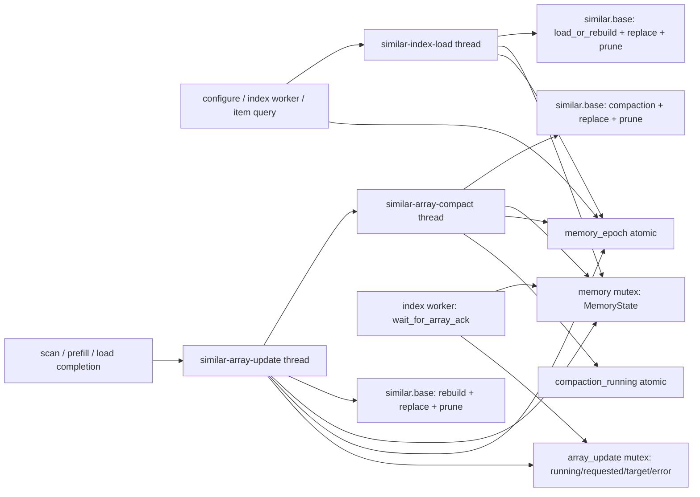
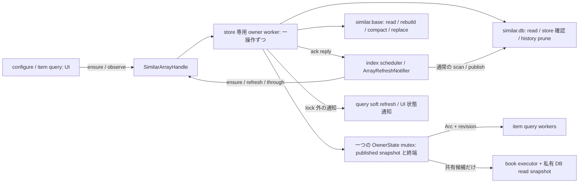
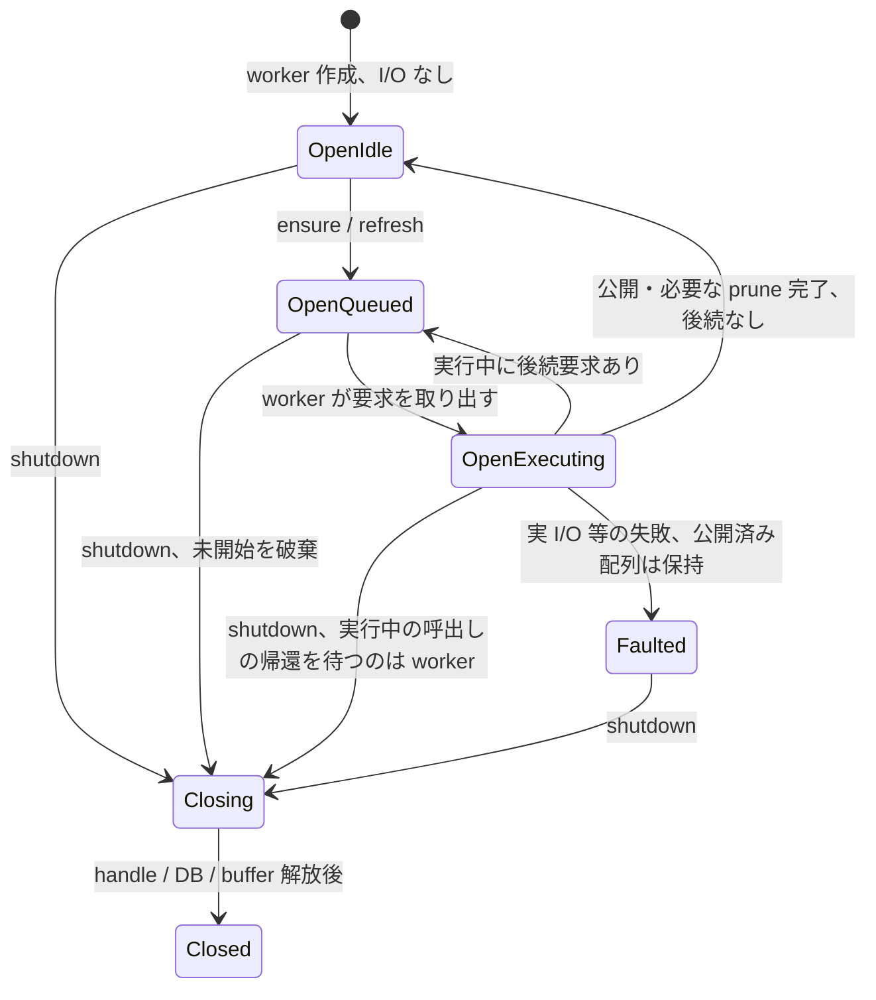

# §1.404 類似索引の検索配列 owner 設計

状態: 設計案 R2。2026-10-19、調査コミット `6b9189960` を基準とする。
ClaudeCode の方向づけを実装可能な契約へ具体化した文書であり、製品コードの変更・実装承認ではない。
原因と再現証拠は [調査記録](similar-index-flaky-startup-marker-investigation.md) を参照。
設計・採否・検収は ClaudeCode。以下の型名・ファイル分割は提案名。

## 1. 目的と不変条件

store 全体の検索配列に対して、base の I/O とメモリ公開を行う主体を一つにする。
設定変更のたびに初期ロードを捨てる必要をなくし、正常な公開と worker 停止を読み違える ack もなくす。

1. 同じ data_dir の `similar.base` の load / rebuild / compaction / replace / 公開 / history prune は、
   一つの `SimilarArrayOwner` の一つの worker が、操作を一件ずつ処理する。
2. root / exclusion / password の構成変更は検索結果を失効させるが、store の初期ロードを取消・再起動しない。
3. 公開単位は `PublishedArray { snapshot, revision }`。snapshot の store identity と applied seq は不可分。
   query は immutable `Arc<SearchSnapshot>` を読むだけで、採用権限を持たない。
4. ack 成功は owner が公開済みの **同 store / applied_seq >= 要求 seq** を確認した場合だけ。
   scan / Full の完了印は従来どおり、その ack と job-current 確認後に限る。
5. base の置換が完了して全ファイルハンドルが閉じ、対応する snapshot を採用してから、
   **永続 base の cutoff 以下だけ**を prune する。delta の applied seq 全体を prune しない。
6. scan / watch / dirty scope / ActivityGate / purge / Full・Delta / ZIP・PDF の公開契約を変更しない。
   owner の mutex、DB transaction、scheduler mutex を保持して ack を待たない。
7. UI は短いメモリ操作と非 blocking な要求・状態読取だけ。ファイル確認・DB・配列構築・大きな破棄・join は worker。
8. まれな実 I/O 障害はログ＋通知。自動 retry / backoff / 多段回復を作らず、既存 DB・base を失敗を理由に削除しない。

## 2. 現状の所有と根拠

行番号は `6b9189960`。調査用 probe を含むため調査記録の基点行番号とは異なる。



| 箇所 | 現状と問題 |
| --- | --- |
| `similar_index.rs:948` `start_memory_load` | 別 thread が DB/base を読む・書く。epoch 照合は副作用後。`:1010` 付近の失効では既に済んだ replace / prune を取り消せない |
| `similar_index.rs:2443` notifier configure、`:2735` | eager load の入口。scheduler configure が Ready 以外を Unloaded にするので、旧 loader の I/O 中に後続 loader が始まる |
| `similar_index.rs:3155` | worker の eager load。パネル照会を待たずロードする契約は維持する |
| `similar_index.rs:3713` `wait_for_array_ack` | memory と array_update を別 lock で観測。公開前のメモリと公開後の停止状態を組み合わせ得る |
| `similar_index.rs:3763` `array_update_loop` | journal 適用と missing-history rebuild。初期 loader・compaction との I/O 排他はない |
| `similar_index.rs:3907` `start_compaction` | compaction_running は compaction 同士だけを排他。別 thread から snapshot を CAS 採用し、公開後 prune |
| `similar_search_array.rs:203,232,454,623` | load_or_rebuild / rebuild_from_sqlite / write_compacted_base が共通 write_base に集まる。load_or_rebuild に prune が隠れている |
| `similar_index.rs:682,717,4041` | item query が memory_epoch を cache key / completion の stale 判定に使う。構成の失効と配列公開の失効が混在 |
| `similar_index.rs:2253,2564`、`similar_search_array.rs:351` | book executor は共有 snapshot を候補として読む。私有 snapshot fallback は同一 SQLite read TX のメモリ構築のみで、base 書込・prune をしない |
| `similar_index.rs:3991` | shutdown は scan cancel / notify / book shutdown のみ。旧 memory / array / compaction thread の終了は待たない |

## 3. 新しい所有境界



### 3.1 data_dir 単位と manager の寿命

製品の生成点は `src/app.rs:20044` の一か所で、`data_dir::get()` に対する manager を一つ作り、
全 viewer / notifier はその handle を共有する。scan の再開、設定変更、watch 再登録では owner を作らない。
`SimilarArrayOwner` の生成権限はこの manager 初期化へ閉じ、他 module は clone 可能な handle だけを得る。
App の有効/休止 capability と `Option<SimilarIndexManager>` を維持する。

**process-global の path → Weak registry は追加しない。** 製品に data_dir の live switch や同じ store の
独立 manager 並存の経路がなく、path alias / canonicalize / registry の close 中再取得を扱う状態を増やすため。
owner の単位は「この manager が一度受理した固定 data_dir」で、同じ data_dir を二つの独立 manager へ同時に
渡す API は提供しない。内部 constructor を狭め、テスト生成口と区別する。
これは複数の独立 writer を作って mutex だけ共有する設計ではない。
同じ store の擬似再オープンは §9 の test-only 終了同期を前提とする。

別 data_dir の owner は完全に別状態・別 worker。A の open / close / config / failure が B の配列・query・prune に触れない。
外部 process との live DB 置換や、別表記の path を使った同一ディレクトリへの複数独立 manager は今回の対象外。
将来それを製品で受け付ける場合は、この単一生成の境界から設計を改める。

### 3.2 thread と I/O の範囲

manager の作成時に、DB を開かず owner worker を一つ起動する。最初は Condvar で休眠する。
初回要求時に worker を生成する案は Starting / spawn 予約の状態が余分に必要になるため採らない。
有効 manager 一つにつき休眠 thread 一つという費用を明記し、idle の timer / polling / repaint は追加しない。
旧来の三種類の thread の同時起動はなくなる。

owner だけが base 用 helper を呼べる module 境界へ変更する。pure な apply / compacted_base /
snapshot_on_new_base / book 私有 snapshot の関数は引き続き使う。
dev-tools の独立 fixture・benchmark が低水準 helper を直接使う場合は、製品起動中の data_dir を対象にせず、
既存の専用 copy / disposable fixture に限ることをコードとテストで明示する。

scan writer / prefill writer は今の SQLite owner・transaction を維持する。base actor に scan 全体を移さない。
owner は scheduler の prefill_db mutex を使って待たず、owner worker 上で DB を開く。
DB connection / TX の guard は要求合流・callback・ack 待ちへ持ち出さない。

## 4. 状態と、廃止・分離する状態

共有状態の正本を `Mutex<ArrayOwnerState>` 一つに置く。以下は実装の骨格で、Rust 定義の確定稿ではない。

```rust
enum ArrayOwnerState {
    Open(OpenArray),
    Faulted { published: Option<PublishedArray>, failure: ArrayFailure },
    Closing { published: Option<PublishedArray> },
    Closed(OwnerTerminal),
}
struct OpenArray {
    view: ArrayView,
    work: ArrayWork,
    acknowledgements: Vec<AckRequest>,
}
enum ArrayView { Uninitialized, Missing, Published(PublishedArray) }
struct PublishedArray { snapshot: Arc<SearchSnapshot>, revision: u64 }
enum ArrayWork {
    Idle,
    Queued(ArrayDemand),
    Executing { operation: ArrayOperation, pending: PendingDemand },
}
enum PendingDemand { None, Some(ArrayDemand) }
enum ArrayDemand { LoadIfPresent, LoadOrCreate, RefreshIfPresent, RefreshOrCreate }
```

`view` と `work` を直交して残す理由は、更新/compaction 中も公開済み snapshot への query を継続するため。
「Running だから snapshot なし」に潰さない。Queued と Executing は排他的で、別の running bool は持たない。
高コストの作業用 buffer / DB / 次 snapshot は worker のローカル変数で、共有 lock に入れない。
Faulted の published は初期ロード失敗なら None、既存配列を保持した更新/compaction 失敗なら Some。
この Option は排他的な phase の代用ではなく、失敗前の利用可能な公開結果の有無である。

| 現在の状態 | 新設計での扱い・理由 |
| --- | --- |
| `memory: Mutex<MemoryState>` | 廃止。ArrayView / Faulted の published へ統合 |
| `memory_epoch` | 廃止。owner 内の publication revision と、query scope revision に分離。loader の取消判定には使わない |
| `array_update.running/requested` | 廃止。単一 thread と ArrayWork の Queued / Executing / pending で表す |
| `required_through` | 廃止。目標は個々の AckRequest が所有する。別の最大 seq field を同時に更新しない |
| `array_update.last_error` | 廃止。Faulted / Closed の型付き終端が正本 |
| `compaction_running` | 廃止。Executing(Compact) 以外には compaction は存在しない |
| `array_changed` | owner の wake 用 Condvar に一本化。ack の成否判定には使わない |
| `memory_load_elapsed_us` | owner の診断値へ移す。計測値を scheduling に使わない。既存 startup telemetry はこの値を読む |
| `SchedulerState` / config_epoch / job cancel | 維持。FS 走査・watch・構成・ジョブの所有であり、store 配列の所有とは別 |
| `SummaryState` | 維持。索引件数等の read cache で、base と snapshot の採用を決めない |
| `known_book_store` / book executor | 維持。book の read TX が観測した identity と私有 MIH の失効を管理する。owner のロード世代で置き換えない |

遷移の骨格:



worker 起動失敗・予期しない worker 終了は `Closed(Failed(detail))` とし、ログ＋通知し次回起動を案内する。
新しい thread の自動再起動や回復処理内の回復を作らない。

## 5. 要求の入口・合流と実行順

### 5.1 入口

| 入口 | owner への要求 |
| --- | --- |
| 有効 root の configure | `ensure(LoadOrCreate)`。同じ store のロード中なら合流。構成の query 失効だけを別途行う |
| index worker の eager open | `ensure(LoadOrCreate)`。現在のパネル非依存の eager 契約を維持 |
| item query fallback | `ensure(LoadIfPresent)`。UI で DB 存在確認をしない。DB がなければ作成せず Missing |
| scan / prefill の ArrayRefreshNotifier、ロード完了後 | `refresh(RefreshIfPresent)`。DB を勝手に新規作成する契機にしない |
| DB commit 後の watermark | `request_through(StoreWatermark)` → AckRequest + `RefreshOrCreate` |
| compaction の旧起動点 | actor の選択へ移す。外から snapshot を渡して別 thread を起動しない |
| 「今すぐ確認」 | 従来の UserCheck Full を要求。Faulted を解除する入口にはしない（§8） |

ensure は Published の場合 I/O なし、進行中の load / rebuild はそのまま利用する。
LoadIfPresent の Missing 後に LoadOrCreate / RefreshOrCreate が来る通常操作は、新たに初期化できる。
Missing は障害状態ではなく「未作成」で、Faulted からの回復とは区別する。

### 5.2 合流規則

要求の「load だけ / DB の最新差分まで」と「DB 未作成なら作成する / 作成しない」の強い方を取る。
4 通りを上記 enum で表し、互いの field presence を意味の sentinel にしない。
例えば LoadIfPresent + RefreshOrCreate → RefreshOrCreate、LoadOrCreate + RefreshIfPresent → RefreshOrCreate。
同じ弱い要求の反復は一件にまとまり、configure ごとの thread・load ticket は作らない。

実行開始時に Queued の一件を取り出し、Executing の pending を None にする。
その後に来た通知は pending へ合流させ、作業完了で **取り出した要求だけ**を消費する。
完了処理が pending を丸ごと消さない。pending の refresh は最低一度、新しい DB read TX を行う。
「公開 seq が古い ack 目標を満たした」だけでは、後から来た最新差分通知を捨てない。

LoadIfPresent が Missing を得た時、途中で来た create 要求は次の操作へ残す。
その create 要求に属する ack を、先行する non-create load の Missing で失敗させない。

### 5.3 優先順と compaction

Closing は常に最優先。通常は一件の load/refresh を処理して公開し、到達済み ack を返信する。
その Published が既存 `should_compact()` の閾値に達していれば、後着 pending を保持したまま、
次の一操作として compaction を一回実行する。その後、最新差分確認と pending を合流して refresh へ戻る。
これにより、連続する refresh 通知でも compaction が飢餓にならない。専用の fairness counter や timer は追加しない。
初期化前には compaction は存在せず、ensure だけの反復は Published に対して新しい作業を積まない。
実行中の compaction を後着要求で取り消さず、その終了後に pending を処理する。
compaction 中も既存 Published を query / ack に使い、既に到達済みの ack を compaction 完了まで待たせない。
新しい seq の ack が compaction の残り時間を待つ場合はある。これは指定された直列化に伴う費用で、§12 の測定対象。
UI や scan を modal にしたり、更新頻度・画像形式・query 機能を減らして隠さない。

compaction の終了後は必ず最新差分確認を一件要求する。cutoff 後の DB commit は journal に残り、
この確認と通常通知から後続 snapshot に反映される。refresh が継続するときも、到達済み ack は公開の都度返す。
全 store の inventory/FS scan を array refresh に追加しない。

## 6. I/O・公開・prune の操作契約

### 6.1 初期 load と refresh

1. worker で存在確認・DB open。`load_or_rebuild` は現在の format/hash/proxy/store 検証を維持する。
2. 有効 base はそのまま読む。missing / rejected は DB の既存 read snapshot から base を再構築する。
3. base を書いた場合、write/sync/replace と File / BufWriter / reader handle の破棄まで終える。
4. owner lock 下で snapshot と revision を一回で採用し、到達した ack の結果を確定する。
   callback、reply 送信、大きい旧 Arc の最終破棄は lock 外で行う。
5. 書いた **その base の store / base.applied_seq** を cutoff として history を prune する。
6. 初期ロード後も最新差分確認を一件行う。読んだ base が古くても、既存の読み取り可能な配列を先に使える。

`load_or_rebuild` 内の隠れた prune は外へ出し、返却値に「既存 base 再利用 / この cutoff の base を書いた」
という typed な結果を含める。owner が公開前に prune を行う別経路を残さない。
`rebuild_from_sqlite` と `write_compacted_base` も同じ返却・採用・prune の順序に揃える。

refresh は DB の store identity と change batch を **同じ read TX** で得る。
現 `SimilarDb::load_item_changes_after` (`similar_db.rs:1895`) の返却には store_id がないため、
owner 用の読取 helper を追加/拡張する。別々の SELECT の結果を同一 snapshot とみなさない。
同 store の連続 journal は既存 `apply_change_batch`、missing history / identity 不一致なら同じ actor 内で DB 再構築。
空 change で配列が変わらなければ publication revision を上げない。
DB identity の異なる snapshot を旧 store の seq の延長として扱わない。

prune も store identity を同じ短い DB transaction で検証してから cutoff を適用する helper にする。
別 store の history を旧 seq で削除しない。確認不一致では prune せず、既存 DB/base は保持して通知する。
通常の scan commit は継続でき、cutoff より後の change を削除しない。

### 6.2 compaction

actor が開始時の Published を固定し、既存 `compacted_base` で cutoff の base を構築・置換する。
次 snapshot はその cutoff を基に採用し、公開後にその cutoff まで prune する。
配列の唯一の publisher が同じ worker なので、現在の CAS / `yield_now` 採用ループは不要になる。
DB の後着 commit はメモリを直接変更しないため、cutoff 後の journal と pending refresh で処理できる。
book engine が保持する古い immutable base の Arc は有効なまま。
履歴が足りない book read は既存の同一 read TX の私有 snapshot fallback を利用し、owner へ書込要求を返さない。

採用済み snapshot とその revision は必ず同じ mutex 内で変える。
compaction の採用は seq が同じでも base identity が変わるため revision を進め、book の soft refresh を従来どおり通知する。
base の rename だけ成功して採用前に shutdown された場合は、history を prune せず残す。次回の通常ロードで検証する。
失敗後に base を消す、古い base を書き戻す、専用 rollback を作る処理は不要。

## 7. ack と query の契約

### 7.1 ack の登録と完了

`request_through(goal)` は owner の同じ mutex 内で、次の順に判定する。

- Closing / Closed(Stopped) は即座に Stopped、Closed(Failed) はその失敗を返す。新規登録・refresh はしない。
  shutdown の直前に scheduler が確認済みでも、その後に close が入るのでこの受付拒否は必要。
- Published（Faulted が保持する公開済み配列も含む）が goal と同 store / 十分な seq なら即座に成功結果を確定。
- まだ届かず Faulted なら、その型付き終端を確定。
- それ以外は `AckRequest { id, goal, reply }` を登録し、refresh を合流させる。

ensure / refresh も Closing / Closed では新規作業を積まない。
job cancel は返信の観測前にも確認する。到達済み返信と shutdown が競合しても、scheduler の最終 current 確認を省かない。

reply は一回の結果だけを返す channel。目標ごとの成功/失敗は owner が決め、scheduler は channel と
自分の job cancel だけを待つ。memory / work / thread-running を別々に読まない。
owner 内の waiters は ack を実際に待つ index job 用だけで、UI の毎 frame ensure / 通知には作らない。
製品の scheduler は store ごとに一つの active job なので live waiter も通常一つ。
取消後の reply receiver の破棄は許容し、worker の計算や他の要求を取消しない。

worker は各 DB 読取の開始時に、既に受理した ack request ID の範囲を固定する。
その read 結果で、その範囲の goal の store 不一致 / 不正な将来 seq を型付き失敗として返せる。
**read 開始後に来た ack は、古い read で失敗にせず後続 refresh へ残す。**
一方、公開済み stamp が届いている ack は受付順にかかわらず成功できる。
異なる store の goal を最大 seq だけで合流させたり、未到達を無制限に再試行したりしない。

ack の結果は `Published(stamp)` / `StoreChanged(expected, observed)` / `Failed(operation, detail)` /
`Stopped` 程度とする。cancel は scheduler 自身の通常終端。
ディスクエラーの種類ごとに回復方式を分ける taxonomy は作らない。
DB read 時点で既に commit 済みという watermark の前提が崩れた seq は、観測 stamp とともに失敗を返し再試行しない。

到達済みの公開を、後から起きた別操作の失敗で取り消さない。
例えば seq=10 の公開後に compaction が失敗しても、seq<=10 の同 store ack は成功でよい。
seq=11 は失敗。owner の失敗状態は別途ログ/進捗表示に残す。
返信待ちは scan worker のみ。既存の 100ms の cancel 観測間隔は維持できるが、timeout を障害判定に使わない。
ack 成功後の job-current / config epoch / shutdown 確認、ScannedFull の印、成功 disposition は既存 scheduler に残す。

### 7.2 item query の構成失効

`QueryScopeState { revision, enabled_roots, item_cache }` を manager の query context が所有する。
構成の受理時に immutable roots を差し替えて scope revision を進める。base owner へ invalidate を送らない。
cache / request の token は `ItemQueryStamp { scope_revision, publication_revision }` とする。

snapshot と publication revision は owner から同時に得る。cache hit と completion の採用時には、
その revision と現在の scope revision の両方を検証する。
旧 scope の結果が configure 後に cache を再充填しないよう、scope 確認と cache 更新は同じ scope lock 内で行う。
必要な二つの lock の順序は **owner → query scope**。両方とも短いメモリ操作だけ。
owner の採用側・configure 側は他方の lock を保持して callback しない。
線形走査、SQLite 検証、hit の構築/大量破棄を lock 内や UI に置かない。
query worker は受理時の immutable roots を使い、scope が変わった completion は捨てる。

既存 cache の6件上限、見開き2ページの同時 query、Arc の再利用を維持する。
単なる publication 通知の遅延で古い cache が有効扱いされないよう、正当性を callback の cache clear に依存させない。
OwnerState の Published と Faulted(Some) は query に利用できる。Faulted(None) は Failed、Missing は既存 NoIndex。
query の「index worker が実行中か」は scheduler の phase から読み、UI 向け progress 投影を制御の根拠にしない。

### 7.3 book query と通知

book executor の request owner / hard invalidate / store 観測 / limits / read TX / MIH / 私有 fallback は維持する。
共有 snapshot の取得元と readiness gate だけを owner の観測 API へ替える。
Loading 相当の待機を維持し、Missing / Faulted では既存の book DB 経路を通す。
gate は、親 scheduler の shutdown または owner の Closing / Closed(Stopped) では Complete(Stopped) とする。
Closed(Failed) で親が存続する場合は、既存の MemoryState::Failed と同様に私有 DB 経路の Run とする。
Uninitialized で load/refresh が準備中・実行中、または index worker が実行中なら Wait、Published は Run。
root / password 等の変更は従来の book hard invalidate、配列採用は soft refresh。順序と責任を混同しない。
**readiness を変える遷移は、snapshot 不採用の場合も book dispatch へ通知する。**
初期化中→Missing、初期化中→Faulted(None)、worker 起動失敗/予期しない終了→Closed(Failed) でも、
既存 `soft_refresh` / `BookQueryDispatchNotifier` 等により dispatch_ticket を進めて Wait を起こす。
`similar_book_query.rs:964–971` の待機は UI repaint や単なる query の再読取では解けない。
通常 shutdown は既存 book executor shutdown で待機を止め、owner の後着通知は再起動を起こさない。
owner からの callback は Weak な scheduler 参照経由、owner lock 外で行い、終了済み manager を復活させない。

## 8. 実 I/O 障害と一つの回復入口

操作の失敗時は Faulted として止め、待っている未到達 ack 全件へ同じ失敗を返す。
既存 Published があれば保持し、prune 前の失敗なら history を残す。
既に公開した後の prune 失敗でも公開結果を巻き戻さず、以後の操作を止めてログ＋通知する。
次回初期化の失敗にも追加処理・再試行を設けない。

**回復入口は、次回プロセス起動での新しい owner の初期化一つ**とする。
同じ owner の Faulted は終端で、構成変更・watch 通知・query・Full 再要求から解除しない。
「今すぐ確認」の UserCheck Full 自体は維持するが、未到達 ack は同じ失敗になり、回復予約は作らない。
ログと既存の詳細表示には、エラーの元情報とともに再起動の案内を付ける。

稼働中の「今すぐ確認」を回復入口にしない理由:
`request_full_all` (`similar_index.rs:2418–2440`) は active job があれば Full を pending にする。
owner の Faulted が見えても旧 scan の ack 失敗終端（`:3451–3462`）がまだ終わっていない時点では、
後着 UserCheck が旧 job の restore / stop の後に開始される保証がない。
失敗後に pending を無条件で reserve すると、restore した元 Full の自動 retry loop になる。
これを区別する回復要求の保持・scheduler 終端の handshake は、まれな実 I/O 障害のためには追加しない。
次回起動へ寄せれば、回復と旧 scan / shutdown / 反復入力の組み合わせ自体がなくなる。

現状の「configure による Failed→Unloaded の暗黙の読み直し」はなくなる。
この**失敗時の回復規則の変更を設計採択事項として明記する**。通常の構成変更・走査・検索は維持する。
稼働中の回復が別途必須と判断された場合は、本案をそのまま実装せず scheduler の終端所有から別設計する。

次回起動では既存 base と DB を保持して、新しい owner が通常の初期化を行う。
既存 base が有効なら読んで差分適用し、無効なら DB から作り直す。常に DB 全件再構築するとは約束しない。
新しい永続 repair flag、schema 変更、壊れた DB の再作成は追加しない。
worker 自体が作れない/終了した Closed(Failed) も同じく次回起動を案内する。

ユーザー通知は既存のお気に入りの `更新未完了` と詳細、query の Failed に接続する。
scan が待っていない compaction 等の失敗も見えるよう、manager の progress 読取で owner の Faulted / Closed(Failed) を
`Degraded(ArrayPublication)` として既存 report に投影する。scan phase / 制御にはこの投影を使わない。
owner の終端時に既存の UI wake と §7.3 の book dispatch 通知を行う。
新しい常時ポーリングや毎 frame toast は追加しない。

## 9. shutdown と擬似再オープン

manager shutdown は従来どおり scan を cancel し book executor を shutdown したうえで、owner に close を通知する。
owner lock 内で Closing にし、未開始の要求を破棄し、保留 ack の Stopped を確定する。
reply 送信や大きな payload 解放は lock 外。UI thread は join / DB close 待ち / Condvar wait をしない。
初期 loader / compactor の個別 JoinHandle はなくなり、owner worker が自分の実処理終了を所有する。

実行中の OS/SQLite 呼出しを強制中断しない。帰還後に新操作を開始せず、Closing を見てメモリ採用・prune を行わない。
既に採用済みで shutdown が来た場合も、未開始 prune は省いてよい。journal は保持する。
worker が DB / file / buffer / 最終 snapshot を解放し終わってから Closed と終了通知を公開する。
単なる snapshot 参照の read/close で他 context の mutation invalidation を発行しない。

`cfg(test)` の `shutdown_and_wait_array_owner_for_test()` または close receipt の wait を設ける。
対象 fixture は **shutdown（scan cancel + owner close 通知）→ barrier 解放/旧 scan worker join → owner の Closed を待つ
→ DB/manager を drop → 同じ data_dir を再オープン** の順にする。
現対象テストが scope 中に shutdown してから旧 worker を join する順序にも合わせる。
待つのは headless テストだけで、製品 shutdown の実行時間を延ばさない。
Closed はスレッド入口を抜け始めた印ではなく、base/DB I/O を再開できない終端である。
スレッド終了待ちの test 上限は hang 検出用で、製品の correctness を sleep や時間経過に依存させない。

global registry を置かないため、この fixture の同期は必要。
単に drop(manager) した後すぐ次を作る旧 fixture の順序は、新契約の擬似再起動として残さない。
テストの helper は owner を閉じるだけで、通常 APPDATA や sibling の store に触れない。

## 10. 移行・互換性

`similar.base` はリリース済みの派生 cache。**形式を変更しない**。
magic / format version / header長 / hash/proxy version / store_id / seq / checksum / record layout を維持する。
existing base と similar.db をそのまま読み、従来の reject 条件だけで DB から再構築する。
similar.db の schema / hash version / page order / scanned_once fingerprint も変えない。
既存 cache・DB の一律削除やユーザー操作による移行は不要。
将来 base 形式を変える場合は、この決定を流用せずリリース済み cache として別途検証する。

履歴 prune を owner へ移すことで、DB 側に API の transaction 境界変更はあるが保存データ形式は変わらない。
book engine の過去 snapshot は不足した history を私有 DB read snapshot で補う既存契約を保つ。

## 11. 調査 probe と恒久診断

| 現在の調査コード | 実装時の扱い |
| --- | --- |
| `trace_startup_investigation` と `MIV_SIMILAR_STARTUP_TRACE` の複数 lock stderr dump | 削除。正本が一つになり、非原子的な dump を恒久運用しない |
| load captured/current epoch と discarded の stderr | 削除。config による load discard 自体がなくなる |
| 対象テストの restarted_worker_returned stderr | 削除。結果・ack・印を普通の assert で検証 |
| `startup_test_probe` の full_prepared 等、既存の ordering test hook | 既存用途を維持。配列関係の phase は owner の typed test phase へ接続 |
| base BeforeReplace / AfterReplace の path-scoped probe | cfg(test) に限り保持・移設。actor serialization と Windows handle 寿命の barrier に使う。global 競合しない guard/対象 path の限定は維持 |
| `reconfigure_overlapping_loaders_fail_publication` | §12 の成功契約へ反転・改名し、通常回帰にする。失敗を assert する ignored test は残さない |

恒久ログは worker の一操作の start / terminal と ack の異常終端に限定する。
`owner_id / operation_id / operation / terminal / observed store+seq / required store+seq / detail` を記録する。
detail は OS/SQLite の元のエラーを残し、`array_publication_failed` という集計名だけに潰さない。
`StoreChanged`、`Failed(operation)`、`Stopped`、job の `Cancelled/Stale` を区別する。
store 単位のログで、ファイル一件・UI frame ごとの大量出力はしない。
既存の memory load の source/rows/elapsed、rebuild reason、array update/compaction の件数/時間は維持し、
「成功」は実際のメモリ採用後に出す。ログ・callback は owner mutex / DB TX 外で行う。
型は診断のためであり、失敗種別ごとの retry/recovery state machine には使わない。

## 12. テストと受入条件

製品の方向づけを実装前に独立レビューし、以下を headless の決定的テストで確認する。
実アプリの操作・起動は本計画の自動 gate に含めない。

| 分類 | 必須の確認 |
| --- | --- |
| 初期 load 合流 | load を base 置換前で止め、configure の root / 除外 / password 変更と複数 ensure を重ねる。load 実行1本、discardなし、採用成功、Full と印の成立 |
| witness 反転 | 旧 witness の「二つ目の BeforeReplace を待つ」barrier は廃止。後続要求の受付完了を待って先行1本を解放する。二つ目の loader が来ないことを sleep で待たず、operation count/順序で検証 |
| 初期 Missing | LoadIfPresent は DB を作らない。途中/後着の LoadOrCreate は失われず成功。後着 ack が先行 Missing で失敗しない |
| 要求消失防止 | DB read の前後・publish 前後・idle 移行直前に refresh / through を投入。後着通知が古い目標への到達で消えず、最新 TX へ進む |
| ack | 同 store / seq のみ成功。異 store、同 seq の別 store、不正な先行目標を失敗。公開直後に worker が idle となる順序でも成功。旧 worker-stopped 推測分岐が存在しない |
| ack の取消/失敗 | config cancel / shutdown は通常取消。後続 goal と sibling owner の待機を取消しない。到達済み goal は後続 compaction 失敗でも成功、未到達は同じ型付き失敗。shutdown確認とrequest_throughの間を止め、Closingへ後着する要求がStoppedで終わる |
| refresh / rebuild / compact | 同じ base に触る操作の最大同時数1。missing-history rebuild 中の compaction 要求、compaction 中の最新 commit/refresh を barrier で固定し cutoff 後の change を保持 |
| prune | disk replace→memory adopt→prune の順。initial rebuild も同じ。別 store の cutoff では削除しない。base cutoff を超える delta/後着 change は残す |
| item query | 構成変更前の worker 完了を後着させ採用拒否。配列公開前の結果も拒否。revision と snapshot の取違えなし。見開き2ページ・6件 cache・同 token Arc 再利用を維持 |
| book query | 共有候補の取得元だけ変更。Loading gate / hard-soft invalidate / store切替 / 同一TX / history不足の私有fallback / MIH / limits の既存回帰を再利用・実行。Wait中にMissing/Faulted/Closedへ移し、追加UI入力なしでdispatchが再評価される |
| failure / recovery | replace / DB read / prune の injected failure は一度の Failed、ログ＋進捗通知、データ保持。config/watch/query/Full反復で再試行しない。旧ownerのClosed後、新ownerで既存base/DBを検証し正常公開・Full/印へ。実profile/プロセス起動は不要 |
| shutdown / reopen | 各操作中に Closing。未開始を処理せず、closed 後の I/O / publish / prune なし。test-only receipt 後に同じ data_dir を再オープンし元の startup marker テストが通る |
| context 分離 | 異なる temp data_dir の A/B を同時に使用。A の configure / close / failure / 次owner初期化が B の snapshot revision、ack、query、base、history に影響しない |

実行順は pure state / actor focused → similar_index / similar_search_array / similar_db → book query/engine・
indexer manager・metadata reconfiguration → 負荷 stress → main lib / workspace・vendor・doc full gate とする。
通常・portable の core check、fmt、必要な snapshot/グリフ検査も repository policy に従う。
同じソース・条件の成功台帳は再利用し、異なる phase の成功を混同しない。

負荷受入は [調査 §3.2](similar-index-flaky-startup-marker-investigation.md#32-cpu-負荷--モジュール-stress) の
24 CPU 負荷 process + nextest similar_index module、`--stress-count 10 -j 48 --no-fail-fast` を最低一回、
**全周失敗0**。helper を使い捨て target に生成する手順もテスト変更と同時に保存し、PC の CPU 数と負荷条件を記録する。
さらに `scripts/test-lib-full.ps1 -Force` を二回、対象を含め失敗0。これは現象の旧再現率への確認であり、
確率試験だけで安全性を証明せず barrier 回帰を必須とする。
全件の反復は今回の flaky 修正受入に限る。通常の編集ごとに unfiltered suite を反復しない。

UI thread の I/O / join が増えていないことは call graph と slow/fake-I/O 下の非 blocking handler test で確認する。
compaction 中の新しい ack の待ち時間、初期ロード回数、通常小 Delta の K 依存、idle wake を記録する。
実操作の遅延が確認されたら、sleep や機能制限を入れず設計担当へ実測と費用を返す。
最終実装では通常の `scripts/build-dev.ps1` を作って利用者へ渡し、agent は起動しない。
この文書作成段階では code / test / binary の変更・実行は不要。

## 13. 段階と規模

**設計・検証は段階化するが、製品の経路切替は一回で行う。**

1. P1: `similar_array_owner`（新 module）と純粋な状態遷移・actor テスト、base/DB helper の ownership 契約を用意。
   製品はまだ旧経路を使い、新 owner を同時起動しない。既存 helper の意味変更と未接続 caller の不整合を残さない。
2. P2: initial load / update / compaction / prune / snapshot / ack / item stamp / book readiness を一括で owner へ接続。
   旧 three-thread 起動点と旧 bool/epoch を同じ chunk で撤去。二方式が同じ base を扱う中間状態を配布しない。
3. P3: witness 反転・fixture 収束・恒久ログ・scope/sibling 回帰・文書整合を完成し、独立実装レビューと受入 gate。
   P2 の correctness に必要なテストは P3 まで先送りせず同じ chunk に含める。

主な対象は `src/similar_array_owner.rs`（新）、`src/similar_index.rs`、`src/similar_search_array.rs`、
`src/similar_db.rs`、`src/lib.rs` の module 宣言とテスト群。必要な境界変更は indexer/book の adapter まで。
概算は production 新設/接続 500〜900 行、旧起動・採用・ack 経路の撤去/移動 300〜450 行、
新規回帰と既存 fixture 移行 350〜650 行程度。差分の扱いで重なるため合算を最終 LOC としない。
中〜大の一まとまりで、小さな guard 修正としては扱わない。UI・DB schema・ファイル形式の新設は含めない。
実装の正確な範囲は P1 の独立設計レビューと主要テストの移行時に確定する。

状態の簡素化として、global registry、load の supersession、snapshot CAS、別 compaction worker、
retry timer、recovery bool を作らない/撤去する。保持する直交状態は §4 の表のとおり。
長い処理をアプリ全体の modal にする案は background 索引と通常閲覧を止めるため採らず、
同じ効果を store worker 内の直列化で得る。

## 14. 範囲外と承認・引き継ぎ

範囲外は、scan アルゴリズム・watch 受付・Full省略条件・ActivityGate・hash/DB/base形式・
book query engine のアルゴリズム・cross-process の writer 排他・実行中の data_dir switch・
外部から DB を差し替える操作の完全な協調・稀なI/O失敗の自動回復。
いずれも競合修正の便宜で機能を削除/無効化する対象ではない。

設計採択前に確認する論点は、single manager の生成境界、全 base I/O と prune の集約、
ack reply の到達事実、query scope と publication の二つの revision、明示回復の入口、close receipt。
実装担当はこれらの前提を source で再確認し、矛盾は根拠 file:line を添えて設計担当へ返す。
今回の実装はまだ始めない。

## 15. 独立レビュー記録

R1 を GPT-6.1 Sol / xhigh の独立した read-only 担当へ渡した。P1 なし、P2 は次の2件。
Closing へ後着する ack を Stopped で閉じる規則と、snapshot 採用を伴わない book readiness 遷移の
dispatch 通知が不足していた。R2 の §7 / §9 / §12 へ契約と回帰を追加した。
併せて自己点検で compaction 飢餓の防止と fixture の shutdown 順序を修正し、
実 I/O 障害からの回復入口を次回起動へ簡素化した。
同じ独立担当が R2 を差分確認し、残る P1/P2 なし・構造的合意可能と回答した。
single manager 境界、後着要求、query stamp / lock順、store照合prune、Closeの契約を静的に点検した結果である。
configure の暗黙再読込を廃止する回復規則の採否は、ClaudeCode の判断に残す。
採択は ClaudeCode の判断とし、独立レビューを製品の検証済み証拠には使わない。

文書作成時の確認: UTF-8 読取、4個の fenced block の対応、相対リンクの存在、`git diff --check` は成功。
差分は本書と `docs/README.md` の索引追加のみ。製品 source、既存 probe/witness、テスト条件は変更していない。
文書のみの作業なので製品テスト・build・アプリ起動は行わず、コミットも行っていない。
